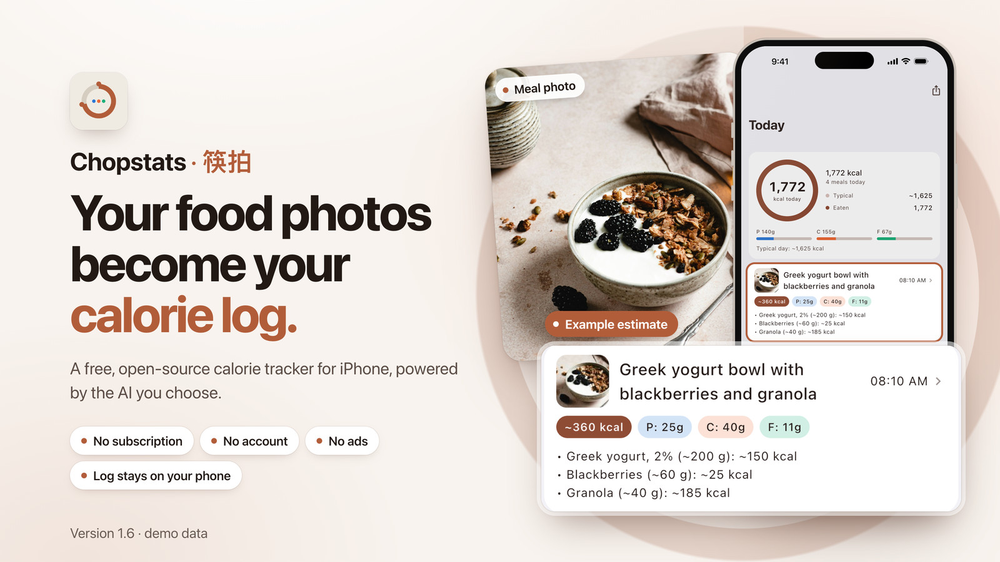
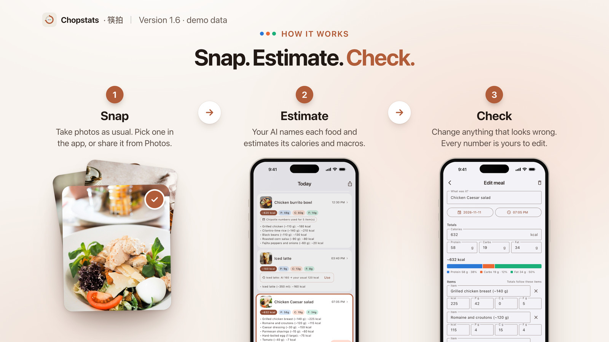
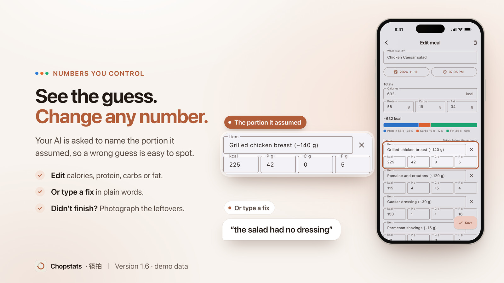

<!--
Maintainer notes. Nothing in this comment is shown on GitHub.

This page opens with four slides (hero, how it works, numbers you control,
privacy), then a short feature list ("What else it does") and the reference
sections. On 2026-11-13 the owner found the page too much like a slide deck
and asked for fewer slides; four were kept. Add new features to the list,
not as new slides. It describes the App Store version, 1.6.0. Merge a change that names a new version only
once that version is live on the App Store.

Lines tied to a release. Re-read them when a new App Store version ships:
1. "New in 1.6": the line under the hero slide, and "new in 1.6" inside the
   tags in "What else it does" (keep "off by default"). Drop them when 1.6
   is no longer the newest version.
2. The caption under the hero slide names the version the screens show.
3. "Coming next" lists what is on main but not in the App Store version:
   the native iOS look and iCloud Backup. When they ship, move them into
   "What else it does" and "More features", and update "Privacy", because
   iCloud Backup copies the log to the user's own iCloud Drive.
4. "Privacy" and "Everything that is sent, case by case" describe the App
   Store version. Check them against docs/PRIVACY.md at that version's tag,
   because the policy on main may already describe the next version.
5. "Android" names the newest GitHub release, its APK file and its size.
   Update them with each release.
6. "For developers" names the tag the App Store version was built from. Its
   two test counts are dated lower bounds.
7. "What it costs": the sentence about Gemini's free tier and what Google may
   do with what is sent comes from Google's Gemini API pricing page, read on
   2026-11-10. Check it again when the default model or Google's terms change.

The slides:
1. docs/readme/slides/NN-name.jpg (English) and docs/readme/zh/slides/
   NN-name.jpg (Chinese), 1600 x 900 JPEG, rendered from docs/readme/src
   (its README says how). To change a slide, change deck.json, render both
   languages, and update the alt text and the caption in both READMEs. The
   README shows 01-hero, 02-how, 03-control and 10-privacy; the other
   rendered slides stay in the folders, unused here.
2. Every phone on a slide is a screenshot of version 1.6.0 with demo data.
3. The burrito bowl's meal card on slide 02 names Chipotle (demo data). The
   trademark line under "License" says Chopstats is not affiliated with the
   restaurants named.
4. Under each slide: a heading, one or two sentences and its fine print, so
   the page still reads without the pictures. Keep the slide headings
   unique, because they become anchors. These anchors are linked: get-started,
   what-it-costs, privacy, android, coming-next, for-developers and
   build-from-source.
5. The food photos are from Unsplash. docs/readme/CREDITS.md names each one,
   and the first line under "License" credits the photographers.

The download badge and the second language:
1. App Store badge. It is Apple's own artwork, loaded from Apple's marketing
   tools address (the way Apple's embed code does it), shown once at the
   top, 180 px wide (60 px tall; Apple's minimum is 40 px). It links to the
   app's page. Do not recolor it, crop it or replace it with a shields.io
   pill. If the picture fails to load, its alt text is still the link. The
   line at the end of "What else it does" links the App Store with text,
   not a second badge.
2. Chinese README. README.zh-CN.md follows this file section by section.
   Change both files in the same commit. Its slides are in
   docs/readme/zh/slides/, and its badge is Apple's zh-cn artwork.
-->

<p align="center"><b>English</b> · <a href="README.zh-CN.md" lang="zh-Hans" hreflang="zh-Hans">简体中文</a></p>

<div align="center">

# Chopstats · 筷拍

**Your food photos become your calorie&nbsp;log.**

A free, open-source calorie tracker for iPhone, powered by the AI you&nbsp;choose.

<a href="https://apps.apple.com/app/id6828989410"></a>

</div>

<p align="center">
  
</p>

<div align="center">

Free · No in-app purchases · iPhone, iOS&nbsp;15 or later

**New in 1.6:** My usual foods · Restaurant nutrition for US chains (off by default) · Meta glasses photos

You need a key from the AI service you choose. Google Gemini, the default, has a free&nbsp;tier.

[Get started](#get-started) · [What it costs](#what-it-costs) · [Privacy](#privacy) · [Android](#android)

<sub>Screens of version 1.6, with demo data. Food photos from Unsplash, credited at the end.</sub>

</div>

<br>

<p align="center">
  
</p>

<div align="center">

### How it works

Take meal photos the way you already do, then pick one in Chopstats or share it from Photos. Your AI names each food, the portion it assumed, and its calories, protein, carbs and fat, and you check the result.

<sub>Chopstats has no camera of its own: photos come from the Camera app. The first time, the app asks before it sends anything to your AI. Write a dietary profile, such as "vegetarian", and the AI reads it with every photo.</sub>

</div>

<br>

<p align="center">
  
</p>

<div align="center">

### Numbers you control

Every food shows the portion your AI assumed, such as "Grilled chicken breast (~140 g)", so a wrong guess is easy to spot. Change any number, or type a fix in plain words, such as "the salad had no dressing".

<sub>Didn't finish? Photograph what is left under Today › Log › Leftovers, and the meal shrinks to what you ate. The app asks the AI to read a nutrition label or printed weight before it estimates by eye. Estimates can be wrong, and nobody has measured this app's accuracy.</sub>

</div>

<br>

<p align="center">
  
</p>

<div align="center">

### No account, no ads, no tracking

Your meals, weight and settings stay on your phone, and the developer receives none of your data. The photos and text you log go to the AI provider you chose, or to your own server.

<sub>The app asks before it first sends anything, and Stop Sharing ends it. Watch Camera Roll sends every new photo while it is on, and Restaurant nutrition, if you turn it on, has its own recipients. Details under [Privacy](#privacy).</sub>

</div>

<br>

## What else it does

- **My usual foods** (new in 1.6). Meals you logged on at least 2 of the last 90 days wait under Today › Log › My usual foods. Tap one to log it again: no photo, no AI, nothing sent. If you set a food's numbers yourself, the app may offer them as Your usual numbers on later photos of it; nothing changes until you tap Use my numbers.
- **Restaurant nutrition** (new in 1.6, off by default). For a meal photo from a US chain restaurant, your AI can look up the nutrition the chain publishes and use it in place of its own estimate. The meal names its source, and you can undo the change or tap Wrong restaurant. US meals only, from a built-in list of 403 chains. Needs an Anthropic or OpenRouter key, or your own server on the Claude plan; not available with Gemini yet. Your AI's numbers are replaced only when the chain's own website publishes them and the match is clear; otherwise, and always with your own server, you get a suggestion. The published serving may not match what you ate.
- **Watch Camera Roll** (off by default). New food photos are logged without opening the app. While it is on, every new photo, food or not, goes to your AI, which decides whether it shows a meal. iOS decides when background scans run, so a photo is not always logged right away; opening the app catches up. Needs full photo access and Background App Refresh. Switching it on also sends recent photos, as far back as the Backfill Lookback setting says (2 days by default).
- **Meta glasses photos** (new in 1.6). With Watch Camera Roll on, photos that the Meta AI app saves from your glasses to your library are checked for food on your iPhone first. Photos with food go to your AI and are logged; photos without food are not sent. Chopstats does not connect to the glasses. The check can be wrong, and if it cannot run, the photo is sent like any other. Switch it off under Settings › Photos › Meta glasses photos; photos you pick or share are still sent.
- **No photo needed.** Describe a meal in words, such as "two eggs and toast with butter", in any language your AI reads; that sends your text and today's date. Or enter the numbers yourself: no AI, no key, and it works offline.
- **Your day and your trend.** Today shows what you ate next to your typical day, which comes from your previous 7 days. History charts the last 30 days, and Body tracks your weight along with your waist, chest and hip. If you set a daily calorie goal, the daily summary notification compares your day with it.
- **English and 简体中文.** Every screen comes in English and Simplified Chinese. Pick one under Settings › Language, or let it follow your iPhone. Not on the mainland China App Store.
- **Your own AI key.** Chopstats works with Google Gemini (the default, with a free tier), OpenAI, Anthropic, xAI, OpenRouter, DeepSeek, Alibaba Qwen, ByteDance Doubao and Zhipu GLM, or your own server. The app itself is free, with no subscription; more under [What it costs](#what-it-costs).

<div align="center">

**[Download on the App Store](https://apps.apple.com/app/id6828989410)** · [Build from source](#build-from-source) · [Android APK](#android)

<sub>iPhone, iOS 15 or later · MIT licensed · Android: a signed APK for arm64 phones on GitHub Releases, not on Google Play</sub>

</div>

<br>

<details>
<summary><b>More features, in detail</b></summary>

Everything here is in the App Store version.

**Logging**

- **Drinks.** The app asks the AI to log coffee, tea, juice, soda, bubble tea, shakes and beer, and to skip plain water.
- **Orders, receipts and labels.** The app also asks the AI to log a takeout order confirmation, a receipt or a nutrition label by reading its text. How well this works depends on the AI you chose.
- **Dietary profile.** Write a line such as "vegetarian" or "home cooking, light oil", and the AI reads it with every photo.
- **Leftovers, two ways.** If your AI recognizes the remains of a meal you logged earlier that day, the app reduces that meal and adds no second one. You can also pick the meal and the leftover photo yourself under **Today › Log › Leftovers**, for meals from today and yesterday.
- **Fixes in your own words.** Under **Today › Log › Fix or delete a meal**, type "the noodles were roast duck rice" or "delete the coffee I just logged". The app always asks you to confirm before it deletes a meal.
- **Foods you stopped eating.** In **My usual foods**, **Hide from this list** takes one off the list.

**Photos**

- **One analysis per photo.** The app does not analyze the same photo file twice.
- **The photo's own date.** A meal lands on the day its photo was taken, if that day is within the last 45 days. A photo from Saturday that you log on Monday lands on Saturday.
- **Thumbnails that stay.** Each meal logged from a photo keeps a small thumbnail in the app, even after you delete the photo from your photo library.
- **Photo Coverage.** A screen that lists recent photos, shows which were logged, and can retry the rest.

**Your day and your trend**

- **Empty days.** History labels a day with nothing logged as "no meals logged".
- **Protein, carbs and fat shares.** Each meal shows how its calories divide between protein, carbs and fat.
- **Calorie goal and daily summary.** One notification a day, at the time you set, compares the day with your calorie goal. If you set no goal, it compares the day with your typical day, which the app works out from your previous 7 days. You can turn it off.
- **Metric or imperial units.** The English interface can show weight and body measurements in pounds and inches.
- **Your day as one image.** The app turns today into one image that you can share.
- **Light and dark mode.** The app follows your phone's setting.

**Your AI and your data**

- **Test This Provider.** Six checks in order: configuration, network, key and account credit, text analysis, photo analysis and quota. Each one says what is wrong and what to do next.
- **Free-tier limits.** When Gemini's free tier reaches its daily limit, the app pauses analysis, keeps new photos and retries them later.
- **Export.** **Settings › Your Data › Export Data** writes one JSON file with your meals, weight and body measurements, plus the list of processed photos. Settings, the dietary profile, thumbnails and API keys are not in the file.
- **Import.** On another phone, open **Import Data** and paste the file's text, or tap **Import from clipboard**. Import adds what is missing and never duplicates meals that are already there.

</details>

## Get started

1. **Get the app.** Download Chopstats from the [App Store](https://apps.apple.com/app/id6828989410).
2. **Get an API key.** A key is a code you create on an AI provider's website. Google Gemini is already selected, and it has a free tier. See [where to get a key](docs/SUPPORT.md#getting-started-bring-your-own-key). If you are charged, you pay the provider, never the app.
3. **Paste the key.** Open **Settings › AI Provider › API Key** and paste it. Then go back and tap **Test This Provider**. The app asks before it first sends anything. Tap **Allow**.
4. **Log a meal.** Open **Today › Log › From recent photos** and pick a meal photo. Your AI names the dishes and estimates calories, protein, carbs and fat. Check the numbers and change any that look wrong.

> [!NOTE]
> Calories and nutrients are AI estimates from photos and descriptions, and they can be wrong. Check them and correct them. Chopstats is not a medical device and does not give medical or nutrition advice. Talk to a doctor or registered dietitian before you make health decisions.

## What it costs

The app is free, and nothing is sold inside it. The estimates come from an AI provider that you choose. If it charges, you pay it directly.

- **Start with Google Gemini.** It is the app's default, and it has a free tier with a daily limit. On the free tier, Google says it may use what you send to improve its products.
- **Or pick another provider.** OpenAI, Anthropic and six more each need their own key. Prices and limits change, so check the provider's pricing page.
- **Or use no AI at all.** Typing a meal's numbers yourself needs no key and works offline.

## Privacy

Your meals, weight and settings stay on your phone. The app contains no code for usage statistics, crash reports or ads. The code is public, so anyone can check these claims.

The photos and text that the AI analyzes go to your AI provider, or to your own server if you run one. The app adds the context the AI needs, such as your dietary profile or a short summary of that day's other meals.

- **Photos travel without location.** The copy the app sends has no location or other hidden details (metadata).
- **Watch Camera Roll sends every new photo while it is on.** That includes photos that are not food. On iPhone, Meta glasses photos are checked for food on the phone first, and one with no food in it is not sent.
- **Restaurant nutrition has its own recipients.** It is off by default and asks permission on its own screen, which names who receives lookups.
- **The app asks first.** Before it first sends anything to a provider, a dialog names the company and lists what is sent.
- **You can stop it.** In Settings, **Stop Sharing** ends all sending to your current provider, including photos still waiting to be sent and its restaurant lookups, and turns Watch Camera Roll off.
- **Your provider's terms apply.** Its privacy policy covers what it does with your data. A free tier can have different terms, as [Gemini's does](#what-it-costs).

<details>
<summary><b>Everything that is sent, case by case</b></summary>

This list covers the App Store version. Apart from Restaurant nutrition, the recipient is always the AI provider you chose, or your own server. Two of them pass the data on: OpenRouter sends it to the maker of the model you picked, and your own server sends it to the AI plan signed in on it.

- **You log a photo:** a smaller copy of it, without its location or other metadata. With it go your dietary profile, if you wrote one, and a short summary of up to five other meals from that day.
- **You turn on Watch Camera Roll:** the same, for every new photo in your photo library, food or not. Switching it on also sends recent photos, as far back as the **Backfill Lookback** setting says.
- **Watch Camera Roll meets a Meta glasses photo:** the app recognizes photos that the Meta AI app saved to your library. On iPhone, Apple's built-in image classifier first checks each one for food, on the phone, and a photo with no food in it is not sent. If the check cannot run, the photo is sent like any other. On Android there is no such check. Switch **Meta glasses photos** off to stop logging these photos automatically.
- **You log leftovers:** the leftover photo and the meal you picked.
- **You describe a meal:** your text and today's date.
- **You type a fix or ask to delete a meal:** your text, today's date and your meals from the last 7 days.
- **You tap Test This Provider:** a fixed message and a built-in test image, plus your dietary profile if you wrote one. None of your photos or meals.
- **You turn on Restaurant nutrition:** for a meal eaten in the US, up to three chain names from the app's built-in list, the food names with their amounts, the country code US and the reply language. They go to your AI service, which searches the web for the chain's published nutrition: Anthropic; or OpenRouter, which passes them to the maker of the model you picked and searches with its partner Exa; or your own server, which searches with Claude web search. No other provider gets lookups. A chain found nearby shows that you were near it. A lookup never sends the photo, its location, your dietary profile or your meal history. With **Use photo location** on, the iPhone reads where a restaurant or takeout photo was taken, and for a restaurant meal it asks Apple Maps which food places are nearby. Apple receives that location, as when you use Maps.
- **You use your own server:** the same data goes to the server you run. While a server address is saved, the app also sends the server the date, to ask for that day's Garmin activity summary.

The app sends nothing to the developer. It keeps API keys in the iOS Keychain, the iPhone's protected store for passwords and keys. On Android it keeps them in encrypted storage backed by the Android Keystore. Your phone's own backup can include the app's data.

</details>

Export your data to a file at any time. The [privacy policy](docs/PRIVACY.md) has the full details, including [Restaurant nutrition](docs/PRIVACY.md#restaurant-nutrition-lookup-off-unless-you-turn-it-on).

## Android

Chopstats is not on Google Play. Version 1.6.0 is on the [Releases page](https://github.com/AkiyamaKunka/Chopstats/releases/tag/v1.6.0) as an APK, the Android install file: `Chopstats-v1.6.0-b106-arm64-v8a.apk`, about 22 MB. This repository's release workflow built and signed it from the `v1.6.0` tag, the same code as the iPhone app.

- **arm64 phones only.** A phone with a 32-bit processor refuses it.
- **You install it yourself.** Android asks you to allow installs from your browser or file manager. The app does not update itself: install the next APK from the Releases page when one comes out.
- **Coming from the 1.4.0 preview?** That August 2026 build is still named Bitewise. It sends photos with their embedded metadata, which includes the location if your camera recorded it, and it asks no permission first. Android cannot install 1.6.0 over it. Export your log in the old app, uninstall it, install 1.6.0, then open **Settings › Your Data › Import Data**.
- **A few things differ from iPhone.** Restaurant nutrition looks up printed brands only and never reads where a photo was taken. Meta glasses photos are not checked for food on the phone, so with Watch Camera Roll on they are sent like any other photo. The screenshots on this page are from an iPhone.

Developers can also [build the app from source](#build-from-source).

## Questions

<details>
<summary><b>How accurate are the numbers?</b></summary>

They are estimates, and they can be wrong. Nobody has measured this app's accuracy, so this page claims no figure.

The app does three things about errors. It asks the AI to prefer printed numbers over guesses. It asks the AI to put the portion it assumed in each food's name, so you can see a wrong assumption. And you can change every number.

The preference for printed numbers is an [instruction to the AI](shared/prompts/estimation_priority.txt). How well it works depends on the AI you choose. Apart from Restaurant nutrition, which names the chain's page its numbers came from, the app does not show where a number came from, such as a label or a visual estimate.

</details>

<details>
<summary><b>Can it log meals without me opening the app?</b></summary>

Yes, with Watch Camera Roll on. It needs an API key, full access to your photos, and Background App Refresh switched on.

On iPhone, iOS decides when the app may scan for new photos in the background, so a new photo is not always logged right away. If you swipe the app away, scanning stops until you open it again. Opening it catches up on the photos you took in between. If you allow notifications, one tells you when the app logged a meal in the background.

</details>

<details>
<summary><b>Which AI providers work, and where do they process my data?</b></summary>

Nine work with an API key: Google Gemini, OpenAI, Anthropic Claude, xAI Grok, OpenRouter, DeepSeek, Alibaba Qwen, ByteDance Doubao and Zhipu GLM. Gemini is selected on a fresh install. Each provider has a short list of models, the individual AIs it offers, and you can type a model name yourself. When you change provider, the change applies from the next request.

Gemini has a free tier. GLM's default model is marked free in the app, and a GLM account needs real-name verification. Check the provider's current pricing.

DeepSeek, Qwen, Doubao and GLM process data in mainland China, and the app's permission dialog says so before you allow them. Each provider's own privacy policy covers what it does with the data it receives.

Advanced users can also route analysis through [a server they run themselves](docs/SERVER.md).

</details>

Something not working? Start with **Settings › AI Provider › Test This Provider**, which names what is broken. Then see the [support page](docs/SUPPORT.md) or [open an issue](https://github.com/AkiyamaKunka/Chopstats/issues). Issues are public, so never post an API key, your photos or personal data there.

## Coming next

Built and in the public code on `main`, but not in the App Store version yet. Neither has a release date.

- **A native iOS look.** A redesign in the iOS style.
- **iCloud Backup.** Copies your log to your own iCloud Drive, so it survives deleting the app or moving to a new iPhone, with no account and no server of ours. It is on by default, and a notice comes first: nothing is uploaded until you answer it.

## For developers

Chopstats is a Flutter app for iPhone and Android in `app/`, with an optional self-hosted Python server at the repository root. The App Store version, 1.6.0, was built from the tag [`v1.6.0`](https://github.com/AkiyamaKunka/Chopstats/tree/v1.6.0), so you can check this page against the code that shipped. `main` already holds the next version.

<p>
  <a href="https://apps.apple.com/app/id6828989410"></a>
  <a href="https://github.com/AkiyamaKunka/Chopstats/actions/workflows/python-tests.yml"></a>
  <a href="LICENSE"></a>
</p>

### Build from source

```bash
git clone https://github.com/AkiyamaKunka/Chopstats.git
cd Chopstats/app
flutter pub get
flutter run
```

You need Flutter with Dart SDK 3.12.2 or later. Then add a key in the app, as in [Get started](#get-started).

- **A real iPhone.** Open `app/ios/Runner.xcworkspace` in Xcode and set your signing team. Change the two bundle identifiers, the app group and the iCloud container to your own, because the ones in the project belong to the App Store app.
- **An Android APK.** Run `bash scripts/build_share_apk.sh` from the repository root. It writes an arm64 APK to `~/Desktop/Chopstats-share/`. Android builds need JDK 17. On Linux, set `JAVA_HOME` first.

<details>
<summary><b>How it is built and tested</b></summary>

- **Two implementations, kept in step.** The Dart app and the Python server share no runtime code. A [behavior spec](docs/APP_PORT_SPEC.md) cites file and line for each rule and lists the deliberate differences. [Shared constants and prompts](shared/) are generated for both sides, and both test suites replay the same [golden vectors](shared/vectors/).
- **One vocabulary for provider errors.** A [conformance test](app/test/analyzer/provider_feedback_matrix_test.dart) checks each provider's error replies against eight failure classes. A user whose account is out of credit is told to recharge, not to make a new key.
- **A ledger for every photo.** A photo is identified by the md5 of its original bytes and tracked through five states. The same file is not analyzed twice, and the watcher does not log a meal again after you delete it.

Both suites run in CI on every push. Measured on `main` on 2026-11-10, they held more than 3,500 Dart tests and more than 2,300 Python tests. The diagrams and the detail are in [docs/ARCHITECTURE.md](docs/ARCHITECTURE.md): the photo pipeline, capture dating, leftover arithmetic and the server runbook.

</details>

<details>
<summary><b>Your own server (optional)</b></summary>

Skip this unless you are comfortable running a small server.

The repository root holds a Python server that you run on your own machine. When you select **Your own server** in the app, the phone sends photos and text to it with one upload key.

The server runs the analysis through the Claude Code CLI. It uses the AI plan that is signed in on that server: Claude, GLM Coding Plan or Doubao Agent Plan. Check your plan's acceptable-use terms before you route app traffic through it.

- The phone holds one upload key. The plan's credentials stay on the server.
- For a photo, the server writes the analysis prompt itself. The phone supplies only data for it: your dietary profile, that day's meal summaries, and your choice of plan, model, effort and reply language.
- A text request carries its prompt from the phone, and the server runs it with tools off.
- Each reply names which AI answered, and the app rejects a mismatch.
- A setup link or QR code fills in the app's server settings after one confirmation.
- When the server's Claude sign-in expires, you can reconnect it from the phone.
- For the Claude route you can pick the model (opus, sonnet, haiku or fable) and the effort (low, medium or high) from the phone.
- While a server address is saved, the app sends it the date to ask for that day's Garmin activity summary.
- The original Telegram bot is still in the repository and runs in the same process. `TELEGRAM_POLLING=0` runs the phone API without it.

Guides: [docs/SERVER.md](docs/SERVER.md) for setup, the API and the request flow between the app and the server, [docs/SERVER_DEPLOY.md](docs/SERVER_DEPLOY.md) for deployment, and [docs/SERVER_TLS.md](docs/SERVER_TLS.md) for HTTPS.

</details>

<details>
<summary><b>Live check of every AI provider</b></summary>

Model names and endpoints change, so the repository carries a live check next to the mocked contract tests:

```bash
scripts/test_providers_live.sh
```

It sends a real photo and a real text request through the app's own analyzers to every provider that has a key in `~/.bitewise/provider_keys.env`. The template is `scripts/provider_keys.env.example`, and the file stays on your machine.

A provider without a key is still probed. The live endpoint must refuse an invalid key, and the app must report that as a key problem. This catches a wrong URL, a retired endpoint or a misread error.

One OpenRouter key runs the whole popular-model matrix in one pass. OpenRouter's public catalog is checked without a key, so the curated model list cannot go stale unnoticed.

In the app, **Settings › AI Provider › Test This Provider** runs the same kind of staged check for the selected provider.

</details>

<details>
<summary><b>Run the checks</b></summary>

```bash
# server tests
python3 -m pytest -q
# app tests
(cd app && flutter analyze && flutter test)
# server and app bindings in step
python3 scripts/sync_shared.py --check
# no secrets or personal data
bash scripts/check_public_safety.sh
```

CI runs all four on every push. The Python suite runs on 3.9 and 3.10, with `ruff` and a coverage floor. With `PUBLIC_SAFETY_SCAN_HISTORY=1` the safety gate also scans the full git history.

</details>

<details>
<summary><b>Project layout</b></summary>

- `app/`: the Flutter app for iPhone and Android. Start here.
- `shared/`: constants, prompts and golden vectors that both sides compile from.
- `telegram_bot.py`: the optional server. A Flask API for the app, plus the Telegram bot.
- `scripts/`: parity sync, vector generation, APK build and the safety gate.
- `tests/` and `app/test/`: the Python suite and the Dart suite.
- `docs/ARCHITECTURE.md`: how the app is built and kept in step with the server, plus the server runbook.
- `docs/APP_PORT_SPEC.md`: the behavior spec that both implementations follow.
- `docs/SERVER.md`: running your own server. Analysis backends, Telegram bot and app API.
- `docs/RELEASING.md`: the signed release lane for the App Store and Android, and the owner's checklist.
- `docs/PRIVACY.md` and `docs/SUPPORT.md`: the privacy policy and the support page, both linked from the App Store listing.
- `docs/readme/`: the slides on this page and the source they are rendered from.
- `android/` and `ios/`: older upload clients for the server (Termux, Shortcuts). They are not the app.

</details>

Issues and pull requests are welcome. Two rules matter more than style: never commit a credential, and keep the server and the app in step. The details are in [CONTRIBUTING.md](CONTRIBUTING.md) and [SECURITY.md](SECURITY.md). Keep anything security-sensitive out of public issues and use the email address on the [support page](docs/SUPPORT.md#contact).

## License

[MIT](LICENSE) © 2026 AkiyamaKunka

<sub>Food photos: Natalie Behn, Katka Pavlickova, Andrew Relf, Demi DeHerrera and Mikey Frost on Unsplash ([credits](docs/readme/CREDITS.md)).</sub><br>
<sub>Formerly named Bitewise and, before that, CalorieTracker. Old links redirect here.</sub><br>
<sub>iPhone is a trademark of Apple Inc., registered in the U.S. and other countries and regions. App Store is a service mark of Apple Inc. Android and Google Play are trademarks of Google LLC. Other product, company and restaurant names belong to their owners, and Chopstats is not affiliated with them.</sub>
