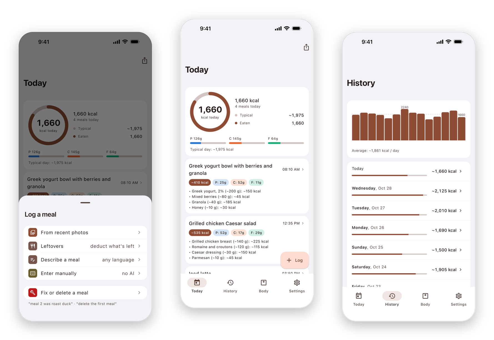
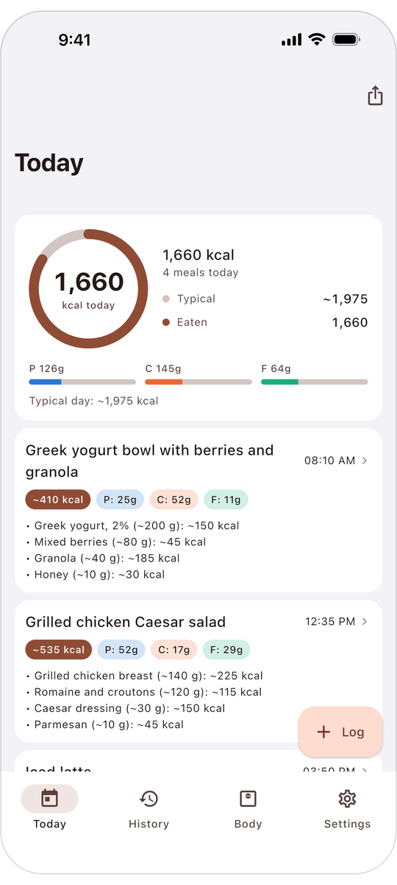
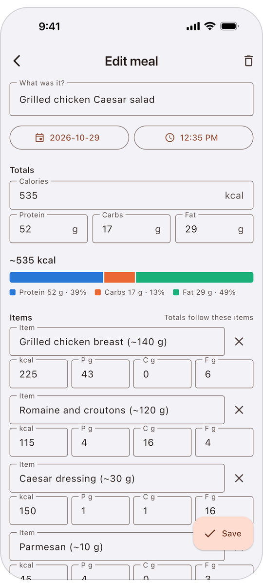
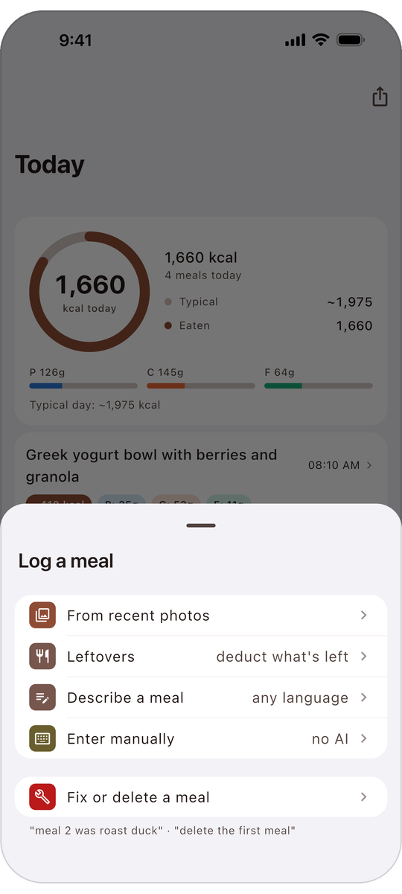
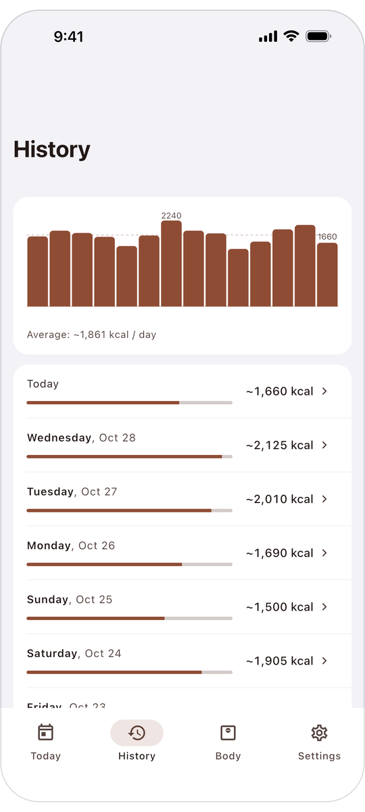
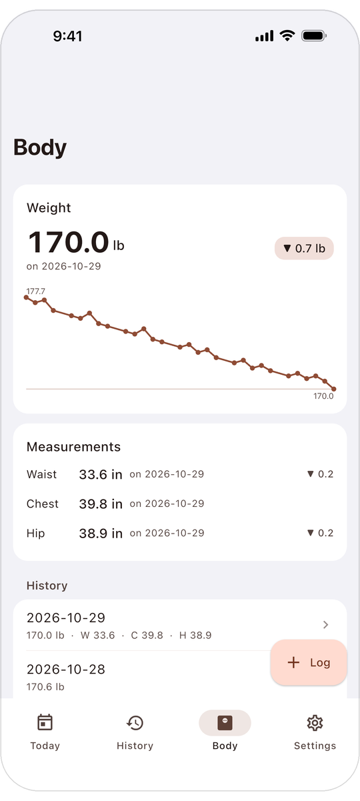
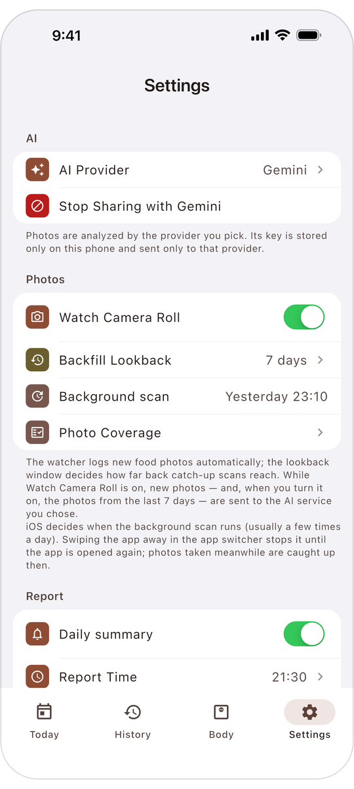

<!--
Maintainer notes. Nothing in this comment is shown on GitHub.

Lines tied to a release. Re-read them when a new App Store version ships:
1. The caption under the hero picture names the App Store version.
2. "Coming next": move each bullet into "What you get" when it ships.
3. "Privacy" and "Everything that is sent, case by case" describe the App Store
   version. When restaurant lookup ships, add its recipients (docs/PRIVACY.md,
   "Restaurant nutrition lookup"). With it on, a photo's location can go to
   Apple Maps on iPhone.
4. "Android": rewrite it when a current Android build is published.
5. The pictures in docs/readme/ and their alt text show the 1.5.0 look.
   Re-shoot them when the look changes. The six phone screenshots carry 14
   transparent pixels above and below (540 x 1201), so they do not touch when
   they stack on a phone. Pad a new picture the same way.
6. "For developers": the two test counts are dated lower bounds.
7. "What it costs": the sentence about Gemini's free tier and what Google may
   do with what is sent comes from Google's Gemini API pricing page, read on
   2026-11-10. Check it again when the default model or Google's terms change.

The download badge and the second language:
1. App Store badge. It is Apple's own artwork, loaded from Apple's marketing
   tools address (the way Apple's embed code does it), shown once, 180 px wide
   (60 px tall; Apple's minimum is 40 px). It links to the app's page. Do not
   recolor it, crop it or replace it with a shields.io pill. If the picture
   fails to load, its alt text is still the link.
2. Chinese README. README.zh-CN.md follows this file section by section.
   Change both files in the same commit. Its pictures are in docs/readme/zh/,
   padded like the English ones (note 5 above), and its badge is Apple's
   zh-cn artwork.

Left out on purpose, until it exists:
1. The commit of the App Store build. When it has a tag, name it once under
   "For developers", so a reader can check the Privacy claims against the
   code that shipped. Use a tag name that does not start with "v", because a
   v tag starts the release workflow.
-->

<p align="center"><b>English</b> · <a href="README.zh-CN.md">简体中文</a></p>

<div align="center">

# Chopstats · 筷拍

**Your food photos become your calorie&nbsp;log.**

A free, open-source calorie tracker for iPhone. Take meal photos the way you already do. Pick one in the app, and the AI service you choose estimates its calories, protein, carbs and fat. You can check and correct every number.

<a href="https://apps.apple.com/app/id6828989410"></a>

Free · No in-app purchases · iPhone, iOS&nbsp;15 or later

You need a key from the AI service you choose. Google Gemini, the default, has a free&nbsp;tier.

</div>

<p align="center">
  
</p>

<p align="center"><sub>Screenshots of App Store version 1.5.0, with demo&nbsp;data.</sub></p>

<div align="center">

No Chopstats account. No ads. No tracking. Your log stays on your phone. Photos and descriptions you log go to the AI service you choose, and the developer receives none of your&nbsp;data.

[Get started](#get-started) · [What it costs](#what-it-costs) · [Privacy](#privacy)

<sub>In English and 简体中文 · Not on the mainland China App Store · Android: not on Google Play, developers can <a href="#android">build from source</a></sub>

</div>

## Get started

1. **Get the app.** Download Chopstats from the [App Store](https://apps.apple.com/app/id6828989410).
2. **Get an API key.** A key is a code you create on an AI provider's website. Google Gemini is already selected, and it has a free tier. See [where to get a key](docs/SUPPORT.md#getting-started-bring-your-own-key). If you are charged, you pay the provider, never the app.
3. **Paste the key.** Open **Settings › AI Provider › API Key** and paste it. Then go back and tap **Test This Provider**. The app asks before it first sends anything. Tap **Allow**.
4. **Log a meal.** Open **Today › Log › From recent photos** and pick a meal photo. Your AI names the dishes and estimates calories, protein, carbs and fat. Check the numbers and change any that look wrong.

## What you get

- **Log a meal from a photo.** Pick one from your recent photos, or share it from the Photos app.
- **Turn on automatic logging, if you want.** The Watch Camera Roll setting logs new food photos. It is off by default. While it is on, the app sends every new photo, food or not, to your AI provider, which decides whether it shows a meal.
- **Check what the AI assumed.** The app asks the AI to name the portion it assumed, such as "Steamed rice (~150 g)". It also asks the AI to read a nutrition label or printed weight before it estimates by eye.
- **Change any number.** Open a meal to edit it, or type a fix such as "meal 2 was roast duck".
- **Subtract leftovers.** Photograph what is left and the meal shrinks to what you ate.
- **Log without a photo.** Describe a meal in words, such as "two eggs and toast with butter", in any language your AI reads. Or enter the numbers yourself, with no AI and no key.
- **See your day and your trend.** Today shows what you ate next to your typical day. History covers 30 days. Body charts your weight and keeps waist, chest and hip. A daily summary notification is optional.

<p align="center">
  
  
</p>

<details>
<summary><b>More features and screens</b></summary>

Everything here is in the App Store version.

**Logging**

- **Drinks.** The app asks the AI to log coffee, tea, juice, soda, bubble tea, shakes and beer, and to skip plain water.
- **Orders, receipts and labels.** The app also asks the AI to log a takeout order confirmation, a receipt or a nutrition label by reading its text. How well this works depends on the AI you chose.
- **Dietary profile.** Write a line such as "vegetarian" or "home cooking, light oil", and the AI reads it with every photo.
- **Leftovers, two ways.** If your AI recognizes the remains of a meal you logged earlier that day, the app reduces that meal and adds no second one. You can also pick the meal and the leftover photo yourself under **Today › Log › Leftovers**, for meals from today and yesterday.
- **Fixes in your own words.** Under **Today › Log › Fix or delete a meal**, type "meal 2 was roast duck" or "delete the first meal". The app always asks you to confirm before it deletes a meal.

**Photos**

- **One analysis per photo.** The app does not analyze the same photo file twice.
- **The photo's own date.** A meal lands on the day its photo was taken, if that day is within the last 45 days. A photo from Saturday that you log on Monday lands on Saturday.
- **Thumbnails that stay.** Each meal logged from a photo keeps a small thumbnail in the app, even after you delete the photo from your photo library.
- **Photo Coverage.** A screen that lists recent photos, shows which were logged, and can retry the rest.

**Your day and your trend**

- **Empty days.** History labels a day with nothing logged as "no meals logged".
- **Protein, carbs and fat shares.** Each meal shows how its calories divide between protein, carbs and fat.
- **Calorie goal and daily summary.** One notification a day, at the time you set, compares the day with your calorie goal. If you set no goal, it compares the day with your typical day, which the app works out from your previous 7 days. You can turn it off.
- **Metric or imperial units.** The English interface can show weight and body measurements in pounds and inches.
- **Your day as one image.** The app turns today into one image that you can share.
- **Light and dark mode.** The app follows your phone's setting.

**Your AI and your data**

- **Test This Provider.** Six checks in order: configuration, network, key and account credit, text analysis, photo analysis and quota. Each one says what is wrong and what to do next.
- **Free-tier limits.** When Gemini's free tier reaches its daily limit, the app pauses analysis, keeps new photos and retries them later.
- **Export.** **Settings › Your Data › Export Data** writes one JSON file with your meals, weight and body measurements, plus the list of processed photos. Settings, the dietary profile, thumbnails and API keys are not in the file.
- **Import.** On another phone, open **Import Data** and paste the file's text, or tap **Import from clipboard**. Import adds what is missing and never duplicates meals that are already there.

<p align="center">
  
  
</p>

<p align="center">
  
  
</p>

</details>

> [!NOTE]
> Calories and nutrients are AI estimates from photos and descriptions, and they can be wrong. Check them and correct them. Chopstats is not a medical device and does not give medical or nutrition advice. Talk to a doctor or registered dietitian before you make health decisions.

## What it costs

The app is free, and nothing is sold inside it. The estimates come from an AI provider that you choose. If it charges, you pay it directly.

- **Start with Google Gemini.** It is the app's default, and it has a free tier with a daily limit. On the free tier, Google says it may use what you send to improve its products.
- **Or pick another provider.** OpenAI, Anthropic and six more each need their own key. Prices and limits change, so check the provider's pricing page.
- **Or use no AI at all.** Typing a meal's numbers yourself needs no key and works offline.

## Privacy

Your meals, weight and settings stay on your phone. The app contains no code for usage statistics, crash reports or ads. The code is public, so anyone can check these claims.

The photos and text that the AI analyzes go to your AI provider, or to your own server if you run one. The app adds the context the AI needs, such as your dietary profile or a short summary of that day's other meals.

- **Photos travel without location.** The copy the app sends has no location or other hidden details (metadata).
- **Watch Camera Roll sends every new photo while it is on.** That includes photos that are not food.
- **The app asks first.** Before it first sends anything to a provider, a dialog names the company and lists what is sent.
- **You can stop it.** In Settings, **Stop Sharing** ends all sending to your current provider and turns Watch Camera Roll off.
- **Your provider's terms apply.** Its privacy policy covers what it does with your data. A free tier can have different terms, as [Gemini's does](#what-it-costs).

<details>
<summary><b>Everything that is sent, case by case</b></summary>

This list covers the App Store version. The recipient is always the AI provider you chose, or your own server. Two of them pass the data on: OpenRouter sends it to the maker of the model you picked, and your own server sends it to the AI plan signed in on it.

- **You log a photo:** a smaller copy of it, without its location or other metadata. With it go your dietary profile, if you wrote one, and a short summary of up to five other meals from that day.
- **You turn on Watch Camera Roll:** the same, for every new photo in your photo library, food or not. Switching it on also sends recent photos, as far back as the **Backfill Lookback** setting says.
- **You log leftovers:** the leftover photo and the meal you picked.
- **You describe a meal:** your text and today's date.
- **You type a fix or ask to delete a meal:** your text, today's date and your meals from the last 7 days.
- **You tap Test This Provider:** a fixed message and a built-in test image, plus your dietary profile if you wrote one. None of your photos or meals.
- **You use your own server:** the same data goes to the server you run. While a server address is saved, the app also sends the server the date, to ask for that day's Garmin activity summary.

The app sends nothing to the developer. It keeps API keys in the iOS Keychain, the iPhone's protected store for passwords and keys. On Android it keeps them in encrypted storage backed by the Android Keystore. Your phone's own backup can include the app's data.

Restaurant nutrition lookup is not in the App Store version yet. It is off by default, it asks permission on its own screen, and it sends data to its own list of recipients. The privacy policy already describes them.

</details>

Export your data to a file at any time. The [privacy policy](docs/PRIVACY.md) has the full details.

## Android

Chopstats is not on Google Play, and there is no Android download of the current version yet. The Android code in this repository is up to date, so developers can [build the app from source](#build-from-source).

<details>
<summary><b>An older preview build from August&nbsp;2026</b></summary>

Version 1.4.0 is on the [Releases page](https://github.com/AkiyamaKunka/Chopstats/releases/tag/v1.4.0) as an APK, the Android install file, for arm64 phones. It is three months older than the iPhone app and still carries the old name, Bitewise. It differs from the app this page describes:

- It sends photos with their embedded metadata, which includes the location if your camera recorded it.
- It shows no permission dialog and no notice before Watch Camera Roll starts sending, and it has no Stop Sharing.
- It has six of the nine providers (no DeepSeek, xAI or OpenRouter) and no daily calorie goal.

A future Android release cannot be installed over it. You will have to uninstall it first, so export your data before you upgrade.

</details>

## Questions

<details>
<summary><b>How accurate are the numbers?</b></summary>

They are estimates, and they can be wrong. Nobody has measured this app's accuracy, so this page claims no figure.

The app does three things about errors. It asks the AI to prefer printed numbers over guesses. It asks the AI to put the portion it assumed in each food's name, so you can see a wrong assumption. And you can change every number.

The preference for printed numbers is an [instruction to the AI](shared/prompts/estimation_priority.txt). How well it works depends on the AI you choose. The app does not show where a number came from, such as a label or a visual estimate.

</details>

<details>
<summary><b>Can it log meals without me opening the app?</b></summary>

Yes, with Watch Camera Roll on. It needs an API key, full access to your photos, and Background App Refresh switched on.

On iPhone, iOS decides when the app may scan for new photos in the background, so a new photo is not always logged right away. If you swipe the app away, scanning stops until you open it again. Opening it catches up on the photos you took in between. If you allow notifications, one tells you when the app logged a meal in the background.

</details>

<details>
<summary><b>Which AI providers work, and where do they process my data?</b></summary>

Nine work with an API key: Google Gemini, OpenAI, Anthropic Claude, xAI Grok, OpenRouter, DeepSeek, Alibaba Qwen, ByteDance Doubao and Zhipu GLM. Gemini is selected on a fresh install. Each provider has a short list of models, the individual AIs it offers, and you can type a model name yourself. When you change provider, the change applies from the next request.

Gemini has a free tier. GLM's default model is marked free in the app, and a GLM account needs real-name verification. Check the provider's current pricing.

DeepSeek, Qwen, Doubao and GLM process data in mainland China, and the app's permission dialog says so before you allow them. Each provider's own privacy policy covers what it does with the data it receives.

Advanced users can also route analysis through [a server they run themselves](docs/SERVER.md).

</details>

Something not working? Start with **Settings › AI Provider › Test This Provider**, which names what is broken. Then see the [support page](docs/SUPPORT.md) or [open an issue](https://github.com/AkiyamaKunka/Chopstats/issues). Issues are public, so never post an API key, your photos or personal data there.

## Coming next

Built and in the public code, but not in the App Store version yet:

- **My usual foods.** Log one of your regular foods again with one tap. It needs no photo and no AI.
- **Restaurant nutrition lookup.** The app can look up published nutrition for meals from US chain restaurants. It is off by default, and it needs an Anthropic or OpenRouter key, or your own server.

## For developers

Chopstats is a Flutter app for iPhone and Android in `app/`, with an optional self-hosted Python server at the repository root.

<p>
  <a href="https://apps.apple.com/app/id6828989410"></a>
  <a href="https://github.com/AkiyamaKunka/Chopstats/actions/workflows/python-tests.yml"></a>
  <a href="LICENSE"></a>
</p>

- **Two implementations, kept in step.** The Dart app and the Python server share no runtime code. A [behavior spec](docs/APP_PORT_SPEC.md) cites file and line for each rule and lists the deliberate differences. [Shared constants and prompts](shared/) are generated for both sides, and both test suites replay the same [golden vectors](shared/vectors/).
- **One vocabulary for provider errors.** A [conformance test](app/test/analyzer/provider_feedback_matrix_test.dart) checks each provider's error replies against eight failure classes. A user whose account is out of credit is told to recharge, not to make a new key.
- **A ledger for every photo.** A photo is identified by the md5 of its original bytes and tracked through five states. The same file is not analyzed twice, and the watcher does not log a meal again after you delete it.

Both suites run in CI on every push. Measured on `main` on 2026-11-10, they held more than 3,500 Dart tests and more than 2,300 Python tests. The diagrams and the detail are in [docs/ARCHITECTURE.md](docs/ARCHITECTURE.md): the photo pipeline, capture dating, leftover arithmetic and the server runbook.

### Build from source

```bash
git clone https://github.com/AkiyamaKunka/Chopstats.git
cd Chopstats/app
flutter pub get
flutter run
```

You need Flutter with Dart SDK 3.12.2 or later. Then add a key in the app, as in [Get started](#get-started).

- **A real iPhone.** Open `app/ios/Runner.xcworkspace` in Xcode and set your signing team. Change the two bundle identifiers and the app group to your own, because the ones in the project belong to the App Store app.
- **An Android APK.** Run `bash scripts/build_share_apk.sh` from the repository root. It writes an arm64 APK to `~/Desktop/Chopstats-share/`. Android builds need JDK 17. On Linux, set `JAVA_HOME` first.

<details>
<summary><b>Your own server (optional)</b></summary>

Skip this unless you are comfortable running a small server.

The repository root holds a Python server that you run on your own machine. When you select **Your own server** in the app, the phone sends photos and text to it with one upload key.

The server runs the analysis through the Claude Code CLI. It uses the AI plan that is signed in on that server: Claude, GLM Coding Plan or Doubao Agent Plan. Check your plan's acceptable-use terms before you route app traffic through it.

- The phone holds one upload key. The plan's credentials stay on the server.
- For a photo, the server writes the analysis prompt itself. The phone supplies only data for it: your dietary profile, that day's meal summaries, and your choice of plan, model, effort and reply language.
- A text request carries its prompt from the phone, and the server runs it with tools off.
- Each reply names which AI answered, and the app rejects a mismatch.
- A setup link or QR code fills in the app's server settings after one confirmation.
- When the server's Claude sign-in expires, you can reconnect it from the phone.
- For the Claude route you can pick the model (opus, sonnet, haiku or fable) and the effort (low, medium or high) from the phone.
- While a server address is saved, the app sends it the date to ask for that day's Garmin activity summary.
- The original Telegram bot is still in the repository and runs in the same process. `TELEGRAM_POLLING=0` runs the phone API without it.

Guides: [docs/SERVER.md](docs/SERVER.md) for setup, the API and the request flow between the app and the server, [docs/SERVER_DEPLOY.md](docs/SERVER_DEPLOY.md) for deployment, and [docs/SERVER_TLS.md](docs/SERVER_TLS.md) for HTTPS.

</details>

<details>
<summary><b>Live check of every AI provider</b></summary>

Model names and endpoints change, so the repository carries a live check next to the mocked contract tests:

```bash
scripts/test_providers_live.sh
```

It sends a real photo and a real text request through the app's own analyzers to every provider that has a key in `~/.bitewise/provider_keys.env`. The template is `scripts/provider_keys.env.example`, and the file stays on your machine.

A provider without a key is still probed. The live endpoint must refuse an invalid key, and the app must report that as a key problem. This catches a wrong URL, a retired endpoint or a misread error.

One OpenRouter key runs the whole popular-model matrix in one pass. OpenRouter's public catalog is checked without a key, so the curated model list cannot go stale unnoticed.

In the app, **Settings › AI Provider › Test This Provider** runs the same kind of staged check for the selected provider.

</details>

<details>
<summary><b>Run the checks</b></summary>

```bash
# server tests
python3 -m pytest -q
# app tests
(cd app && flutter analyze && flutter test)
# server and app bindings in step
python3 scripts/sync_shared.py --check
# no secrets or personal data
bash scripts/check_public_safety.sh
```

CI runs all four on every push. The Python suite runs on 3.9 and 3.10, with `ruff` and a coverage floor. With `PUBLIC_SAFETY_SCAN_HISTORY=1` the safety gate also scans the full git history.

</details>

<details>
<summary><b>Project layout</b></summary>

- `app/`: the Flutter app for iPhone and Android. Start here.
- `shared/`: constants, prompts and golden vectors that both sides compile from.
- `telegram_bot.py`: the optional server. A Flask API for the app, plus the Telegram bot.
- `scripts/`: parity sync, vector generation, APK build and the safety gate.
- `tests/` and `app/test/`: the Python suite and the Dart suite.
- `docs/ARCHITECTURE.md`: how the app is built and kept in step with the server, plus the server runbook.
- `docs/APP_PORT_SPEC.md`: the behavior spec that both implementations follow.
- `docs/SERVER.md`: running your own server. Analysis backends, Telegram bot and app API.
- `docs/RELEASING.md`: the signed release lane for the App Store and Android, and the owner's checklist.
- `docs/PRIVACY.md` and `docs/SUPPORT.md`: the privacy policy and the support page, both linked from the App Store listing.
- `android/` and `ios/`: older upload clients for the server (Termux, Shortcuts). They are not the app.

</details>

Issues and pull requests are welcome. Two rules matter more than style: never commit a credential, and keep the server and the app in step. The details are in [CONTRIBUTING.md](CONTRIBUTING.md) and [SECURITY.md](SECURITY.md). Keep anything security-sensitive out of public issues and use the email address on the [support page](docs/SUPPORT.md#contact).

## License

[MIT](LICENSE) © 2026 AkiyamaKunka

<sub>Formerly named Bitewise and, before that, CalorieTracker. Old links redirect here.</sub><br>
<sub>iPhone is a trademark of Apple Inc., registered in the U.S. and other countries and regions. App Store is a service mark of Apple Inc. Android and Google Play are trademarks of Google LLC.</sub>
