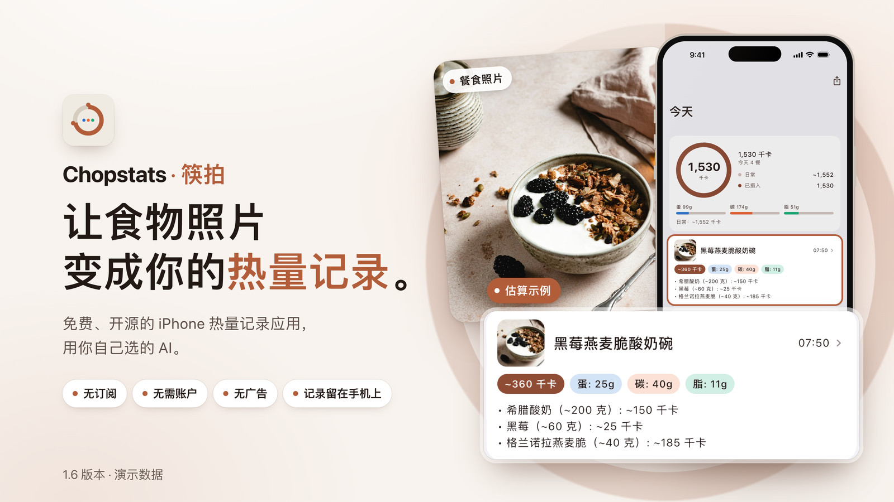
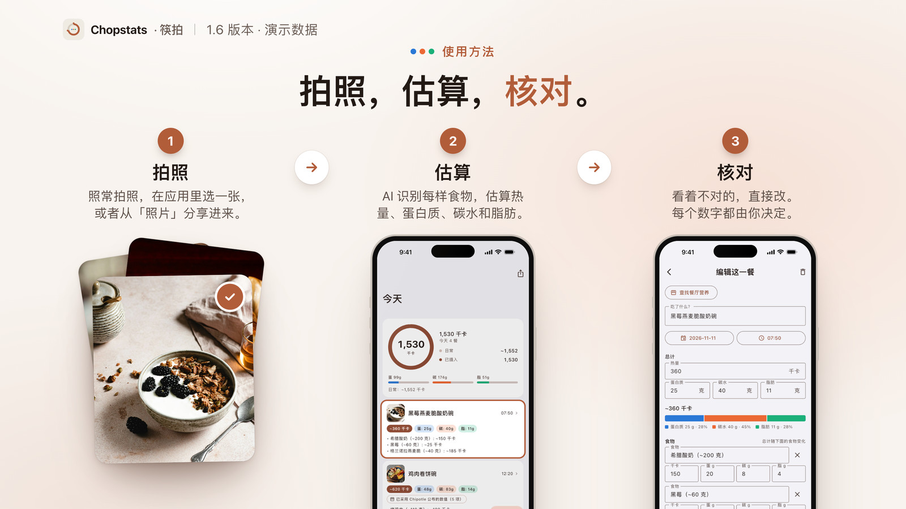
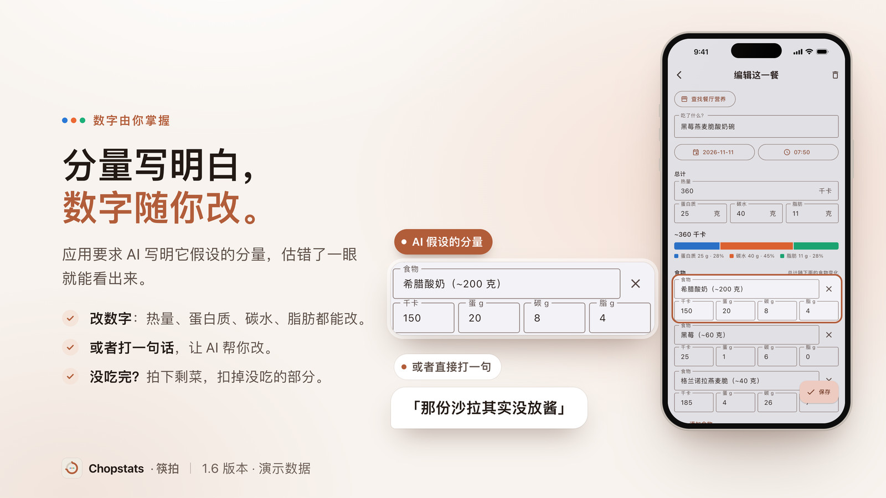
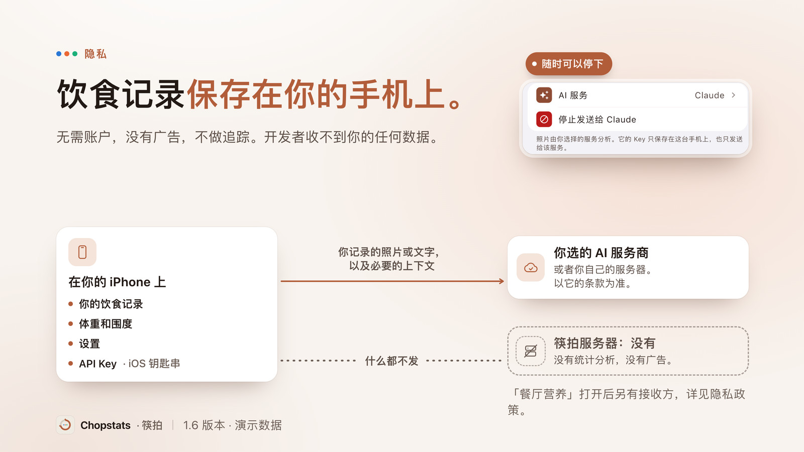

<!--
Maintainer notes. Nothing in this comment is shown on GitHub.

This is the Simplified Chinese README. It follows README.md section by section,
with the same facts, links and caveats. Change both files in the same commit.
The release-tied lines and the slide notes at the top of README.md apply here
too.

Rules for this file:
1. Screen, button and setting names are copied from app/lib/l10n/app_zh.arb and
   sit inside 「」. In prose the app is 筷拍.
2. Bold next to Chinese punctuation breaks on GitHub. A closing ** that comes
   right after 。 or 」 must be followed by punctuation, a space or the end of
   the line. An opening ** right before 「 must start the line or follow a
   space. So a bold label ends before its colon ("**标签**：正文"), and a
   control name in the middle of a sentence gets 「」 and no bold.
3. The slides are in docs/readme/zh/slides/ and show version 1.6.0 in Chinese,
   with Chinese demo data (the dumplings, the yogurt bowl). Each slide's alt
   text and caption describe the Chinese slide, so they are not word-for-word
   translations of README.md.
4. docs/PRIVACY.md has a Chinese half, linked here as docs/PRIVACY.md#中文.
   The other linked documents are in English only, and the text says so
   with （英文） after the link, or once at the top of 写给开发者.
5. One caveat is repeated on purpose. Step 1 of 开始使用 says again that the
   app is not on the mainland China App Store. Everything else has a
   counterpart in README.md, and nothing here goes beyond it.
6. Word map: "AI service" is AI 服务, "provider" is 服务商, "meal" is 一餐 or
   餐食, "portion" is 分量, "estimate" is 估算, "calories" is 热量.
7. Everything below this comment sits inside <div lang="zh-Hans"> so screen
   readers read it with a Chinese voice (GitHub's page is lang="en"). Keep the
   opening and closing div lines and the blank lines next to them. The
   > [!NOTE] alert sits between two divs: GitHub draws alerts only at the top
   level, never inside an HTML block.
-->

<div lang="zh-Hans">

<p align="center"><a href="README.md" lang="en" hreflang="en">English</a> · <b>简体中文</b></p>

<div align="center">

# Chopstats · 筷拍

**让食物照片变成你的热量记录。**

免费、开源的 iPhone 热量记录应用，用你自己选的 AI。

<a href="https://apps.apple.com/app/id6828989410"></a>

</div>

<p align="center">
  
</p>

<div align="center">

免费 · 无 App 内购买 · iPhone，iOS&nbsp;15 或更高版本

**1.6 新增**：「我常吃的」 · 「餐厅营养」（美国连锁餐厅，默认关闭） · Meta 眼镜拍的照片

需要准备一个你所选 AI 服务的 Key。默认选中的 Google Gemini 有免费额度。

[开始使用](#开始使用) · [费用](#费用) · [隐私](#隐私) · [Android](#android)

<sub>截图来自 1.6 版本，内容为演示数据。食物照片来自 Unsplash，致谢见页尾。</sub>

</div>

<br>

<p align="center">
  
</p>

<div align="center">

### 使用方法

照常拍下每一餐，然后在筷拍里选一张，或者从「照片」分享进来。你的 AI 会识别每样食物，写明假设的分量，估算热量、蛋白质、碳水和脂肪，再由你核对。

<sub>筷拍没有内置相机，照片来自「相机」。第一次发送前，应用会先征求你的同意。填写「饮食偏好」（例如“素食”），AI 分析每张照片时都会参考。</sub>

</div>

<br>

<p align="center">
  
</p>

<div align="center">

### 数字由你掌握

每样食物都写明 AI 假设的分量，例如“希腊酸奶（~200 克）”，估错了一眼就能看出来。每个数字都可以改，也可以直接打一句修改，例如「那份沙拉其实没放酱」。

<sub>没吃完？在「今天 › 记录 › 记录剩菜」里拍下剩下的部分，这一餐会减为你实际吃掉的量。应用要求 AI 先读营养成分表或印出来的重量，再凭目测估算。估算可能有误，这款应用的准确度没有人测量过。</sub>

</div>

<br>

<p align="center">
  
</p>

<div align="center">

### 无需账户，没有广告，不做追踪

你的餐食、体重和设置保存在你的手机上，开发者收不到你的任何数据。你记录的照片和文字，会发送给你选的 AI 服务商，或者你自己的服务器。

<sub>第一次发送前，应用会先征求同意；「停止发送给 …」随时可以停下。「监控相册」开启期间会发送每一张新照片，「餐厅营养」打开后另有接收方。详见[隐私](#隐私)。</sub>

</div>

<br>

## 还能做什么

- **「我常吃的」**（1.6 新增）：最近 90 天里至少有 2 天记过的餐，会出现在「今天 › 记录 › 我常吃的」里。点一下就再记一次：不用拍照，不用 AI，不发送任何内容。如果你自己设过某种食物的数值，之后再拍到它时，筷拍可能会以「你平时的数值」建议改用；你点「采用我的数值」之前不会改动。
- **「餐厅营养」**（1.6 新增，默认关闭）：在美国连锁餐厅吃饭时拍下的餐，你的 AI 可以查找该连锁店公布的营养信息，用它代替自己的估算。这一餐会注明来源，你可以撤销，也可以点「不是这家」。只查在美国吃的餐，内置 403 家连锁店名单。需要 Anthropic 或 OpenRouter 的 Key，或者使用 Claude 套餐的你自己的服务器；Gemini 暂不支持。只有连锁店官网公布了数值且匹配明确时，才会替换 AI 的数值；否则只给出建议，使用你自己的服务器时也一律只给建议。公布的份量可能和你吃的量不一致。
- **「监控相册」**（默认关闭）：开启后，新的食物照片会自动记录，不用打开应用。开启期间，每一张新照片，不管是不是食物，都会发送给你的 AI，由它判断是不是一餐。后台扫描由 iOS 决定何时运行，新照片不一定马上记录；打开应用时会补扫。需要访问所有照片的权限，并打开「后台 App 刷新」。打开开关时还会发送最近的照片，往回看多少天由「补扫回溯」决定（默认 2 天）。
- **Meta 眼镜拍的照片**（1.6 新增）：打开「监控相册」后，Meta AI 应用从眼镜存进相册的照片，会先在 iPhone 上检查有没有食物。有食物的发送给你的 AI 并记录，没有食物的不发送。筷拍不连接眼镜。检查在手机上进行，也可能判断错；如果检查无法运行，照片会像普通照片一样发送。可以在「设置 › 照片」里关闭「包括 Meta 眼镜拍的照片」；你自己选择或分享进来的照片仍会发送。
- **不拍照也能记**：用文字描述一餐，例如“一碗牛肉面加一个鸡蛋”，你的 AI 读得懂的语言都可以；这会把你输入的文字和今天的日期发送给你的 AI。也可以自己输入数字：不用 AI，不需要 Key，离线也能用。
- **今天和趋势**：「今天」把吃了多少和你的日常水平放在一起对照，日常水平由此前 7 天的记录算出，你也可以设定「每日热量目标」。「历史」回看 30 天，「身体」记录体重以及腰围、胸围和臀围。
- **简体中文和英文**：每个页面都有简体中文和英文。可以在「设置 › 语言」里选择，或者选「跟随系统」。未在中国大陆区 App Store 上架。
- **用你自己的 AI Key**：应用免费，没有订阅，应用内也不出售任何东西。支持 Google Gemini（默认，有免费额度）、OpenAI、Anthropic、xAI、OpenRouter、DeepSeek 深度求索、Qwen 通义千问、Doubao 豆包和 GLM 智谱，也可以用你自己的服务器。如果收费，费用直接付给服务商。详见[费用](#费用)。

<div align="center">

**[在 App Store 下载](https://apps.apple.com/app/id6828989410)** · [从源码构建](#从源码构建) · [Android APK](#android)

<sub>iPhone，iOS 15 或更高版本 · MIT 许可 · Android：GitHub Releases 上有适用于 arm64 手机的签名 APK，未上架 Google Play</sub>

</div>

<br>

<details>
<summary><b>更多功能</b></summary>

这里列出的功能，App Store 版本里都有。

**记录**

- **饮品**：应用要求 AI 把咖啡、茶、果汁、汽水、奶茶、奶昔和啤酒记下来，白水不记。
- **订单、小票和营养成分表**：应用还要求 AI 读取外卖订单确认页、小票或营养成分表上的文字，据此记录一餐。效果如何，取决于你选的 AI。
- **饮食偏好**：写一句话，例如“素食”或“家常菜，少油”，AI 分析每张照片时都会参考。
- **剩菜的两种记法**：如果你的 AI 认出照片里是当天早些时候记录过的某一餐剩下的，应用会扣减那一餐，不会再多记一餐。你也可以在「今天 › 记录 › 记录剩菜」里自己选是哪一餐、用哪张剩菜照片，今天和昨天的餐食都可以选。
- **用你自己的话修改**：在「今天 › 记录 › 修改或删除某餐」里输入「那碗面其实是烧鸭饭」或「删除刚才那杯咖啡」。删除一餐之前，应用一定会先请你确认。
- **隐藏不再吃的**：在「我常吃的」里点「不在列表里显示」，就能把你不再吃的食物从列表里去掉。

**照片**

- **一张照片只分析一次**：同一个照片文件，应用不会分析第二次。
- **按照片的拍摄日期记录**：一餐会记在照片拍摄的那一天，前提是那一天在最近 45 天以内。周六拍的照片周一才记录，也会记在周六。
- **缩略图一直保留**：用照片记录的每一餐，应用里都会留一张小缩略图。之后你把照片从相册里删掉，缩略图也还在。
- **「照片覆盖检查」**：这个页面列出最近的照片，标明哪些已经记录，其余的可以重试。

**今天和趋势**

- **没有记录的日子**：某一天什么都没记，「历史」会把它标为“无记录”。
- **蛋白质、碳水和脂肪的占比**：每一餐都会显示蛋白质、碳水和脂肪各占多少热量。
- **热量目标和每日总结**：每天在你设定的时间发一条通知，把当天的摄入和你的热量目标对比。如果没有设目标，就和你的日常水平对比，日常水平由应用根据此前 7 天的记录算出。这条通知可以关闭。
- **公制或英制单位**：英文界面可以用磅和英寸显示体重和围度。
- **把今天变成一张图**：应用可以把今天的饮食生成一张图片，方便你分享。
- **浅色和深色模式**：跟随手机的系统设置。

**你的 AI 和你的数据**

- **「测试当前服务」**：依次检查六项，分别是配置、网络、Key 与账户余额、文字分析、照片分析和额度。每一项都会说明哪里有问题、下一步该怎么做。
- **免费额度的上限**：Gemini 的免费额度达到当日上限后，应用会暂停分析，保留新照片，之后再重试。
- **导出**：「设置 › 你的数据 › 导出数据…」会生成一个 JSON 文件，里面有你的餐食、体重和身体围度，以及已处理照片的列表。设置、饮食偏好、缩略图和 API Key 不在文件里。
- **导入**：在另一台手机上打开「导入数据…」，粘贴文件里的文字，或者点「从剪贴板导入」。导入只会补上缺少的内容，已有的餐食不会重复。

</details>

## 开始使用

1. **下载应用**：从 [App Store](https://apps.apple.com/app/id6828989410) 下载筷拍（中国大陆区 App Store 未上架）。
2. **准备一个 API Key**：Key 是你在 AI 服务商网站上创建的一串字符。应用默认选中 Google Gemini，它有免费额度。各家的 Key 在哪里创建，见[支持页面](docs/SUPPORT.md#getting-started-bring-your-own-key)（英文）。如果产生费用，你付给的是服务商，不是筷拍。
3. **粘贴 Key**：打开「设置 › AI 服务 › API Key」，把 Key 粘贴进去。然后返回上一页，点「测试当前服务」。第一次发送任何内容之前，应用会先征求你的同意，点「允许」。
4. **记录一餐**：打开「今天 › 记录 › 从最近照片选择」，选一张餐食照片。你的 AI 会识别菜品，并估算热量、蛋白质、碳水和脂肪。核对这些数字，看着不对的就改掉。

</div>

> [!NOTE]
> 热量和营养数据是 AI 根据照片和描述做出的估算，可能有误，请核对并修改。筷拍不是医疗器械，不提供医疗或营养建议。做出健康相关决定前，请咨询医生或注册营养师。

<div lang="zh-Hans">

## 费用

应用免费，应用内也不出售任何东西。估算由你选择的 AI 服务商完成。如果服务商收费，费用由你直接付给它。

- **从 Google Gemini 开始**：它是应用的默认选项，有免费额度，每天有上限。按 Google 的说法，使用免费额度时，它可能把你发送的内容用于改进自己的产品。
- **或者换一家服务商**：OpenAI、Anthropic 和另外六家，每家都需要它自己的 Key。价格和额度会变，请查看服务商的定价页面。
- **或者完全不用 AI**：自己输入一餐的数字，不需要 Key，离线也能用。

## 隐私

你的餐食、体重和设置保存在你的手机上。应用里没有统计使用情况、上报崩溃或投放广告的代码。代码是公开的，任何人都可以核实这些说法。

交给 AI 分析的照片和文字，会发送给你的 AI 服务商。如果你运行了自己的服务器，则发送到那台服务器。应用还会附上 AI 需要的上下文，例如你的饮食偏好，或当天其他餐食的简短摘要。

- **照片不带位置**：应用发送的那份副本，不含拍摄地点和其他隐藏信息（元数据）。
- **「监控相册」开启期间会发送每一张新照片**：包括不是食物的照片。在 iPhone 上，Meta 眼镜拍的照片会先在手机上检查有没有食物，没有食物的不会发送。
- **「餐厅营养」另有接收方**：它默认关闭，会在单独的页面上征求你的同意，并写明查询发给谁。
- **先征求同意**：第一次向某家服务商发送任何内容之前，应用会弹出对话框，写明公司名称和要发送的内容。
- **你可以停止发送**：在「设置」里点「停止发送给 …」（后面是当前服务商的名称），应用就不再向这家服务商发送任何内容，包括还在等待发送的照片和发给它的餐厅查询，「监控相册」也会关闭。
- **以服务商自己的条款为准**：它如何处理你的数据，由它的隐私政策决定。免费额度的条款可能不一样，[Gemini 就是如此](#费用)。

<details>
<summary><b>逐项说明：每种情况下发送了什么</b></summary>

这份清单针对 App Store 版本。除了「餐厅营养」，接收方始终是你选择的 AI 服务商，或你自己的服务器。其中有两个会把数据再转交出去：OpenRouter 转交给你所选模型的厂商，你自己的服务器转交给服务器上登录的 AI 套餐。

- **用照片记录时**：一份缩小的照片副本，不含拍摄地点和其他元数据。一起发送的还有你的饮食偏好（如果你填写了），以及当天其他餐食的简短摘要，最多五餐。
- **打开「监控相册」时**：同上，对象是相册里的每一张新照片，不管是不是食物。打开开关时还会发送最近的照片，往回看多少天由「补扫回溯」这项设置决定。
- **「监控相册」遇到 Meta 眼镜拍的照片时**：应用会识别 Meta AI 应用存进相册的照片。在 iPhone 上，苹果系统自带的图像分类器会先在手机上检查每一张有没有食物，没有食物的照片不会发送；如果检查无法运行，照片会像普通照片一样发送。Android 上没有这项检查。关闭「包括 Meta 眼镜拍的照片」，就不再自动记录这类照片。
- **记录剩菜时**：剩菜照片，以及你选的那一餐。
- **用文字描述一餐时**：你输入的文字和今天的日期。
- **输入一句修改，或要求删除某餐时**：你输入的文字、今天的日期，以及最近 7 天的餐食。
- **点「测试当前服务」时**：一条固定的测试消息和一张内置的测试图片。如果你填写了饮食偏好，也会一起发送。不会发送你的任何照片或餐食。
- **打开「餐厅营养」时**：对在美国吃的餐，发送内置名单里最多三家连锁店的名称、食物名称和份量、国家代码 US 以及回复语言。它们发给你的 AI 服务，由它在网上查找该连锁店公布的营养信息：Anthropic；或者 OpenRouter，它会转交给你所选模型的厂商，并通过合作方 Exa 搜索；或者你自己的服务器，用 Claude 网页搜索。其他服务商不做查询。在附近找到的连锁店，说明你到过它附近。查询绝不发送照片、拍摄位置、饮食偏好或你的饮食记录。打开「使用照片位置」后，iPhone 会读取餐厅或外卖照片的拍摄位置；如果是在餐厅吃的，还会向 Apple 地图查询附近的餐饮场所。Apple 会收到这个位置，和你使用地图时一样。
- **使用你自己的服务器时**：同样的数据会发送到你运行的那台服务器。只要保存了服务器地址，应用还会把日期发给它，用来请求当天的 Garmin 活动摘要。

应用不会向开发者发送任何内容。API Key 保存在 iOS 钥匙串里，也就是 iPhone 上存放密码和密钥的受保护区域。在 Android 上，Key 保存在由 Android Keystore 保护的加密存储里。手机自身的备份可能包含应用的数据。

</details>

你可以随时把数据导出为文件。完整细节见[隐私政策](docs/PRIVACY.md#中文)，其中也写明了[餐厅营养查询](docs/PRIVACY.md#餐厅营养查询只有你开启后才会使用)的细节。

## Android

筷拍没有上架 Google Play。1.6.0 版放在 [Releases 页面](https://github.com/AkiyamaKunka/Chopstats/releases/tag/v1.6.0)上，是一个 APK（Android 的安装文件）：`Chopstats-v1.6.0-b106-arm64-v8a.apk`，约 22 MB。它由本仓库的发布流程从 `v1.6.0` 标签构建并签名，和 iPhone 版是同一份代码。

- **只适用于 arm64 手机**：32 位处理器的手机会拒绝安装。
- **需要你自己安装**：Android 会要求你允许从浏览器或文件管理器安装应用。应用不会自动更新，新版本发布后，请从 Releases 页面安装新的 APK。
- **从 1.4.0 预览版升级**：那是 2026 年 8 月的版本，用的还是旧名字 Bitewise。它发送照片时会带上照片里嵌入的元数据（如果相机记录了拍摄地点，地点也在其中），也不会先征求同意。1.6.0 不能直接覆盖安装它：先在旧版里导出记录，卸载旧版，安装 1.6.0，再打开「设置 › 你的数据 › 导入数据…」。
- **和 iPhone 版有几处不同**：「餐厅营养」只按印出的品牌查询，绝不读取照片的拍摄位置。Meta 眼镜拍的照片不会先在手机上检查有没有食物，所以打开「监控相册」后，它们会像普通照片一样发送。本页的截图都来自 iPhone。

开发者也可以[从源码构建应用](#从源码构建)。

## 常见问题

<details>
<summary><b>这些数字有多准？</b></summary>

这些数字都是估算，可能有误。没有人测量过这款应用的准确度，所以本页不给出任何准确率数字。

针对误差，应用做了三件事。第一，要求 AI 优先采用印出来的数字，其次才是猜测。第二，要求 AI 把假设的分量写进每样食物的名称里，假设错了你能看出来。第三，每个数字你都可以改。

优先采用印出来的数字，是一条[写给 AI 的指令](shared/prompts/estimation_priority.txt)（英文）。效果如何，取决于你选的 AI。除了「餐厅营养」会注明数值来自连锁店的哪个页面，应用不会显示某个数字的来源，比如是来自营养成分表，还是目测估算。

</details>

<details>
<summary><b>不打开应用，它也能记录吗？</b></summary>

可以，前提是打开「监控相册」。它需要一个 API Key 和访问所有照片的权限，还要打开系统的「后台 App 刷新」。

在 iPhone 上，应用什么时候可以在后台扫描新照片，由 iOS 决定，所以新照片不一定马上记录。如果你在多任务界面上滑关闭了筷拍，扫描会停止，直到你再次打开它。打开时，应用会补扫这期间拍的照片。如果你允许通知，应用在后台记录一餐后会发通知告诉你。

</details>

<details>
<summary><b>支持哪些 AI 服务商？它们在哪里处理我的数据？</b></summary>

有九家可以用 API Key 接入：Google Gemini、OpenAI、Anthropic Claude、xAI Grok、OpenRouter、DeepSeek 深度求索、Qwen 通义千问、Doubao 豆包和 GLM 智谱。全新安装时选中的是 Gemini。每家服务商都有一份简短的模型列表，模型就是它提供的某一个具体的 AI，你也可以自己输入模型名。更换服务商后，从下一次请求开始生效。

Gemini 有免费额度。GLM 的默认模型在应用里标为免费，GLM 账户需要实名认证。请查看服务商当前的定价。

DeepSeek、Qwen、Doubao 和 GLM 在中国大陆处理数据。在你允许之前，应用征求同意的对话框会写明这一点。每家服务商如何处理收到的数据，以它自己的隐私政策为准。

进阶用户也可以通过[自己运行的服务器](docs/SERVER.md)（英文）进行分析。

</details>

遇到问题？先试试「设置 › AI 服务 › 测试当前服务」，它会指出具体是哪里出了问题。然后可以看[支持页面](docs/SUPPORT.md)（英文），或者[提交 issue](https://github.com/AkiyamaKunka/Chopstats/issues)。issue 是公开的，千万不要在里面贴出 API Key、你的照片或个人信息。

## 即将推出

已经做好，也在 `main` 分支公开的代码里，但还不在 App Store 版本中，也都还没有发布日期：

- **原生 iOS 外观**：iOS 风格的新界面。
- **「iCloud 备份」**：把你的记录复制到你自己的 iCloud 云盘，删除应用或换新 iPhone 后记录仍在，不需要账户，也不经过我们的任何服务器。它默认开启，第一次备份前会先显示一条说明，你回答之前不会上传任何内容。

## 写给开发者

筷拍是一个面向 iPhone 和 Android 的 Flutter 应用，代码在 `app/`。仓库根目录还有一个可选的 Python 服务器，由你自行部署。App Store 上的 1.6.0 版由 [`v1.6.0`](https://github.com/AkiyamaKunka/Chopstats/tree/v1.6.0) 标签构建，你可以对照实际发布的代码核实本页的说法。`main` 分支上已经是下一个版本。本节链接的文档目前只有英文。

<p>
  <a href="https://apps.apple.com/app/id6828989410"></a>
  <a href="https://github.com/AkiyamaKunka/Chopstats/actions/workflows/python-tests.yml"></a>
  <a href="LICENSE"></a>
</p>

### 从源码构建

```bash
git clone https://github.com/AkiyamaKunka/Chopstats.git
cd Chopstats/app
flutter pub get
flutter run
```

需要安装 Flutter，自带的 Dart SDK 须为 3.12.2 或更高版本。然后按[开始使用](#开始使用)里的步骤，在应用里添加 Key。

- **装到 iPhone 真机**：用 Xcode 打开 `app/ios/Runner.xcworkspace`，设置你的签名团队。把两个 Bundle Identifier、App Group 和 iCloud 容器改成你自己的，因为工程里现有的属于 App Store 上的那个应用。
- **构建 Android APK**：在仓库根目录运行 `bash scripts/build_share_apk.sh`。脚本会在 `~/Desktop/Chopstats-share/` 里生成一个 arm64 的 APK。Android 构建需要 JDK 17。在 Linux 上，请先设置 `JAVA_HOME`。

<details>
<summary><b>它是怎么构建和测试的</b></summary>

- **两套实现，保持一致**：Dart 应用和 Python 服务器不共用任何运行时代码。一份[行为规范](docs/APP_PORT_SPEC.md)为每条规则标出文件和行号，并列出有意保留的差异。[共享的常量和提示词](shared/)会为两边分别生成代码，两套测试回放的是同一批 [golden vectors](shared/vectors/)（标准测试向量）。
- **服务商的报错，用同一套说法**：一个[一致性测试](app/test/analyzer/provider_feedback_matrix_test.dart)把每家服务商的错误响应对照八类故障逐一检查。账户余额用完的用户，看到的提示是去充值，而不是重新创建 Key。
- **每张照片都记入台账**：照片以原始字节的 md5 作为标识，在五种状态之间流转。同一个文件不会分析两次。你删除一餐之后，监控也不会把它再记一遍。

每次推送，两套测试都会在 CI 里运行。2026-11-10 在 `main` 分支上统计，Dart 测试超过 3,500 个，Python 测试超过 2,300 个。架构图和细节见 [docs/ARCHITECTURE.md](docs/ARCHITECTURE.md)：照片处理流程、拍摄日期的判定、剩菜的计算，以及服务器运维手册。

</details>

<details>
<summary><b>你自己的服务器（可选）</b></summary>

如果你对自己运行一台小型服务器没有把握，请跳过这一节。

仓库根目录里有一个 Python 服务器，由你在自己的机器上运行。在应用里选择「你自己的服务器」后，手机会用一个上传密钥，把照片和文字发送给它。

服务器通过 Claude Code CLI 执行分析，用的是这台服务器上已登录的 AI 套餐：Claude、GLM Coding Plan 或 Doubao Agent Plan。让应用的请求走这个套餐之前，请先查看套餐的使用条款。

- 手机上只保存一个上传密钥。套餐的登录凭证留在服务器上。
- 分析照片时，提示词由服务器自己生成。手机只提供其中用到的数据：你的饮食偏好、当天的餐食摘要，以及你选择的套餐、模型、思考力度和回复语言。
- 文字请求的提示词由手机发来，服务器运行它时不启用工具。
- 每次回复都会注明是哪个 AI 作答的，对不上时应用会拒收。
- 用一个配置链接或二维码，确认一次，就能填好应用里的服务器设置。
- 服务器上的 Claude 登录过期后，可以在手机上重新连接。
- 使用 Claude 时，可以在手机上选择模型（opus、sonnet、haiku 或 fable）和思考力度（低、中或高）。
- 只要保存了服务器地址，应用就会把日期发给它，用来请求当天的 Garmin 活动摘要。
- 最初的 Telegram 机器人还在仓库里，和服务器运行在同一个进程中。设置 `TELEGRAM_POLLING=0`，可以只运行手机用的 API，不启动机器人。

文档：[docs/SERVER.md](docs/SERVER.md) 讲安装配置、API，以及应用和服务器之间的请求流程，[docs/SERVER_DEPLOY.md](docs/SERVER_DEPLOY.md) 讲部署，[docs/SERVER_TLS.md](docs/SERVER_TLS.md) 讲 HTTPS。

</details>

<details>
<summary><b>对每家 AI 服务商做实时检查</b></summary>

模型名称和接口地址会变，所以仓库里除了使用模拟数据的契约测试，还有一个连接真实接口的检查：

```bash
scripts/test_providers_live.sh
```

它会通过应用自己的分析器，向每一家在 `~/.bitewise/provider_keys.env` 里配了 Key 的服务商，发送一张真实的照片和一条真实的文字请求。模板是 `scripts/provider_keys.env.example`，这个文件保存在你自己的机器上。

没有配 Key 的服务商同样会被探测。真实接口必须拒绝一个无效的 Key，应用也必须把它报告为 Key 的问题。这样可以发现写错的 URL、已经停用的接口，或者被误读的错误。

一个 OpenRouter 的 Key 可以一次跑完整个热门模型矩阵。OpenRouter 的公开模型目录不用 Key 也会被检查，所以应用里精选的模型列表一旦过时，就会被发现。

在应用里，「设置 › AI 服务 › 测试当前服务」会对当前选中的服务商做同一类分步检查。

</details>

<details>
<summary><b>运行检查</b></summary>

```bash
# 服务器测试
python3 -m pytest -q
# 应用测试
(cd app && flutter analyze && flutter test)
# 服务器和应用的共享绑定保持一致
python3 scripts/sync_shared.py --check
# 没有密钥或个人数据
bash scripts/check_public_safety.sh
```

每次推送，CI 都会运行这四项。Python 测试在 3.9 和 3.10 两个版本上运行，另有 `ruff` 检查和覆盖率下限。设置 `PUBLIC_SAFETY_SCAN_HISTORY=1` 后，安全检查还会扫描完整的 git 历史。

</details>

<details>
<summary><b>项目结构</b></summary>

- `app/`：面向 iPhone 和 Android 的 Flutter 应用。从这里看起。
- `shared/`：常量、提示词和标准测试向量，两边的代码都由它们生成。
- `telegram_bot.py`：可选的服务器。给应用用的 Flask API，外加 Telegram 机器人。
- `scripts/`：让两边保持一致的脚本、测试向量生成、APK 构建和安全检查。
- `tests/` 和 `app/test/`：Python 测试和 Dart 测试。
- `docs/ARCHITECTURE.md`：应用的架构，它如何与服务器保持一致，以及服务器运维手册。
- `docs/APP_PORT_SPEC.md`：两套实现共同遵循的行为规范。
- `docs/SERVER.md`：运行你自己的服务器。分析后端、Telegram 机器人和应用 API。
- `docs/RELEASING.md`：App Store 和 Android 的签名发布流程，以及项目所有者的检查清单。
- `docs/PRIVACY.md` 和 `docs/SUPPORT.md`：隐私政策和支持页面，App Store 的应用页面上都有链接。
- `docs/readme/`：本页的幻灯片，以及生成它们的源文件。
- `android/` 和 `ios/`：早期给服务器用的上传客户端（Termux、快捷指令）。它们不是这个应用。

</details>

欢迎提交 issue 和 pull request。有两条规则比代码风格更重要：绝不提交任何凭证，并且让服务器和应用保持一致。细则见 [CONTRIBUTING.md](CONTRIBUTING.md) 和 [SECURITY.md](SECURITY.md)。涉及安全的内容不要发在公开的 issue 里，请发到[支持页面](docs/SUPPORT.md#contact)上的邮箱。

## 许可证

[MIT](LICENSE) © 2026 AkiyamaKunka

<sub>食物照片：Natalie Behn、Katka Pavlickova、Andrew Relf、Demi DeHerrera 和 Mikey Frost，来自 Unsplash，详见[致谢](docs/readme/CREDITS.md)（英文）。</sub><br>
<sub>曾用名 Bitewise，更早叫 CalorieTracker。旧链接会跳转到这里。</sub><br>
<sub>iPhone 是 Apple Inc. 在美国和其他国家及地区注册的商标。App Store 是 Apple Inc. 的服务标记。Android 和 Google Play 是 Google LLC 的商标。其他产品、公司和餐厅名称归各自的所有者所有，筷拍与它们没有关联。</sub>

</div>
