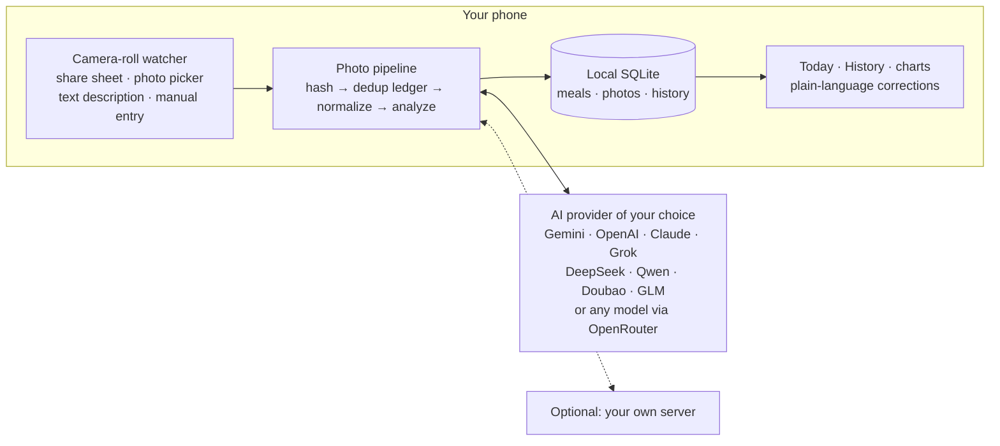
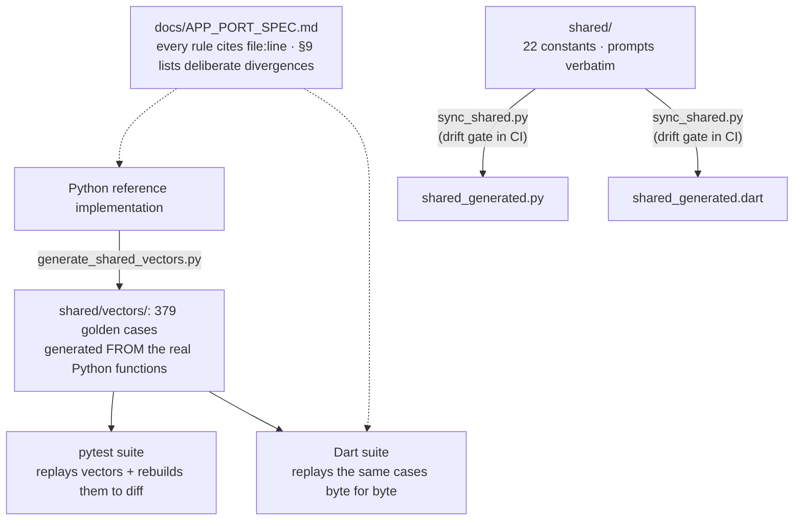

# Chopstats: Architecture & Ops Runbook

A reference for how the system fits together, why the tricky parts work the
way they do, and how to operate it. Distilled from the code; verify against
the source before relying on any specific number.

The first section covers the Flutter app and how it is kept in step with the
server. Sections 1 to 5 cover the self-hosted server, the original
CalorieTracker, which still installs under `~/CalorieTracker`.

## The app, and how it stays in step with the server

This section moved here from the README in November 2026. Its counts were
taken on `main` on 2026-11-10.



### Two implementations, kept in step

The part of this codebase most worth reviewing is how two full
implementations of the same product are kept in step: a Python server and a
Dart app, with no shared runtime code.

1. **A spec with line-number citations.** [APP_PORT_SPEC.md](APP_PORT_SPEC.md)
   extracts every behavioral rule from the production Python with `file:line`
   evidence, and §9 is a table of deliberate divergences. Each row says what
   differs, why, and which test pins it.
2. **Shared constants and prompts, generated for both runtimes.**
   [shared/](../shared/) holds 22 behavior constants (normalization size,
   dedup windows, validation bounds and more) and the prompts verbatim.
   `scripts/sync_shared.py --check` is a drift gate run in CI.
3. **379 golden vectors, replayed by both suites.** Python is the oracle. Its
   real functions generate the 8 files in [shared/vectors/](../shared/vectors/)
   (coercion of hostile model output, capture-time dating, NL normalization,
   report formulas and more), and the Dart suite must match byte for byte,
   including NaN, Infinity and expected-throw cases. Cross-language drift is a
   failing test, not a field bug.



### The order of evidence

The analysis follows a strict evidence ladder, kept in
[`shared/prompts/estimation_priority.txt`](../shared/prompts/estimation_priority.txt).
A nutrition label in the photo beats everything, including the Chinese
kJ-per-100 g conversion. Then comes a printed weight (scale sticker, package,
receipt). Then brand-published data for recognized chains and packaged goods.
Visual estimation comes last, calibrated against real-size references
(chopsticks, bowls, hands), with the assumed grams stated in every item name
so a wrong assumption can be seen and fixed.

The ladder is an instruction to the model, not a guarantee, and the app does
not show which step the model used. A developer can change it by editing that
file and running `python3 scripts/sync_shared.py`, which regenerates the
bindings for both the app and the server.

### A provider conformance matrix

[provider_feedback_matrix_test.dart](../app/test/analyzer/provider_feedback_matrix_test.dart)
tests ten analyzers (the nine key providers and the self-hosted server)
against a shared vocabulary of eight failure classes: auth, rate limit,
billing, model not found, overloaded, content filter, junk reply and daily
quota. It holds 57 fixtures, with bodies taken verbatim from provider docs or
live probes.

"Out of money" alone arrives in seven shapes: OpenAI `429 insufficient_quota`,
GLM `429` code 1113, Doubao `403 AccountOverdueError`, Qwen `400 Arrearage`,
Anthropic `400` credit balance, DeepSeek `402 Insufficient Balance` and
OpenRouter `402 Insufficient credits`. All seven map to one verdict for the
user: recharge, do not regenerate the key.

### A photo pipeline built around one identity

The md5 of a photo's original bytes drives a five-state reservation ledger:
`processing`, `saved`, `skipped`, `failed`, `deleted`.

- The pipeline reserves the hash before it analyzes, so the same photo file
  is not analyzed twice.
- The meal insert and the `saved` mark happen in one transaction.
- Tombstones keep a deleted meal from coming back on the next scan.
- There is a strict path and a deliberate path. The automated watcher never
  reclaims a failed row. A person who adds the photo again may.
- All intake is serialized through one FIFO tail, so one photo's bytes are in
  memory at a time and the app does not rate-limit itself.

Identity is byte-exact. The same picture saved again or re-compressed by
another app has different bytes and counts as a new photo.

### Capture dating with a trust boundary

A meal lands on the day its photo was taken. The app tries, in order: the
filename timestamp, the library asset date, the EXIF `DateTimeOriginal`, and
last the intake time. Every candidate passes the same validation window. A
time more than 1 hour in the future or more than 45 days old is rejected,
because EXIF is untrusted input until it passes.

This is what puts a 23:50 dinner that was shared after midnight on yesterday's
total. Meta glasses photos have an extra dating guard in
`app/lib/services/photo/capture_dating.dart`.

### Leftover arithmetic stays in code

When a photo shows the remains of a meal logged earlier that day (or, for a
photo taken before 4 a.m., the day before, once the recipient was allowed
under the consent text that says so), the model supplies fractions only. All arithmetic runs in deterministic, clamped code
against the local database. The automatic path applies a leftover only when
the model's confidence is at least 0.75. The manual Leftovers flow is the
fallback and the repair path.

### Today and History

Today compares the running total with a typical day, which is the median of
the previous 7 days, so under-logged days do not drag it down. History covers
30 days, and a day with nothing logged is shown dimmed as "no meals logged"
and does not vanish, so a broken watcher looks broken. The meal screen draws
protein, carbs and fat as shares of energy (4, 4 and 9 kcal per gram) and
updates as you edit.

### Tests and CI

Both suites run in CI on every push: more than 3,500 Dart tests and more than
2,300 Python tests on 2026-11-10. CI runs the Python suite on 3.9 and 3.10
with `ruff` and a coverage floor, the Flutter suite, the parity drift gate and
the public-safety gate. The suites are reviewed for their capacity to fail.
Several were rewritten after being caught passing while broken.

## 1. System overview

The server is a single-user pipeline that turns food photos into logged
meals and a nightly report. Three ingress paths feed one analysis-and-storage
core.

```
 Android (Termux watcher) ─┐
   upload_photo.py + sh    │  POST /upload  (X-API-Key) —
                           │  multipart or raw image body
 iOS (Shortcut)  ──────────┼──►  Flask upload API  ──►  photo-hash
   camera-close upload     │     (telegram_bot.py,      reservation ledger
                           │      port 5000)            (photo_ingestions)
 Telegram (direct photo) ──┘            │                     │
                                        ▼                     ▼
                                  Claude Code CLI   ──►  SQLite (meals.db)
                                  (opt-in, tried 1st)        │
                                   └► Gemini 2.5 Flash       │
                                      (fallback/default;     │
                                       vision + intents)     │
                                        ▲                     ▼
 Telegram (text: correct/     ────────┘             daily_report.py (23:30)
   delete/log/chat)                                  ──► Telegram + PushPlus

 meal_relay.py (localhost:8765) — legacy path: accepts pre-analyzed meal
   JSON and writes straight to meals.db (bypasses Gemini).
```

- **Entry point:** `python3 telegram_bot.py` runs two loops — a Flask API on
  `0.0.0.0:5000` (daemon thread) and the main-thread Telegram long-poll.
- **Analysis:** Claude-first when enabled, Gemini as the fallback and default.
  With `CLAUDE_ANALYZER_ENABLED=1` and the Claude Code CLI installed, photo
  analysis runs headless on a Claude subscription (`claude -p`, credential
  minted by `claude setup-token`); any failure — CLI absent, usage window
  exhausted, timeout, malformed output — falls back to Google Gemini
  (`GEMINI_MODEL`, default `gemini-3.8-flash`), requested in native-JSON mode;
  images are downscaled before the call. Text-intent parsing (corrections,
  NL commands) stays on Gemini.
- **Meal dating:** meals normally date to the user-local upload time, but a
  client may declare when the photo was *taken* (`captured_at` form field or
  `X-Captured-At` header, device-local `YYYY-MM-DD HH:MM:SS`; Android derives
  it from the camera filename, iOS sends the photo's Creation Date), so
  backfilled uploads — nightly sync, offline-queue drain — land on the capture
  day's ledger. The server validates the value: unparseable, more than an hour
  in the future, or older than `CAPTURED_AT_MAX_AGE_DAYS` (default 45) falls
  back to upload-time dating.
- **Storage:** one SQLite file, `~/CalorieTracker/meals.db` (WAL). Seven
  tables: `meals`, `heartbeats`, `photo_ingestions`, `body_weight`,
  `workouts`, `activities`, `fitness_profile`.
- **Reporting:** `daily_report.py` is a pure formatter (no LLM) fired by
  launchd/cron at ~23:30 local. Before formatting it performs an optional,
  self-guarded Garmin pull (`_sync_garmin_activity`, backed by `garmin.py`);
  `generate_report` itself stays offline.
- **Fitness:** `nutrition.py` (diet-mode/macro math), `fitness_plan.py`
  (Daniels VDOT run planning), and `garmin.py` (config-gated activity pull)
  feed the report's `_fitness_sections`.

## 2. The ledger / dedup model

Every photo, regardless of source, is deduplicated through the
`photo_ingestions` table before it can become a meal. A row is keyed by
`(chat_id, image_hash)` and moves through these states:

| Status | Meaning | Set by |
| --- | --- | --- |
| `processing` | Reserved; analysis in flight | `reserve_photo_hash` |
| `saved` | Analyzed and logged as a meal (`meal_id` set) | `mark_photo_hash_status` |
| `skipped` | Gemini said "not food" | `mark_photo_hash_status` |
| `failed` | Analysis failed; file kept for `/retry_failed` | failure paths |
| `deleted` | Tombstone — meal deleted, or failed upload cleared | `delete_meal`, `discard_failed_photo_hashes_by_prefix` |

Key rules that make dedup correct:

- **Atomic reservation.** `reserve_photo_hash` runs a `BEGIN IMMEDIATE`
  transaction: it rejects if a meal already exists for the hash, reclaims a
  stale `processing` row (older than `PHOTO_RESERVATION_STALE_SECONDS`, 6h) or
  a caller-listed reclaimable status, else inserts a fresh `processing` row.
  Concurrent reservers of the same hash yield exactly one winner.
- **Original-hash contract.** The phone may recompress a photo before upload,
  so the client declares the *original* DCIM file's md5 in an `original_hash`
  form field. That declared hash — not the recompressed bytes — becomes the
  ledger/meals key, so the nightly `--sync`/`/reconcile` (which hash originals)
  still dedup correctly. Malformed values fall back to hashing the bytes.
- **`/reconcile` suppression.** Android sends its recent photo hashes;
  `_reconcile_missing_hashes` returns only those the server has never seen —
  logged, reserved (non-stale), in-flight, or failed-and-kept hashes are all
  suppressed, so recovery never double-logs. Tombstones (`deleted`) stay
  suppressed too, so a deleted meal is not auto-resurrected.
- **Cross-source dedup reality.** The same physical meal sent via *both*
  Telegram and Android is not deduplicated by bytes — Telegram delivers its
  own recompressed rendition whose md5 can never equal the DCIM original. This
  is inherent, not a bug; in normal use each photo takes one path.

## 3. Failure-recovery design

The system assumes crashes, dead networks, and quota exhaustion happen, and
degrades without losing data.

- **Boot sweep** (`_sweep_stranded_pending_uploads`): on startup, any file
  still in the pending dir (a crash mid-analysis) is moved to the failed store
  and marked `failed` under its declared hash, recoverable via
  `/retry_failed`. Orphaned `processing` reservations with no backing file are
  released so the photo can be re-sent.
- **SIGTERM handling:** a handler turns SIGTERM into the normal
  KeyboardInterrupt shutdown so in-flight non-daemon upload threads finish
  instead of being severed.
- **Offline queue (phone):** when the server is unreachable, `upload_photo.py`
  queues the photo in `~/.offline_queue` and drains it after the next
  successful heartbeat. Permanently-rejected photos (app-origin 400/413/415)
  are quarantined in `~/.offline_queue/rejected/` instead of wedging the
  queue.
- **Gemini quota circuit breaker:** a daily free-tier quota error pauses all
  analysis for `GEMINI_DAILY_QUOTA_COOLDOWN_SECONDS` (12h), persisted to
  `service_health.json`; quota-paused photos are kept with keep/discard
  buttons rather than dropped.
- **Stale-heartbeat warning:** if the phone stops pinging for
  `HEARTBEAT_STALE_WARNING_HOURS` (2h), the bot warns you in Telegram — so a
  dead watcher surfaces instead of photos silently piling up. The cooldown
  re-arms on recovery and retries a failed send in ~15 min.
- **Daily-report catch-up:** auto mode targets the correct local date (the
  previous day on an early catch-up run) and dedupes via the health ledger, so
  a machine asleep at report time delivers the missed report on its next run.
- **Cross-process health writes:** `service_health.py` `update()` wraps every
  read-modify-write of `service_health.json` in an `flock`, so the bot and the
  cron report process cannot lose each other's records.

## 4. Configuration

Secrets and tunables live in `.env` (see [`.env.example`](../.env.example) for
the full list and defaults). The most operationally relevant:

| Var | Purpose |
| --- | --- |
| `GEMINI_API_KEY`, `GEMINI_MODEL` | Analysis model |
| `CLAUDE_ANALYZER_ENABLED` | Try Claude (via the Claude Code CLI) before Gemini for photos (default off) |
| `CLAUDE_ANALYZER_BIN`, `CLAUDE_ANALYZER_MODEL`, `CLAUDE_ANALYZER_TIMEOUT_SECONDS` | CLI binary (`claude`), optional `--model` override, per-analysis timeout (120s, clamped 10–600) |
| `TELEGRAM_BOT_TOKEN`, `TELEGRAM_CHAT_ID` | Bot + single-user allowlist |
| `ANDROID_API_KEY` | Upload API key (phones must match) |
| `MEAL_RELAY_HOST`, `MEAL_RELAY_API_KEY` | Legacy relay bind/key |
| `HEARTBEAT_STALE_WARNING_HOURS` | Phone-offline warning threshold (2h; 0 off) |
| `TRUSTED_PROXY_ENABLED` | Honor `X-Forwarded-For` (default off) |
| `MAX_API_UPLOAD_BYTES` | Upload size cap (25 MB) |
| `CAPTURED_AT_MAX_AGE_DAYS` | Oldest client-declared capture date honored (45 days; older dates fall back to upload-time dating) |
| `GARMIN_ENABLED` | Turn on the daily Garmin activity pull (default off) |
| `GARMIN_TOKEN_DIR` | Pre-minted token directory — token-only auth, minted off-server |
| `GARMIN_NET_USE_TOTAL` | Net calories against Garmin's whole-day total instead of active-only |

Phone-side knobs (`PING_INTERVAL_SECONDS`, `SEED_FRESH_MINUTES`,
`CALORIE_RECOMPRESS_MAX_EDGE`, `CAMERA_DIR`, `SYNC_LOOKBACK_DAYS`, …) are
documented in [SERVER.md](SERVER.md#android), under Mobile Uploads.

## 5. Ops runbook

**Deploy the server (GCP VM).**
1. `git pull` the branch on the VM.
2. Restart the service: `sudo systemctl restart caloriebot.service`
   (unit name overridable via `CALORIE_BOT_SERVICE_NAME`).
3. Confirm: `sudo systemctl status caloriebot.service`, then `/status` in
   Telegram.

**Update the phone (Android).**
1. `adb push android/upload_photo.py android/android_watcher.sh android/install_and_start.sh /sdcard/Download/`
   and `adb push android/shortcuts /sdcard/Download/shortcuts`.
2. Tap the 🔁 update widget (or `bash /sdcard/Download/install_and_start.sh`
   in Termux). The installer syntax-checks the payload before stopping the
   running watcher, so a truncated push cannot leave the phone watcher-less.
   It also plants a Termux:Boot auto-start script
   (`~/.termux/boot/start-calorie-tracker.sh`) so the watcher restarts after a
   phone reboot — requires the Termux:Boot app installed and opened once.
3. Optional: `pip install pillow` in Termux to enable pre-upload recompression.

**Rotate the Telegram bot token.**
1. `/revoke` then `/token` with @BotFather to mint a new token.
2. Update `TELEGRAM_BOT_TOKEN` in the VM's `.env` and restart the service.
3. The old token exists in early git history — rotation is required before any
   public publish (see [SECURITY.md](../SECURITY.md)).

**Check health.**
- `/status` — heartbeat age, Gemini state, upload queue depth, last report.
- `/doctor`, `/gemini`, `/vpn`, `/report_status` — targeted diagnostics.
- `logs/service_health.json` — the raw ledger (Gemini events, quota pause,
  VPN evidence, daily-report outcomes).

**Common failures.**

| Symptom | Likely cause / fix |
| --- | --- |
| No daily report | Machine asleep at 23:30 (catches up next run), or `TELEGRAM_CHAT_ID` non-numeric. Check `/report_status`. |
| Photos not arriving | Watcher dead or phone offline — the bot warns after 2h; check `~/watcher.log` and `/android`. |
| Photos taken during a watcher outage | Recovered automatically: the watcher runs a catch-up `--sync` 30s after every start (with Termux:Boot, right after reboot) plus the nightly 23:00 sync. The window is `SYNC_LOOKBACK_DAYS` (default 2, up to 30 for long outages). |
| "Gemini paused" replies | Daily free-tier quota hit; 12h circuit breaker. Kept photos recover via `/retry_failed` after it clears. |
| Uploads rejected on cellular | Carrier blocks port 5000 — clients try port 80 first (needs the VM's 80→5000 redirect, not in the repo). |
| Duplicate meals | Should not happen via one path; if seen, check `photo_ingestions` for a missing/`deleted` row and the reconcile suppression.
