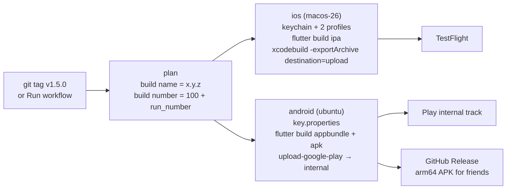

# Releasing BiteWise · 筷拍

How the app gets from a git tag to TestFlight / the App Store and to Google
Play, and everything the owner has to do once by hand before that works.
Written 2026-10-10 against Flutter 3.44.2, Xcode 26.2 and the GitHub
`macos-26` / `ubuntu-24.04` runner images; the store consoles move around, so
treat exact menu names as "as of this writing".

| Piece | What it does | Secrets |
|---|---|---|
| [`.github/workflows/mobile-build.yml`](../.github/workflows/mobile-build.yml) | On every PR and push to `main`, `loop/**`, `feat/**`, `fix/**` (docs-only changes skipped): compiles the iOS project unsigned (Runner **and** ShareExtension) on macOS and the Android app bundle on Ubuntu. Passes today, before any enrolment. | none |
| [`.github/workflows/release.yml`](../.github/workflows/release.yml) | On a `v*` tag or **Actions → Release → Run workflow**: signed IPA → TestFlight, signed AAB → Play internal track, arm64 APK → GitHub Release. Lanes whose secrets are missing are skipped with a warning naming them. | listed in [§ 3](#3-github-secrets-and-variables) |
| [`.github/workflows/python-tests.yml`](../.github/workflows/python-tests.yml) | The existing server + Flutter test CI. Unchanged. | none |
| [`app/ios/ExportOptions.plist`](../app/ios/ExportOptions.plist) | Manual-signing export options naming a profile for **both** bundle ids. CI overwrites the team id and profile names with what it reads from the secrets. | |
| [`app/android/app/build.gradle.kts`](../app/android/app/build.gradle.kts) | Signs the release build with the upload key when `app/android/key.properties` exists, otherwise with the debug key plus a warning. | |
| [`app/android/whatsnew/`](../app/android/whatsnew/) | Play "What's new" text per locale, sent with every upload. | |



Identifiers that must match everywhere:

| | Value |
|---|---|
| iOS app bundle id | `dev.calorietracker.calorieTracker` |
| iOS share-extension bundle id | `dev.calorietracker.calorieTracker.ShareExtension` |
| App Group (both targets) | `group.dev.calorietracker.calorieTracker` |
| Apple team in `Runner.xcodeproj` today | `WLQB3YB22M` (a **free** personal team, see § 1.2) |
| Android package / application id | `dev.calorietracker.calorie_tracker` (permanent after the first Play upload) |
| Display name | `Bitewise` (Info.plist `CFBundleDisplayName`); store name `BiteWise · 筷拍` |
| Version | `app/pubspec.yaml` `version: 1.5.0+7` → `CFBundleShortVersionString` / `versionName` = `1.5.0`; the build number is stamped by CI (§ 5) |

---

## 1. Apple: one-time setup

### 1.1 Enrol in the Apple Developer Program

The team `WLQB3YB22M` in the project is a free personal team: 7-day
profiles, no TestFlight, no App Store, no App Store Connect API. Nothing in
this document works until the same Apple Account is enrolled:

1. <https://developer.apple.com/programs/enroll/> → Individual. Needs
   two-factor authentication on the Apple Account and your legal name.
   US$99 per membership year; activation can take up to 48 h.
2. Once active, open Xcode → Settings → Accounts; the team should now read
   *"(Individual)"* instead of *"(Personal Team)"*.

### 1.2 Check the Team ID (keychain continuity)

An individual who upgrades the same Apple Account normally keeps the same
Team ID. Verify it in <https://developer.apple.com/account> → Membership
details. **If it changed**, update `teamID` in `app/ios/ExportOptions.plist`
and `DEVELOPMENT_TEAM` in `app/ios/Runner.xcodeproj/project.pbxproj` (every
occurrence, Runner and ShareExtension), and expect this on the phone:
`flutter_secure_storage` items live in the keychain access group
`<TeamID>.dev.calorietracker.calorieTracker`, so a build from a new team
cannot read the API/upload keys saved by today's dev build. The TestFlight
build would start with empty key fields; paste them once. Either way, never
install a build older than commit `9df6846` on the owner's iPhone again (the
keychain migration is one-way).

### 1.3 Identifiers: two App IDs and the App Group

<https://developer.apple.com/account/resources/identifiers/list>

1. **App Group**: Identifiers → + → App Groups → identifier
   `group.dev.calorietracker.calorieTracker`, description "BiteWise".
2. **App ID** `dev.calorietracker.calorieTracker` (explicit, type App):
   Capabilities → tick **App Groups** → Configure → select the group above.
   Also tick nothing else; background fetch needs no capability.
3. **App ID** `dev.calorietracker.calorieTracker.ShareExtension`
   (explicit): the same App Groups capability bound to the same group.

Both entitlement files in the repo already ask for the group; if an App ID
lacks the capability the archive step passes but App Store Connect rejects
the upload with ITMS-90078 (see § 9).

### 1.4 The app record in App Store Connect

<https://appstoreconnect.apple.com> → My Apps → + → New App:

- Platform iOS; Name `BiteWise · 筷拍` (30 chars max; the name is global,
  pick another if taken); Primary language `Chinese (Simplified)` (the
  owner's audience) or English; Bundle ID `dev.calorietracker.calorieTracker`;
  SKU `bitewise-ios`; User Access: Full.
- Note the app's numeric **Apple ID** (App Information → General). It is
  only needed for the altool fallback (variable `ASC_APP_APPLE_ID`).

### 1.5 App Store Connect API key (for uploads from CI)

Users and Access → Integrations → App Store Connect API → **Team Keys**
(the Account Holder must first click *Request Access* once):

1. Generate API Key → Name `bitewise-ci`, Access **App Manager** (enough to
   upload builds; this lane never creates certificates or profiles through
   the API — those are made by hand in § 1.6; only cloud signing would need
   Admin).
2. Download `AuthKey_<KEYID>.p8` — **Apple offers the download exactly
   once.** Note the **Key ID** (10 chars) and the **Issuer ID** (UUID shown
   at the top of the page).
3. Turn them into secrets (§ 3): `ASC_KEY_ID`, `ASC_ISSUER_ID`,
   `ASC_API_KEY_P8_BASE64`.

### 1.6 Certificate and the two provisioning profiles

The lane signs manually: one Apple Distribution certificate (valid one year,
shared by both targets) and one App Store profile per bundle id. Do this on
the owner's Mac; the private key never leaves it except inside the encrypted
`.p12` that becomes a secret.

1. **Certificate signing request**: Keychain Access → Certificate Assistant
   → Request a Certificate From a Certificate Authority → your email, common
   name "BiteWise Distribution", *Saved to disk* → `BiteWise.certSigningRequest`.
2. **Apple Distribution certificate**: Certificates, Identifiers & Profiles
   → Certificates → + → *Apple Distribution* → upload the CSR → Download
   `distribution.cer` → double-click to import into the login keychain.
   (Only the Account Holder/Admin can create it; a team may hold at most a
   couple at a time, so reuse rather than re-create.)
3. **Export the .p12**: Keychain Access → My Certificates → expand *Apple
   Distribution: <name>* so the private key shows → select **both** rows →
   right-click → Export 2 items → format `.p12` → choose a strong password
   (that password becomes `IOS_DIST_P12_PASSWORD`). A `.p12` exported from
   the certificate row alone has no private key and the workflow stops at
   "expected exactly one valid 'Apple Distribution' identity".
4. **Profiles**: Profiles → + → Distribution → *App Store Connect* → App ID
   `dev.calorietracker.calorieTracker` → the certificate from step 2 → name
   `BiteWise AppStore` → Generate → Download. Repeat for the ShareExtension
   App ID with the name `BiteWise ShareExtension AppStore`. The names are
   free text: the workflow reads the real names out of the files.
5. Secrets (§ 3): `IOS_DIST_P12_BASE64`, `IOS_DIST_P12_PASSWORD`,
   `IOS_PROFILE_RUNNER_BASE64`, `IOS_PROFILE_SHAREEXT_BASE64`.
6. Delete the exported `.p12`, `.cer`, `.mobileprovision` and `.p8` from
   Downloads afterwards (the root `.gitignore` also refuses to track them).

Calendar note: the certificate and both profiles expire after one year; the
workflow checks the certificate's and both profiles' expiry dates up front
and names the one to renew.

### 1.7 Code prerequisites before the first upload

Done in this change:

- `ITSAppUsesNonExemptEncryption = false` in `app/ios/Runner/Info.plist`
  (the app only uses OS TLS, the keychain and SHA hashing, which are exempt;
  without the key every build sits in "Missing Compliance" until answered).
- `app/pubspec.yaml` bumped to `1.5.0+7`; the ShareExtension already takes
  its version from `$(FLUTTER_BUILD_NAME)` / `$(FLUTTER_BUILD_NUMBER)`.

Still to do in code (each needs an Xcode project edit, i.e. a normal PR):

1. **Privacy manifests.** Neither target has a `PrivacyInfo.xcprivacy`;
   the share extension compiles `receive_sharing_intent`'s
   `UserDefaults(suiteName:)` call (a required-reason API) into its own
   executable. In Xcode: File → New → File → *App Privacy* → name
   `PrivacyInfo.xcprivacy`, target **ShareExtension**; repeat for
   **Runner**. Content for both (adjust `NSPrivacyCollectedDataTypes` to
   whatever § 4.3 ends up declaring):

   ```xml
   <?xml version="1.0" encoding="UTF-8"?>
   <!DOCTYPE plist PUBLIC "-//Apple//DTD PLIST 1.0//EN" "http://www.apple.com/DTDs/PropertyList-1.0.dtd">
   <plist version="1.0">
   <dict>
     <key>NSPrivacyTracking</key><false/>
     <key>NSPrivacyTrackingDomains</key><array/>
     <key>NSPrivacyCollectedDataTypes</key><array/>
     <key>NSPrivacyAccessedAPITypes</key>
     <array>
       <dict>
         <key>NSPrivacyAccessedAPIType</key>
         <string>NSPrivacyAccessedAPICategoryUserDefaults</string>
         <key>NSPrivacyAccessedAPITypeReasons</key>
         <array><string>CA92.1</string><string>1C8F.1</string></array>
       </dict>
     </array>
   </dict>
   </plist>
   ```

   If App Store Connect still emails *ITMS-91053 Missing API declaration*
   naming `receive_sharing_intent.framework`, the plugin itself needs a
   manifest: fork it under `app/packages/` with the file added, or wait for
   upstream. Flutter and the other plugins already ship theirs.
2. **iPad.** Both targets have `TARGETED_DEVICE_FAMILY = "1,2"`, so the
   listing requires 13-inch iPad screenshots and reviewers test on an iPad.
   The UI is phone-only; the simplest fix is `TARGETED_DEVICE_FAMILY = 1`
   on Runner and ShareExtension (project.pbxproj) before the first upload.
3. **Privacy policy URL** (guideline 5.1.1). Nothing exists yet. Publish
   `docs/PRIVACY.md` (what stays on the phone, that the single photo being
   analysed goes to the provider the user chose with the user's own key or
   to a server the user runs, that the developer operates no backend and
   collects nothing) and use its GitHub URL, or enable GitHub Pages.
4. **In-app disclosure** (guideline 5.1.2(i), "clearly disclose where
   personal data will be shared with third parties, including with
   third-party AI, and obtain explicit permission"). The provider picker +
   key entry is arguably that consent; a one-time sentence before the first
   upload ("Photos you log are sent to <provider> for analysis") with an OK
   button is the safe reading. A fixer task, not release engineering.

---

## 2. First-upload shortcut: Xcode on the Mac (no CI)

If you want a build in TestFlight the same day you enrol, before any secret
exists: `cd app && flutter build ios --release --config-only`, open
`app/ios/Runner.xcworkspace`, select *Any iOS Device*, Product → Archive,
then Organizer → Distribute App → App Store Connect → Upload with automatic
signing (Xcode creates the certificate and profiles for the paid team by
itself). Everything in § 1.3–1.4 must exist first. The CI lane is for every
build after that.

---

## 3. GitHub secrets and variables

Repository → Settings → Secrets and variables → Actions. Create the secrets
either at the repository level or inside the environment named `release`
(GitHub creates it on the first run; Settings → Environments → release →
*Required reviewers* = you turns every store upload into a click-to-approve).

Make each base64 value on the Mac and paste it **only** into the GitHub
secret field:

```bash
base64 -i ~/Downloads/BiteWise-dist.p12 | pbcopy        # then ⌘V into the secret
```

or, without the clipboard, straight from the file with the GitHub CLI:

```bash
gh secret set IOS_DIST_P12_BASE64 --repo AkiyamaKunka/BiteWise < <(base64 -i ~/Downloads/BiteWise-dist.p12)
gh secret set PLAY_SERVICE_ACCOUNT_JSON --repo AkiyamaKunka/BiteWise < ~/Downloads/play-service-account.json
```

Never put a value in a chat, a commit, an issue, a `.env` checked into git,
or a terminal history line (`gh secret set NAME` with no redirection prompts
for the value instead).

| Secret | Contents | Made by | Expires |
|---|---|---|---|
| `IOS_DIST_P12_BASE64` | Apple Distribution certificate **with private key**, `.p12`, base64 | § 1.6 step 3 | 1 year |
| `IOS_DIST_P12_PASSWORD` | the `.p12` export password | § 1.6 step 3 | with the p12 |
| `IOS_PROFILE_RUNNER_BASE64` | App Store profile for `dev.calorietracker.calorieTracker`, base64 of the `.mobileprovision` | § 1.6 step 4 | 1 year |
| `IOS_PROFILE_SHAREEXT_BASE64` | App Store profile for `…calorieTracker.ShareExtension`, base64 | § 1.6 step 4 | 1 year |
| `ASC_KEY_ID` | App Store Connect API Key ID | § 1.5 | until revoked |
| `ASC_ISSUER_ID` | App Store Connect Issuer ID | § 1.5 | until revoked |
| `ASC_API_KEY_P8_BASE64` | base64 of `AuthKey_<KEYID>.p8` | § 1.5 | until revoked |
| `ANDROID_UPLOAD_KEYSTORE_BASE64` | base64 of `upload-keystore.jks` | § 6.2 | ~27 years |
| `ANDROID_KEYSTORE_PASSWORD` | keystore password | § 6.2 | |
| `ANDROID_KEY_PASSWORD` | key password (same as the store password when made with the command in § 6.2) | § 6.2 | |
| `PLAY_SERVICE_ACCOUNT_JSON` | the service account's JSON key, whole file | § 6.4 | until rotated |

| Variable (plain text, optional) | Meaning | Default |
|---|---|---|
| `ANDROID_KEY_ALIAS` | alias inside the keystore | `upload` |
| `ASC_APP_APPLE_ID` | the app's numeric Apple ID (§ 1.4) | unset; only the altool fallback reads it |

What the workflow does with them: the `.p12` goes into a throw-away
keychain with a random password, the profiles are installed under their
UUIDs and checked for bundle id, team and expiry, the `.p8` is written to a
`chmod 600` file, `key.properties` + the `.jks` are written into
`app/android/` (git-ignored) — and all of it is deleted in an `always()`
step. No value is ever echoed; GitHub additionally masks them.

---

## 4. The first TestFlight build and App Review

### 4.1 Run it

Actions → **Release** → Run workflow → branch `main` → lane `testflight` →
leave *internal-only* ticked → Run. Watch the `ios` job:

- "installed profile '…' for WLQB3YB22M.dev.calorietracker.calorieTracker"
  twice, "Release configs now sign manually with team …".
- `flutter build ipa` prints the archive and `Built IPA to build/ios/ipa`.
- "Runner.app: Apple Distribution, app group present, 1.5.0 (1xx)" and the
  same for `ShareExtension.appex`.
- The upload step ends with `EXPORT SUCCEEDED`; App Store Connect emails
  "The following build has completed processing" a few minutes later.

The build shows under TestFlight → iOS builds with a *Internal Testing Only*
badge; it cannot be sent to external testers or App Review (that is the
`testFlightInternalTestingOnly` export option, set for every non-tag run).
A tag run (`git tag v1.5.0 && git push origin v1.5.0`) produces an
external-eligible build.

### 4.2 Internal testers → the owner's iPhone

TestFlight → Internal Testing → + group "Owner" → add your own App Store
Connect user → tick *Enable automatic distribution*. Install TestFlight on
the iPhone, accept the invite, install. First things to check on the
phone (see § 1.2): Settings shows the saved provider keys and the server
URL (if not, paste them once); the 后台扫描 row keeps advancing with the
phone locked; the share sheet still offers Bitewise.

### 4.3 App Privacy (nutrition labels) and the BYO-key model

App Store Connect → App Privacy. Apple's definition of *collect* is
"transmitting data off the device in a way that allows you and/or your
third-party partners to access it for longer than needed to service the
request". BiteWise has no developer backend: the single photo being
analysed goes to the AI provider **the user chose with the user's own key**,
or to a server the user runs. The strictly defensible answer is therefore
*Data Not Collected*; the conservative answer, which reviewers rarely push
back on, is to declare what leaves the device:

| Data type | Collected? | Linked to the user | Used for tracking | Purpose |
|---|---|---|---|---|
| Photos or Videos | Yes (sent to the user-selected AI provider for analysis; not retained by the developer) | No | No | App Functionality |
| Health & Fitness → Health, Fitness (calories, weight, meal logs) | Yes (only when the user points the app at a server they run) | No | No | App Functionality |
| Everything else (contacts, location, identifiers, diagnostics, usage) | No | | | |

Pick one answer and keep the privacy policy (§ 1.7.3) and the
`NSPrivacyCollectedDataTypes` arrays consistent with it.

### 4.4 Review submission checklist

- **Metadata**: name, subtitle (30), promotional text, description,
  keywords (100), support URL (the GitHub repo is fine), marketing URL
  (optional), **privacy policy URL** (required), category Health & Fitness,
  copyright, contact information for the reviewer.
- **Screenshots**: App Store Connect → Screenshot specifications has the
  current list. As of this writing: iPhone 6.9-inch (1320×2868 or 1290×2796
  portrait) is required; 6.5-inch (1284×2778 or 1242×2688) optional; if iPad
  stays enabled (§ 1.7.2) iPad 13-inch (2064×2752 or 2048×2732) is required
  too. Take them from the iPhone 17 Pro simulator (`xcrun simctl io booted
  screenshot`), both languages if you localise the listing.
- **App icon**: the 1024×1024 asset is already in `Runner/Assets.xcassets`
  (`flutter_launcher_icons`, alpha removed).
- **Age rating**: fill the questionnaire; nothing applies → 4+.
- **Export compliance**: answered by `ITSAppUsesNonExemptEncryption=false`;
  the version page asks nothing. (Apple notes exempt apps may still owe a
  yearly self-classification report to the US government; see Apple's
  "Complying with Encryption Export Regulations".)
- **Content rights**: no third-party content.
- **App Review Information → Sign-in**: not required. **Notes** (draft,
  edit to taste):

  > BiteWise is a bring-your-own-key calorie tracker. It has no accounts and
  > no backend of ours. The user pastes an API key for the AI provider they
  > already pay for (Google Gemini, OpenAI, Anthropic, DeepSeek, xAI,
  > OpenRouter, Alibaba Qwen, ByteDance Doubao, Zhipu GLM), or points the app
  > at a server they run themselves; that provider receives the single photo
  > being analysed and returns a nutrition estimate. Everything else stays
  > on the phone in a local database.
  >
  > To test: Settings → AI provider → Gemini → paste the key below → back
  > to Today → the + button → choose a food photo (or share one from Photos
  > into Bitewise). "Watch camera roll" asks for Photos access and then logs
  > new food photos by itself; it can take up to a minute for a meal to
  > appear. Demo key (Gemini, low quota, revoked after review): <key>

  Create a dedicated low-quota key for this, paste it **only** into that
  field, revoke it after approval.
- **Pricing and Availability**: Free; availability → deselect *China
  mainland* unless you hold an ICP filing (§ 7).
- **Version release**: *Manually release this version* for the first one.
- Submit. First external TestFlight build and first App Store submission
  each go through review (TestFlight's Beta App Review is lighter;
  subsequent TestFlight builds usually skip it).

---

## 5. Versioning rules

- `app/pubspec.yaml` `version: X.Y.Z+N` is the single source of the
  marketing version: Flutter maps `X.Y.Z` to `CFBundleShortVersionString`
  (iOS, both targets via `$(FLUTTER_BUILD_NAME)`) and `versionName`
  (Android). Bump it in the PR that ships the change, then tag that commit
  `vX.Y.Z`; `release.yml` refuses a tag whose `X.Y.Z` differs from pubspec.
- The **build number** (`CFBundleVersion` / `versionCode`) is stamped by CI:
  `100 + github.run_number` of the Release workflow, or `N` when the tag is
  written `vX.Y.Z+N`. App Store Connect wants it strictly increasing within
  a version, Play wants it unique forever; `run_number` only grows and the
  `+100` keeps CI above the hand-built era. Never lower
  `BUILD_NUMBER_OFFSET` in `release.yml`. Hand builds on the Mac use the `+N`
  from pubspec (currently 7); keep those below 100.
- A tag may be pushed again only after deleting it on both sides; prefer a
  patch bump instead.
- Friends' sideloaded APKs: Android upgrades when `versionCode` grows **and**
  the signing key matches. Every APK before this lane was debug-signed, so
  the first upload-key APK needs an uninstall first (the GitHub Release notes
  say so); after that, upgrades are in place. Whether the GitHub APK and the
  Play build share a key is decided once, in § 6.3.

---

## 6. Google Play mirror

### 6.1 Account and app record

<https://play.google.com/console> → create a developer account (US$25 once;
identity verification; a personal account created after 13 Nov 2023 must
run a closed test with ≥12 testers opted in for 14 continuous days before
Production is unlocked — the **internal** track, which the friends would use,
has no such rule). Create app → name `BiteWise · 筷拍`, default language,
App/Free → the package name is taken from the first upload and is permanent:
`dev.calorietracker.calorie_tracker`.

### 6.2 Upload keystore and `key.properties`

```bash
keytool -genkey -v -keystore ~/upload-keystore.jks -keyalg RSA -storetype JKS \
        -keysize 2048 -validity 10000 -alias upload
```

Answer the prompts (the key password defaults to the store password; keep
them equal). Password characters: `$`, backticks, quotes, spaces and `=`
are all fine — the workflow writes `key.properties` with `printf`, not a
shell heredoc, and checks both passwords with `keytool` before building.
Avoid a leading space (Java drops it), and a backslash must be written
doubled (`\\`) in a hand-written `key.properties`, because that is a Java
properties file (the workflow doubles it for you). Back the `.jks` up
somewhere that is not this repo (the root `.gitignore` refuses `*.jks`,
`*.keystore`, `key.properties`).

For a local release build create `app/android/key.properties`:

```properties
storeFile=/Users/<you>/upload-keystore.jks   # absolute, or relative to app/android/
storePassword=…
keyPassword=…
keyAlias=upload
```

`app/android/app/build.gradle.kts` picks it up automatically; without the
file it warns and uses the debug key (so `scripts/build_share_apk.sh` and
contributors keep working). Secrets (§ 3): `ANDROID_UPLOAD_KEYSTORE_BASE64`
(`base64 -i ~/upload-keystore.jks | pbcopy`), `ANDROID_KEYSTORE_PASSWORD`,
`ANDROID_KEY_PASSWORD`; variable `ANDROID_KEY_ALIAS` only if you did not use
`upload`.

### 6.3 First upload is manual; Play App Signing

The Play Developer API cannot create the very first release, and the
`upload-google-play` action documents the same ("upload an apk or aab
manually first"). Build it on the Mac with `key.properties` in place:

```bash
cd app && JAVA_HOME=/opt/homebrew/opt/openjdk@17 flutter build appbundle --release
# → build/app/outputs/bundle/release/app-release.aab, versionCode 7 from pubspec
```

Play Console → Test and release → Internal testing → Create new release.
Before the first upload the page asks how to set up **Play App Signing**;
the choice is permanent for this package name, so decide first:

- **Recommended here: "Use a different key" → "Export and upload a key
  from Java keystore".** The console shows the exact `java -jar pepk.jar
  --keystore=… --alias=upload --output=… --include-cert --rsa-aes-encryption
  --encryption-key-path=…` command; run it on the Mac against
  `~/upload-keystore.jks` and upload the encrypted zip it produces. Your
  upload key is then also the app signing key, so an APK from a GitHub
  Release and the build Google serves from Play carry the **same**
  signature: a friend can move between the two with a plain install. Keep
  the `.jks` backed up regardless (Play can reset a lost *upload* key, but
  every install is bound to this signing key).
- **Google's default ("Use a Google-generated key")** keeps your `.jks` as
  the *upload* key only; Google re-signs every APK it serves with its own
  key. Simpler, but the GitHub-Release APK and the Play build then have
  **different** signatures, and moving from one to the other needs an
  uninstall (export the log first). Pick this only if the sideload channel
  is going away.

Either way: upload the `.aab`, add testers (email list or a link), save,
roll out.

### 6.4 Service account → `PLAY_SERVICE_ACCOUNT_JSON`

1. <https://console.cloud.google.com> → new project `bitewise-play` → APIs
   & Services → Library → enable **Google Play Android Developer API**.
2. IAM & Admin → Service Accounts → Create (`play-publisher`), grant it
   **no** project roles → Keys → Add key → JSON → the file downloads once.
3. Play Console → Users and permissions → Invite new users → the service
   account's email → App permissions → BiteWise → **Release apps to testing
   tracks** (add *Release to production, exclude devices, and use Play App
   Signing* later, once § 6.1's closed-test rule is satisfied) → Invite.
   Permissions can take a while to propagate; a `403 The caller does not
   have permission` on the first CI run usually means "wait an hour".
4. `gh secret set PLAY_SERVICE_ACCOUNT_JSON --repo AkiyamaKunka/BiteWise < ~/Downloads/<file>.json`,
   then delete the download.

From then on every tag / `play` lane run creates a completed internal-track
release with the `.aab`, the R8 `mapping.txt` and the text from
`app/android/whatsnew/whatsnew-<locale>` (≤500 chars; edit before tagging).
Play adds an informational "you've not uploaded debug symbols" note on
every upload; § 9 says why and how to change that.

### 6.5 App content declarations (Policy → App content)

- **Privacy policy**: the same URL as § 1.7.3.
- **App access**: "All or some functionality is restricted" → instructions
  for the reviewer identical to § 4.4's notes, including a demo key.
- **Ads**: no. **Content rating**: questionnaire → Utility/Health. **Target
  audience**: 18 and over is the simplest truthful answer (keeps the app out
  of the Families policy); **News app**: no; **Government app**: no.
- **Data safety**: mirror § 4.3 — photos and health data are *shared* with
  the AI provider the user selects (purpose App functionality, processed
  ephemerally, not stored by the developer); nothing is collected by the
  developer; data is encrypted in transit; users can delete everything by
  uninstalling (no account). Declare the local database as on-device only.
- **Photo and video permissions**: the manifest declares
  `READ_MEDIA_IMAGES` and `READ_MEDIA_VISUAL_USER_SELECTED` because the core
  feature is watching the camera roll for new food photos; Play requires
  this declaration for broad photo access (apps that only pick single photos
  must use the photo picker instead). Describe the camera-roll watcher as the
  core functionality.
- **Advertising ID**: not used.

### 6.6 Testers and the friends

Internal testing holds up to 100 testers by email list, no review, instant.
The existing APK channel (WeChat) keeps working through the GitHub Release
the `github-release` job creates on every tag; the signature change means
one uninstall for people on pre-1.5.0 builds (§ 5). Whether a friend can
later move between the GitHub APK and the Play build without another
uninstall depends on the Play App Signing choice in § 6.3: same key → plain
install; Google-generated key → uninstall first (export the log). The
GitHub release notes warn about it either way.

---

## 7. China mainland

- **App Store**: since 2023 Apple requires a valid ICP filing number for
  apps on the China mainland storefront; filings need a China-based entity
  or host, which a US individual cannot obtain. Pricing and Availability →
  App Availability → Manage → deselect **China mainland** → Next → confirm
  before the first submission (choosing "All countries" selects it). The app
  itself is unaffected: a mainland user with a non-China Apple ID installs
  normally, and the Qwen / Doubao / GLM providers work without a VPN.
- **Google Play** is not available in mainland China at all; the friends
  there stay on the GitHub Release APK (§ 6.6).

---

## 8. Running a release (cheat sheet)

```bash
# 1. in the shipping PR: app/pubspec.yaml  version: 1.5.1+8   (the +N is for hand builds only)
# 2. edit app/android/whatsnew/whatsnew-*.{en-US,zh-CN}
# 3. merge to main, then
git tag v1.5.1 && git push origin v1.5.1     # iOS + Android lanes, external-eligible TestFlight build, GitHub Release
# or: Actions → Release → Run workflow → lane testflight | play | both (internal-only TestFlight build)
```

Artifacts kept 90 days on the run page: the IPA + dSYMs + Dart symbols
(`flutter symbolize -d app.ios-arm64.symbols` for crash reports), the AAB
with its own R8 mapping as `aab-mapping.txt` (the one Play received), the
two APKs with theirs as `mapping.txt`, the Android Dart symbols.

---

## 9. Troubleshooting

**Workflow says "lane skipped: GitHub secret(s) not configured: …"** — that
is the intended behaviour until § 3 is done; the names listed are the ones
to add.

**"expected exactly one valid 'Apple Distribution' identity"** — the `.p12`
was exported without its private key, or the password secret is wrong
(`security import` fails earlier in that case). Re-export both rows (§ 1.6
step 3). Two identities = an old certificate is still in the keychain you
exported from; export only the current one. Zero with a valid, unexpired
certificate = the WWDR intermediate that issued it is missing; the step
imports Apple's `AppleWWDRCAG3`…`G8` into its keychain first, so look for a
failed download in the log just above the error.

**"the Apple Distribution certificate in IOS_DIST_P12_BASE64 expired on …"**
— the yearly chore in § 10: new certificate, new `.p12`, both profiles
regenerated against it, the four `IOS_*` secrets updated.

**"profile '…' is for TEAM.bundle, expected …"** — the two profile secrets
are swapped, or a profile was made for the wrong App ID.

**"profile '…' expired"** — regenerate it in Certificates, Identifiers &
Profiles (same certificate), download, re-encode the secret.

**`No profiles for 'dev.calorietracker.calorieTracker.ShareExtension' were
found` / `Provisioning profile doesn't include signing certificate`** — the
profile was generated before the current certificate; regenerate it.

**ITMS-90078 "missing entitlement com.apple.security.application-groups"**
— the App ID lacks the App Groups capability, or the profile predates
enabling it. Fix the App ID, regenerate the profile. (The workflow's
"Verify signature, entitlements and versions" step catches this before the
upload.)

**ITMS-91053 "Missing API declaration"** — § 1.7.1.

**"Missing Compliance" in TestFlight** — `ITSAppUsesNonExemptEncryption` is
gone from `Runner/Info.plist`.

**Upload step fails (xcodebuild -exportArchive destination=upload)** — read
the error: an authentication error means the key is wrong, revoked or has
too low a role (App Manager is enough for uploads); a "bundle id / app
record" error means § 1.4 was skipped. To try the other transport set
`IOS_UPLOAD_TRANSPORT: altool` in `release.yml`. Known altool quirks on
Xcode 26: it may upload to the wrong app when the account has several
bundle ids (set the `ASC_APP_APPLE_ID` variable; the workflow passes
`--apple-id`), it has reported success with exit code 0 on failure (the
workflow greps its output for `ERROR`), and one report of a spurious 409
"bundle identifier cannot be changed" went away with the xcodebuild
transport.

**"This bundle is invalid. The value for key CFBundleVersion must contain a
higher value"** — a build number was reused. Tag as `vX.Y.Z+N` with a
higher N once, or raise `BUILD_NUMBER_OFFSET`; never lower it.

**"Xcode 26.2 is not on this runner image"** (warning) — GitHub removed that
patch release; the build used the default. Set `XCODE_VERSION` in both
workflows to the version now on the image (or `""`), and consider updating
the Mac to match.

**"fastlane is not on this runner image"** — the macos-26 image lists
Fastlane 2.238; if it disappears add `sudo gem install fastlane --no-document`
before the "Point the Release configuration…" step.

**Flutter "version solving failed" on CI** — four places name the Flutter
version: `flutter --version` on the Mac, `FLUTTER_VERSION` in
`mobile-build.yml`, `FLUTTER_VERSION` in `release.yml`, and
`python-tests.yml`. Keep the first three equal (the pin moved on the Mac but
not in the workflows, or vice versa). `python-tests.yml` deliberately floats
on channel `stable` with no pin: it is the early warning that the next
stable breaks `flutter analyze` / `flutter test` before the pin is moved, so
a failure there alone means "the newest stable", not a mismatch.

**Android: "app-release.aab is signed with the DEBUG key"** — the keystore
step did not run (secrets missing) or `key.properties` was not written next
to `app/android/`; locally, check the file path and the `storeFile` value.

**"ANDROID_KEYSTORE_PASSWORD does not open the keystore" / "ANDROID_KEY_PASSWORD
does not unlock key"** — the secret holds the wrong password, or the alias
is not `upload` (set the `ANDROID_KEY_ALIAS` variable). On the Mac,
`keytool -list -keystore ~/upload-keystore.jks -alias upload` reproduces
the first one.

**Play: "The Android App Bundle was signed with the wrong key"** — the
keystore in `ANDROID_UPLOAD_KEYSTORE_BASE64` is not the one used for the
first upload. Either re-encode the right `.jks`, or Play Console → Setup →
App signing → *Request upload key reset* with the new certificate.

**Play: "Version code N has already been used"** — see the CFBundleVersion
entry above; the same rule.

**Play: "This App Bundle contains native code, and you've not uploaded debug
symbols"** — informational, on every upload. The Flutter engine's `.so`
symbols are only produced when `app/android/app/build.gradle.kts` sets
`ndk { debugSymbolLevel = "SYMBOL_TABLE" }` inside `buildTypes.release`,
which needs Flutter's NDK (28.2) on the runner; the Ubuntu image ships
27.3/29/30, so AGP would download ~1 GB on every run. The lane leaves it
off. Add it, plus
`debugSymbols: app/build/app/outputs/native-debug-symbols/release/native-debug-symbols.zip`
on the upload step, if native crash traces ever matter.

**Play: `403 The caller does not have permission` / "Package not found"** —
the service account is not invited to the app (§ 6.4), the permission has
not propagated yet, or the first manual upload (§ 6.3) never happened.

**Play: "Only releases with status draft may be created on draft app"** —
the app record has never had a completed release; do § 6.3 first.

**Gradle hangs resolving dependencies on CI** — `settings.gradle.kts` lists
Aliyun mirrors first (for the owner's network); Gradle falls through to
Google/Maven Central but only after the mirror times out. If it bites, retry
the job; moving `google()` first in both Gradle files is the permanent fix
but slows builds on the Mac.

**`base64: invalid input` while installing a secret** — the secret holds the
raw file instead of its base64 text. Re-create it with `base64 -i <file>`.

---

## 10. Yearly and occasional chores

| When | What |
|---|---|
| Every year (Apple emails 30 days ahead) | New Apple Distribution certificate → new `.p12` → regenerate both profiles → update the four `IOS_*` secrets. The expired certificate does not affect the published app. |
| Every year | Apple Developer Program renewal (auto-renew is available). |
| When GitHub rotates the macOS image | `XCODE_VERSION` in both workflows; pin a new one or float. |
| When Flutter is upgraded on the Mac | `FLUTTER_VERSION` in `mobile-build.yml` and `release.yml`, in the same PR as the `pubspec.lock` change (`python-tests.yml` floats on `stable` and needs nothing). |
| Never, unless compromised | The ASC API key, the Play service account key, the upload keystore (if lost: § 6.3 key reset). |
