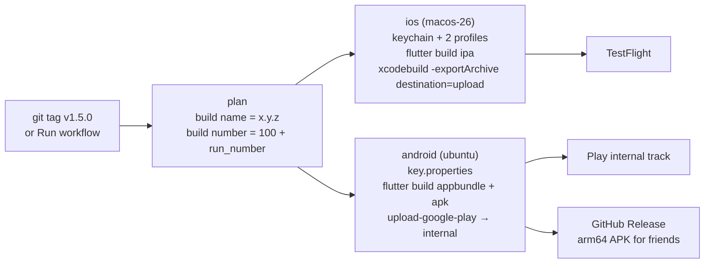

# Releasing Chopstats · 筷拍

How the app gets from a git tag to TestFlight / the App Store and to Google
Play, and everything the owner has to do once by hand before that works.
Written 2026-10-10 against Flutter 3.44.2, Xcode 26.2 and the GitHub
`macos-26` / `ubuntu-24.04` runner images; § 1.4, § 1.7, § 4 and the owner
steps below were brought up to date on 2026-10-25 after an App Review audit
of the first store build, and on 2026-10-29 with the owner's decisions. The store consoles move around, so treat exact
menu names as "as of this writing".

| Piece | What it does | Secrets |
|---|---|---|
| [`.github/workflows/mobile-build.yml`](../.github/workflows/mobile-build.yml) | On every PR and push to `main`, `loop/**`, `feat/**`, `fix/**` (docs-only changes skipped): compiles the iOS project unsigned (Runner **and** ShareExtension) on macOS and the Android app bundle on Ubuntu. Passes today, before any enrolment. | none |
| [`.github/workflows/release.yml`](../.github/workflows/release.yml) | On a `v*` tag or **Actions → Release → Run workflow**: signed IPA → TestFlight, signed AAB → Play internal track, arm64 APK → GitHub Release. Lanes whose secrets are missing are skipped with a warning naming them. | listed in [§ 3](#3-github-secrets-and-variables) |
| [`.github/workflows/python-tests.yml`](../.github/workflows/python-tests.yml) | The existing server + Flutter test CI. Unchanged. | none |
| [`app/ios/ExportOptions.plist`](../app/ios/ExportOptions.plist) | Manual-signing export options naming a profile for **both** bundle ids. CI overwrites the team id and profile names with what it reads from the secrets. | |
| [`app/android/app/build.gradle.kts`](../app/android/app/build.gradle.kts) | Signs the release build with the upload key when `app/android/key.properties` exists, otherwise with the debug key plus a warning. | |
| [`app/android/whatsnew/`](../app/android/whatsnew/) | Play "What's new" text per locale, sent with every upload. | |



Identifiers that must match everywhere:

| | Value |
|---|---|
| iOS app bundle id | `dev.calorietracker.calorieTracker` |
| iOS share-extension bundle id | `dev.calorietracker.calorieTracker.ShareExtension` |
| App Group (both targets) | `group.dev.calorietracker.calorieTracker` |
| Apple team in `Runner.xcodeproj` today | `WLQB3YB22M` — the paid Apple Developer Program (Individual) since 2026-10-29; the Team ID did not change on enrolment (§ 1.2), so the keychain and the dev build carry over |
| Android package / application id | `dev.calorietracker.calorie_tracker` (permanent after the first Play upload) |
| Display name | `Chopstats` (Info.plist `CFBundleDisplayName` and en `InfoPlist.strings`, both targets; 筷拍 under zh-Hans); store name `Chopstats · 筷拍` (owner decision R-F9, 2026-10-29; formerly BiteWise) |
| Version | `app/pubspec.yaml` `version: 1.5.0+7` → `CFBundleShortVersionString` / `versionName` = `1.5.0`; the build number is stamped by CI (§ 5) |

---

## First submission — owner steps in order

Status on 2026-10-29: the first App Store build is `main` + PR #18 (HEIC/GPU
fix) + the release fixes on `release/app-store-1` (per-recipient AI consent,
share-extension purpose string, the owner's decisions, this document). The
restaurant assist and the glasses work (PRs #19/#20) are **not** in it. The
finding ids refer to the 2026-10-25 App Review audit. The owner decided
steps 1 and 2 on 2026-10-29 (the recommended answer each time) and they are
**done in this branch**; the demo key (step 7, R-F6) is still open.

1. **Name** (R-F9) — **DONE 2026-10-29: renamed to Chopstats.** A check on
   2026-10-29 found 12+ live US App Store apps called Bitewise/BiteWise
   (most of them calorie trackers, two sellers are companies named
   Bitewise) and a crowded BITE-/-WISE field at the USPTO, so the English
   name changed. **Chopstats** (筷 chopsticks → stats) had no same-name US
   App Store app and no live or pending USPTO mark (one dead filing); the
   runners-up were Forktally, Pictrition, Platemetry and Gramcracker. This
   is a practical check, not a lawyer's clearance search (state registers
   and unregistered use were not searched). The store name is
   `Chopstats · 筷拍` (14 characters). **Chopstats** is the English display
   name everywhere: `CFBundleDisplayName` in `Info.plist` and en
   `InfoPlist.strings` of Runner **and** ShareExtension, the photo purpose
   string in both, every en UI string (`app_en.arb`, the startup-error
   screen, the `MaterialApp` title), the OpenRouter `X-OpenRouter-Title`,
   the Android launcher label, `docs/PRIVACY.md`, `docs/SUPPORT.md`, the
   README heading and the store metadata. Unchanged on purpose: the zh
   display name 筷拍, the `bitewise://` URL scheme (the setup links and
   `scripts/provision_phone.sh` use it), the bundle ids, the App Group, the
   GitHub repository name, and the certificate/profile labels in § 1.6 and
   `ExportOptions.plist` (internal names nobody else sees). Pinned by
   `app/test/release_decisions_test.dart`.
2. **The open product questions** — **DONE 2026-10-29**:
   - *Own-server row* (R-F5) — **A, neutral.** The connection type that
     said "Subscription" is **Your own server** / 你自己的服务器, with a
     server icon (`Icons.dns_outlined`) instead of the premium badge. Its
     page lists **Claude**, **GLM** and **Doubao** (豆包) under "AI on your
     server", with the company as the note. Everywhere else (the Settings
     root row, *Stop Sharing with …*, the camera-roll notice, the setup-link
     sheet, diagnostics) the AI reads **Claude (server)** / 你服务器上的
     Claude: "Claude via your server" cut the root row's *AI Provider* title
     at 375 pt (`row_fit_layout_test.dart`). Gone: "photos cost nothing
     extra", "flat-rate", "subscription analysis" and "needs credits on Pro"
     (the Fable row is "Fable — frontier"). The setup-link sheet says
     "AI:" instead of "Plan:". Behaviour is unchanged (provider id `server`,
     consent route `server:<plan>`), so your own Claude setup keeps working
     with zero taps (`app/test/ui/own_server_row_test.dart`). Accepted with
     A: the remaining Anthropic/Zhipu terms risk for your own accounts.
   - *Mainland-China/VPN text in the English UI* (R-F11) — **A.** No en
     string gives mainland-China or VPN advice or carries Chinese text: the
     welcome card, the API-key page footer and row notes (empty in English,
     and an empty note shows no value), the Gemini, DeepSeek, Qwen and
     Doubao key footers, Connect Claude, the diagnostics fixes, the
     region-block messages, the Describe/Fix examples, and the model labels
     (`{free}` is "FREE" in en and "FREE 免费" in zh). zh is unchanged. One
     deliberate exception: the consent dialog keeps "{company} processes it
     on servers in mainland China" — that says where the data goes, not how
     to reach a provider. Provider brand names keep their Chinese name
     (Qwen 通义千问). Pinned by `release_decisions_test.dart`.
   - *Privacy policy* (R-F7) — **A.** `docs/PRIVACY.md` has a "Third
     parties and your consent" / 第三方与你的同意 section and the effective
     date 2026-10-29: who receives what (the provider you picked, or your
     own server and the AI plan configured on it; OpenRouter passes it on),
     what each request carries, asking first, withdrawing with Settings ›
     *Stop Sharing with …*, and that each provider's own terms and
     retention apply (no claim that they all protect data equally). On the
     way, an over-disclosure was fixed: *Describe a meal* sends only the
     text and today's date (`NlExecutor.describeMeal` builds its prompt with
     an empty meal list); only *Fix or delete a meal* (`handleText`) sends
     the last 7 days of meals. The consent dialog (en + zh), the policy,
     § 1.7, § 4.3 and the `add_flow.dart` comments now say so.
   - *App Privacy answer* (R-F8) — **B, declare**: Photos or Videos, Health,
     Other User Content; App Functionality only; not linked; no tracking.
     `Runner/PrivacyInfo.xcprivacy` declares exactly these three; the
     ShareExtension's array stays empty (it sends nothing itself). The
     click-by-click App Store Connect answers are in § 4.3.
   - *Support URL* (R-F14) — **A.** [`docs/SUPPORT.md`](SUPPORT.md): iPhone
     only; what the app does, where each provider's key comes from (a
     sentence each), the own-server option, troubleshooting, export /
     delete / stop sharing, GitHub Issues. Both listings' `support_url.txt`
     point at https://github.com/AkiyamaKunka/BiteWise/blob/main/docs/SUPPORT.md
     (404 until this branch is on `main`, step 3). Public contact address
     chosen 2026-10-29: junjia.wang.me@gmail.com (also usable as the App
     Review contact).
3. **Merge PR #18, then the release PR, into `main`** (the step 2 fixes
   are part of it; T-TC-5: **main must equal the store build**; the alternative,
   running the Release workflow on the branch with *internal-only*
   unticked, leaves `main` behind the App Store).
4. Enrol, check the Team ID, create the App IDs, the App Group and the app
   record (§ 1.1–1.4): primary language **English (U.S.)**, zh-Hans as an
   optional localization; name from step 1. **Enrolment and the Team ID
   check are DONE (2026-10-29):** the owner enrolled as an Individual with
   the same Apple ID, Xcode shows the team as a paid Developer Team, and a
   development build signed afterwards carries team `WLQB3YB22M` with a
   one-year profile — the Team ID did not change, so the export below is
   not needed. Kept for reference: **if the Team ID were no longer
   `WLQB3YB22M`**, iOS will refuse to install the TestFlight build over
   today's dev build (§ 1.2), and deleting the dev build wipes its meals
   and settings. So, at step 6:
   1. Settings › Your Data › *Export Data…* (你的数据 › 导出数据…) and
      AirDrop the file to the Mac. It holds the meals, the photo ledger
      (so the scan does not send those photos again) and the body and
      workout data — not the settings, the dietary profile, the meal
      thumbnails or the keys, so write down the dietary profile, the
      lookback (7 days) and the report time.
   2. Only then delete the dev build and install from TestFlight.
   3. Open the file on the Mac, copy all of its text, and on the phone use
      *Import Data…* › *Import from clipboard* (Universal Clipboard).
   4. Set the provider again (your own server: the setup link from
      `scripts/provision_phone.sh --qr`; confirming it is the consent),
      re-enter what you wrote down, and turn on *Watch Camera Roll* again
      — expect the consent and camera-roll notice once.
5. API key, certificate, profiles, GitHub secrets (§ 1.5, 1.6, 3) — or the
   Xcode shortcut (§ 2) for a same-day TestFlight build.
6. **Tag `v1.5.0` on `main`** (§ 4.1, § 8) → TestFlight → install on your
   iPhone through TestFlight and check § 4.2. With an unchanged Team ID it
   installs over the dev build, keeps everything, and shows no consent
   dialog: an install with the watcher on keeps its current recipient (the
   one-time seed in `AppSettings._loadAiConsent`). After a Team ID change
   it is the fresh install from step 4, which asks once.
7. **Demo key** (R-F6) — **still open** (being discussed with the owner,
   2026-10-29; the review notes keep the `<key>` placeholder until then).
   The recommendation so far: **a paid Gemini key in its own Google Cloud
   project**, with the per-day request quota lowered (that is the hard cap;
   a budget only sends alerts) plus a budget alert. Gemini is the default
   provider, so the reviewer's path is shortest. Not a free-tier key: the
   2-day backfill can exhaust it during review, Google may use the inputs,
   and it is unavailable in some regions. A prepaid key at another provider
   (auto-recharge off) also works, but the reviewer must pick that provider.
   The key goes only into the App Review notes field.
8. App Store Connect: App Privacy (§ 4.3, answer B click by click), age rating
   **9+** (§ 4.4), screenshots from an **iPhone 17 Pro Max** simulator you
   create yourself (§ 4.4), metadata with the support and privacy-policy
   URLs, Free, **deselect China mainland** (§ 7), review notes (§ 4.4) with
   the demo key, *Manually release this version*. Submit.
9. After approval: revoke the demo key; update the README install section
   for the App Store.

Later, not needed for the first submission: a launch screen that is not
white in dark mode (T-TC-9), asking for notifications in context instead of
at first launch (R-F13), an on-device food check before the watcher uploads
(R-F12, on PR #19's branch), and "Save Image" from the share sheet
(`NSPhotoLibraryAddUsageDescription`, R-F10 — today iOS simply leaves the
option out).

**When PR #19 (restaurant assist) is merged on top of this build** (done
2026-10-30 on PR #19's branch, following these notes), seven
files conflict (`di.dart`, `add_flow.dart`, `fix_meal_screen.dart`,
`provider_page.dart`, `settings_screen.dart`, `services.dart`, this
document); every hunk keeps both sides:
- `di.dart`: keep `pipeline.bindStream(shareConsent.gate(shareIntake.photos()))`
  and then #19's `mealAssist.start()`. A resolution that keeps #19's bare
  `shareIntake.photos()` fails `test/production_wiring_test.dart`.
- `FixMealScreen` takes both `settings:` and `inUse:` (constructor and the
  `add_flow.dart` call). `settings` is required, so a one-sided resolution
  does not compile; #19's `test/ui/meal_in_use_test.dart` call gains
  `settings: FakeSettings()`.
- Regenerate l10n afterwards (`flutter gen-l10n` in `app/`).

The owner's decisions of 2026-10-29 (owner steps 1–2) add these; every hunk
again keeps both sides:
- `Runner/Info.plist` and `Runner/{en,zh-Hans}.lproj/InfoPlist.strings`:
  #19 extends `NSPhotoLibraryUsageDescription` with the photo-location
  sentence. Take #19's text, write **Chopstats** in both of its en
  sentences, and copy the result to the ShareExtension's `Info.plist` and
  `InfoPlist.strings` (en and zh-Hans): `share_extension_plist_test.dart`
  wants them equal to Runner's.
- `PrivacyInfo.xcprivacy` / `app/test/manifest_gate_test.dart`: #19's test
  "both privacy manifests declare no collected data types" pins `<array/>`
  in **both** targets; Runner now declares the three answer-B types. Keep
  the empty-array check for ShareExtension only (or drop it for
  `release_decisions_test.dart`), and rewrite #19's § 4.3 paragraph
  "Restaurant nutrition lookup … stays *Data Not Collected*": the answer
  stays **B**, and the lookup adds no type (chain and food names go to the
  same user-chosen recipient as the photos; the photo location goes only to
  Apple's MapKit, so Location stays No).
- `app_en.arb` / `app_zh.arb`: #19's own strings write BiteWise — rename them to Chopstats —
  and carry no VPN text. Its tests pin the old own-server labels — 'Claude
  Plan' / 'Claude 订阅' through `planShortClaude`
  (`assistProviderLabel`) in `test/ui/assist_source_card_test.dart`,
  `test/ui/diagnostics_test.dart` and `test/ui/setup_link_flow_test.dart`:
  update them to 'Claude (server)' / '你服务器上的 Claude'.
  `release_decisions_test.dart` and `own_server_row_test.dart` catch any en
  string that brings back Chinese text, VPN advice or plan talk.
- `docs/PRIVACY.md`: the effective date conflicts (#19 2026-10-24, this
  branch 2026-10-29); #19 changes the policy, so give it the merge date.
  #19's added sentences say "Claude Plan" (the intro's "with Claude Plan,
  the server you run", the restaurant section's **Claude Plan:** bullet, and
  the 中文 counterparts): rename them to "your own server" / 你自己的服务器.
  The "Third parties and your consent" section sits before "Changes and
  contact", clear of #19's hunks; add a bullet to its "What that recipient
  receives" list pointing at #19's *Restaurant nutrition lookup* section.
- `provider_page.dart`: on top of the hunks above, this branch changes the
  own-server row (icon, `serverPlanName` value), `noteLabel` (now
  `String?`) and the `{free}` model labels; keep both sides.

The assist's lookups (chain and item names to the user's server,
Anthropic or OpenRouter/Exa) already have their own per-recipient consent
(#19's restaurant consent sheet; every lookup checks `consentCovers`), so
they need no second gate on the AI consent. Before #19 reaches a store
build, though, *Stop Sharing with …* must also turn the assist off when
its lookups go to the same company or server: that row says "nothing more
is sent to …", while the assist keeps its own consent and could go on
sending lookups (a manual one, or a meal still waiting for one).

---

## 1. Apple: one-time setup

### 1.1 Enrol in the Apple Developer Program

**Done 2026-10-29** (Individual, same Apple ID; the Team ID stayed
`WLQB3YB22M`). Before that, the team was a free personal team: 7-day
profiles, no TestFlight, no App Store, no App Store Connect API. The steps,
for reference:

1. <https://developer.apple.com/programs/enroll/> → Individual. Needs
   two-factor authentication on the Apple Account and your legal name.
   US$99 per membership year; activation can take up to 48 h.
2. Once active, open Xcode → Settings → Accounts; the team should now read
   *"(Individual)"* instead of *"(Personal Team)"*.

### 1.2 Check the Team ID (keychain continuity)

An individual who upgrades the same Apple Account normally keeps the same
Team ID: the enrolment converts the personal team. Verify it in
<https://developer.apple.com/account> → Membership details. **If it
changed**, update `teamID` in `app/ios/ExportOptions.plist` and
`DEVELOPMENT_TEAM` in `app/ios/Runner.xcodeproj/project.pbxproj` (every
occurrence, Runner and ShareExtension), and expect this on the phone (not
tested on a device; this is how iOS treats a new team prefix):

- iOS refuses to upgrade an installed app whose `application-identifier`
  (`<TeamID>.dev.calorietracker.calorieTracker`) differs from the new
  build's (MIInstallerErrorDomain: the upgrade's application-identifier
  "does not match" the installed one). The TestFlight build cannot replace
  today's dev build in place.
- The dev build must be deleted first, and that deletes its sandbox: the
  meal database and every setting (the watcher switch and the AI consent
  seed included). The keychain items stay behind in the old team's access
  group, which the new build cannot read either.
- So export the data first and import it into the TestFlight build: the
  sequence is owner step 4. The fresh install asks for the AI consent once,
  like any new install.
- If § 1.3 then says an identifier is "not available", the old personal
  team still holds it; Apple Developer Support can release it.

Either way, never install a build older than commit `9df6846` on the
owner's iPhone again (the keychain migration is one-way).

### 1.3 Identifiers: two App IDs and the App Group

<https://developer.apple.com/account/resources/identifiers/list>

1. **App Group**: Identifiers → + → App Groups → identifier
   `group.dev.calorietracker.calorieTracker`, description "Chopstats".
2. **App ID** `dev.calorietracker.calorieTracker` (explicit, type App):
   Capabilities → tick **App Groups** → Configure → select the group above.
   Also tick nothing else; background fetch needs no capability.
3. **App ID** `dev.calorietracker.calorieTracker.ShareExtension`
   (explicit): the same App Groups capability bound to the same group.

Both entitlement files in the repo already ask for the group; if an App ID
lacks the capability the archive step passes but App Store Connect rejects
the upload with ITMS-90078 (see § 9).

### 1.4 The app record in App Store Connect

<https://appstoreconnect.apple.com> → My Apps → + → New App:

- Platform iOS; Name `Chopstats · 筷拍` (30 chars max; the name is global,
  pick another if taken — and see owner step 1 about the existing
  *Bitewise: AI Calorie Tracker*); Primary language **English (U.S.)** (the
  listing is US-only), with Chinese (Simplified) as an optional
  localization; Bundle ID `dev.calorietracker.calorieTracker`; SKU
  `bitewise-ios`; User Access: Full.
- Name, subtitle and keywords carry no provider marks (Gemini, Claude,
  OpenAI, …) and no accuracy claims; nothing in the listing mentions
  Android, the APK or Telegram (guideline 2.3.10).
- Note the app's numeric **Apple ID** (App Information → General). It is
  only needed for the altool fallback (variable `ASC_APP_APPLE_ID`).

### 1.5 App Store Connect API key (for uploads from CI)

Users and Access → Integrations → App Store Connect API → **Team Keys**
(the Account Holder must first click *Request Access* once):

1. Generate API Key → Name `bitewise-ci`, Access **App Manager** (enough to
   upload builds; this lane never creates certificates or profiles through
   the API — those are made by hand in § 1.6; only cloud signing would need
   Admin).
2. Download `AuthKey_<KEYID>.p8` — **Apple offers the download exactly
   once.** Note the **Key ID** (10 chars) and the **Issuer ID** (UUID shown
   at the top of the page).
3. Turn them into secrets (§ 3): `ASC_KEY_ID`, `ASC_ISSUER_ID`,
   `ASC_API_KEY_P8_BASE64`.

### 1.6 Certificate and the two provisioning profiles

The lane signs manually: one Apple Distribution certificate (valid one year,
shared by both targets) and one App Store profile per bundle id. Do this on
the owner's Mac; the private key never leaves it except inside the encrypted
`.p12` that becomes a secret.

1. **Certificate signing request**: Keychain Access → Certificate Assistant
   → Request a Certificate From a Certificate Authority → your email, common
   name "BiteWise Distribution", *Saved to disk* → `BiteWise.certSigningRequest`.
2. **Apple Distribution certificate**: Certificates, Identifiers & Profiles
   → Certificates → + → *Apple Distribution* → upload the CSR → Download
   `distribution.cer` → double-click to import into the login keychain.
   (Only the Account Holder/Admin can create it; a team may hold at most a
   couple at a time, so reuse rather than re-create.)
3. **Export the .p12**: Keychain Access → My Certificates → expand *Apple
   Distribution: <name>* so the private key shows → select **both** rows →
   right-click → Export 2 items → format `.p12` → choose a strong password
   (that password becomes `IOS_DIST_P12_PASSWORD`). A `.p12` exported from
   the certificate row alone has no private key and the workflow stops at
   "expected exactly one valid 'Apple Distribution' identity".
4. **Profiles**: Profiles → + → Distribution → *App Store Connect* → App ID
   `dev.calorietracker.calorieTracker` → the certificate from step 2 → name
   `BiteWise AppStore` → Generate → Download. Repeat for the ShareExtension
   App ID with the name `BiteWise ShareExtension AppStore`. The names are
   free text: the workflow reads the real names out of the files.
5. Secrets (§ 3): `IOS_DIST_P12_BASE64`, `IOS_DIST_P12_PASSWORD`,
   `IOS_PROFILE_RUNNER_BASE64`, `IOS_PROFILE_SHAREEXT_BASE64`.
6. Delete the exported `.p12`, `.cer`, `.mobileprovision` and `.p8` from
   Downloads afterwards (the root `.gitignore` also refuses to track them).

Calendar note: the certificate and both profiles expire after one year; the
workflow checks the certificate's and both profiles' expiry dates up front
and names the one to renew.

### 1.7 Code prerequisites before the first upload

All done; this is what each one is and where it lives.

- `ITSAppUsesNonExemptEncryption = false` in `app/ios/Runner/Info.plist`
  (the app only uses OS TLS, the keychain and SHA hashing, which are exempt;
  without the key every build sits in "Missing Compliance" until answered).
- `app/pubspec.yaml` is `1.5.0+7`; the ShareExtension takes its version from
  `$(FLUTTER_BUILD_NAME)` / `$(FLUTTER_BUILD_NUMBER)`.

1. **Privacy manifests — done.** Both targets ship a
   `PrivacyInfo.xcprivacy` in their own Resources phase, pinned by
   `app/test/manifest_gate_test.dart`:

   | Target | Required-reason APIs declared | `NSPrivacyCollectedDataTypes` |
   |---|---|---|
   | Runner | UserDefaults `CA92.1`, `1C8F.1`; FileTimestamp `C617.1` | PhotosorVideos, Health, OtherUserContent — not linked, no tracking, App Functionality (§ 4.3, answer B) |
   | ShareExtension | UserDefaults `CA92.1`, `1C8F.1` | empty: the extension sends nothing itself (§ 4.3) |

   The plugins are linked statically through Swift Package Manager
   (`FlutterGeneratedPluginSwiftPackage` in `project.pbxproj`), so their
   code compiles into these two executables, and the two manifests above
   cover the APIs it calls. Their own manifests (as of the locked versions):

   | Plugin | Own manifest | Declares |
   |---|---|---|
   | app_links 7.2.1, share_plus 13.2.1, sqflite_darwin 2.4.3+1, url_launcher_ios 6.4.1, flutter_secure_storage_darwin 0.3.2 | yes | nothing |
   | flutter_local_notifications 22.0.1, permission_handler_apple 9.4.10, shared_preferences_foundation 2.5.6, workmanager_apple 0.9.1+2 | yes | UserDefaults |
   | photo_manager 3.10.0 | yes | FileTimestamp; collected PhotosorVideos (so Xcode's privacy report lists it; App Store Connect does not cross-check it against the label) |
   | receive_sharing_intent 1.9.0 | **no** | — its `UserDefaults(suiteName:)` call is covered by both targets' UserDefaults entries |
   | path_provider_foundation 2.6.0 | n/a | no native iOS code (Dart FFI through `objective_c`) |
   | integration_test (dev dependency) | no | linked into Release by Flutter's generated package; public API only, no XCTest (T-TC-7) |

   The old "fork `receive_sharing_intent`" contingency is dropped: it is
   compiled into the targets rather than shipped as a framework, and neither
   it nor `objective_c` is on Apple's list of SDKs that need their own
   manifest. If ITMS-91053 ever arrives anyway, the email names the API
   category to add to the target's manifest.
2. **iPhone only.** Both targets are `TARGETED_DEVICE_FAMILY = 1` (decided
   2026-10-12): the UI is phone-only, so no iPad screenshots are needed and
   App Review tests on an iPhone. iPads can still run it in iPhone
   compatibility mode. Adding iPad later is allowed; removing it after an
   iPad-capable version has shipped is not, so keep it this way unless an
   iPad layout is built.
3. **Privacy policy URL** (guideline 5.1.1) — **done.** The policy is
   `docs/PRIVACY.md` (English + 中文) at
   https://github.com/AkiyamaKunka/BiteWise/blob/main/docs/PRIVACY.md (live,
   HTTP 200), linked in the app at Settings › Your Data › *Privacy Policy*
   (`privacyPolicyUri` in `settings_screen.dart`). Keep the file in step with
   what the code sends. The "Third parties and your consent" section
   (R-F7) is in, effective 2026-10-29.
4. **Consent before data goes to a third-party AI** (guideline 5.1.2(i)) —
   **done in this branch** (`app/lib/ui/ai_consent.dart`,
   `app/lib/core/ai_consent.dart`). Consent is per recipient: the provider
   id for an API key, `server:<plan>` for the user's own server (the plan is
   the AI company, so a plan switch asks again; a server address edit does
   not). The dialog names the company, lists what goes with a photo
   (dietary profile, a summary of that day's other meals), with *Describe
   a meal* (the text only) and with *Fix or delete a meal* (the last 7
   days of meals), and says where DeepSeek, Qwen,
   Doubao, GLM and the GLM/Doubao plans process data (mainland China). It
   is asked:
   - before a picked photo's bytes are read, before Describe/Fix a meal,
     Leftovers, *Test This Provider* and Photo Coverage *Log all / Retry*;
   - for a photo shared into the app, which is held until answered (Not
     now drops it and says so);
   - when *Watch Camera Roll* is turned on (with the camera-roll notice),
     and when the provider or plan changes while it is on (Not now keeps the
     previous choice); with the watcher off the next foreground send asks;
   - by the setup-link dialog, which now names the plan's company:
     confirming it is the consent.

   Settings › *Stop Sharing with …* withdraws it and turns *Watch Camera
   Roll* off. A foreground send without a configured key asks nothing
   (nothing can leave; it fails with its own "no key" message).
   Existing installs: on the first launch of this build an install with the
   watcher on, or that accepted the old camera-roll notice, keeps its
   current recipient (not gated on a key: a watcher left on without a key
   must not start sending, unasked, once a key is pasted). The photo
   pipeline is unchanged: every automatic send already needs the watcher.
5. **Share extension purpose string** — **done.** The extension links
   Photos.framework (`receive_sharing_intent`'s `PHAsset` lookup), and the
   ITMS-90683 scan runs per bundle, so its `Info.plist` and en/zh-Hans
   `InfoPlist.strings` carry Runner's `NSPhotoLibraryUsageDescription`
   (pinned by `app/test/share_extension_plist_test.dart`). The extension
   never asks at runtime.

---

## 2. First-upload shortcut: Xcode on the Mac (no CI)

If you want a build in TestFlight the same day you enrol, before any secret
exists: `cd app && flutter build ios --release --config-only`, open
`app/ios/Runner.xcworkspace`, select *Any iOS Device*, Product → Archive,
then Organizer → Distribute App → App Store Connect → Upload with automatic
signing (Xcode creates the certificate and profiles for the paid team by
itself). Everything in § 1.3–1.4 must exist first. The CI lane is for every
build after that.

SDK note (T-TC-6): the Mac builds with Xcode 27.1 (iOS 27.1 SDK); CI pins
`XCODE_VERSION: "26.2"` (iOS 26.2 SDK). App Store Connect accepts both (the
current rule is Xcode 26+ with the iOS 26 SDK, since 2026-04-28), but they
are different binaries: ship store builds through one lane and test that
exact build through TestFlight (§ 4.2). A build made with the 27.1 SDK also
brings in the iPhone Duo screenshot requirement from April 2027 (§ 4.4).

---

## 3. GitHub secrets and variables

Repository → Settings → Secrets and variables → Actions. Create the secrets
either at the repository level or inside the environment named `release`
(GitHub creates it on the first run; Settings → Environments → release →
*Required reviewers* = you turns every store upload into a click-to-approve).

Make each base64 value on the Mac and paste it **only** into the GitHub
secret field:

```bash
base64 -i ~/Downloads/BiteWise-dist.p12 | pbcopy        # then ⌘V into the secret
```

or, without the clipboard, straight from the file with the GitHub CLI:

```bash
gh secret set IOS_DIST_P12_BASE64 --repo AkiyamaKunka/BiteWise < <(base64 -i ~/Downloads/BiteWise-dist.p12)
gh secret set PLAY_SERVICE_ACCOUNT_JSON --repo AkiyamaKunka/BiteWise < ~/Downloads/play-service-account.json
```

Never put a value in a chat, a commit, an issue, a `.env` checked into git,
or a terminal history line (`gh secret set NAME` with no redirection prompts
for the value instead).

| Secret | Contents | Made by | Expires |
|---|---|---|---|
| `IOS_DIST_P12_BASE64` | Apple Distribution certificate **with private key**, `.p12`, base64 | § 1.6 step 3 | 1 year |
| `IOS_DIST_P12_PASSWORD` | the `.p12` export password | § 1.6 step 3 | with the p12 |
| `IOS_PROFILE_RUNNER_BASE64` | App Store profile for `dev.calorietracker.calorieTracker`, base64 of the `.mobileprovision` | § 1.6 step 4 | 1 year |
| `IOS_PROFILE_SHAREEXT_BASE64` | App Store profile for `…calorieTracker.ShareExtension`, base64 | § 1.6 step 4 | 1 year |
| `ASC_KEY_ID` | App Store Connect API Key ID | § 1.5 | until revoked |
| `ASC_ISSUER_ID` | App Store Connect Issuer ID | § 1.5 | until revoked |
| `ASC_API_KEY_P8_BASE64` | base64 of `AuthKey_<KEYID>.p8` | § 1.5 | until revoked |
| `ANDROID_UPLOAD_KEYSTORE_BASE64` | base64 of `upload-keystore.jks` | § 6.2 | ~27 years |
| `ANDROID_KEYSTORE_PASSWORD` | keystore password | § 6.2 | |
| `ANDROID_KEY_PASSWORD` | key password (same as the store password when made with the command in § 6.2) | § 6.2 | |
| `PLAY_SERVICE_ACCOUNT_JSON` | the service account's JSON key, whole file | § 6.4 | until rotated |

| Variable (plain text, optional) | Meaning | Default |
|---|---|---|
| `ANDROID_KEY_ALIAS` | alias inside the keystore | `upload` |
| `ASC_APP_APPLE_ID` | the app's numeric Apple ID (§ 1.4) | unset; only the altool fallback reads it |

What the workflow does with them: the `.p12` goes into a throw-away
keychain with a random password, the profiles are installed under their
UUIDs and checked for bundle id, team and expiry, the `.p8` is written to a
`chmod 600` file, `key.properties` + the `.jks` are written into
`app/android/` (git-ignored) — and all of it is deleted in an `always()`
step. No value is ever echoed; GitHub additionally masks them.

---

## 4. The first TestFlight build and App Review

### 4.1 Run it

Only after PR #18 (the HEIC/GPU background fix) and the release PR are on
`main` — a run before that would build without them. Actions → **Release**
→ Run workflow → branch `main` → lane `testflight` → leave *internal-only*
ticked → Run. Watch the `ios` job:

- "installed profile '…' for WLQB3YB22M.dev.calorietracker.calorieTracker"
  twice, "Release configs now sign manually with team …".
- `flutter build ipa` prints the archive and `Built IPA to build/ios/ipa`.
- "Runner.app: Apple Distribution, app group present, 1.5.0 (1xx)" and the
  same for `ShareExtension.appex`.
- The upload step ends with `EXPORT SUCCEEDED`; App Store Connect emails
  "The following build has completed processing" a few minutes later.

The build shows under TestFlight → iOS builds with a *Internal Testing Only*
badge; it cannot be sent to external testers or App Review (that is the
`testFlightInternalTestingOnly` export option, set for every non-tag run).
A tag run (`git tag v1.5.0 && git push origin v1.5.0`) produces an
external-eligible build; the first App Store build is that tag on `main`
(owner step 6), so `main` equals what is in the store. (Running the
workflow on another branch with *internal-only* unticked also produces a
submittable build, but leaves `main` behind the App Store.)

### 4.2 Internal testers → the owner's iPhone

TestFlight → Internal Testing → + group "Owner" → add your own App Store
Connect user → tick *Enable automatic distribution*. Install TestFlight on
the iPhone, accept the invite, install. First things to check on the
phone (see § 1.2): Settings shows the saved provider keys and the server
URL (with an unchanged Team ID the build installs over the dev build and
keeps them; after a Team ID change it is the fresh install of owner
step 4); the 后台扫描 row keeps advancing with the phone locked; the share
sheet still offers Chopstats.

### 4.3 App Privacy (nutrition labels) and the BYO-key model

**Decided 2026-10-29 (R-F8): answer B — declare what leaves the phone.**

App Store Connect → App Privacy. Apple's definition of *collect* is
"transmitting data off the device in a way that allows you and/or your
third-party partners to access it for a period longer than what is
necessary to service the transmitted request in real time", where
*third-party partners* are SDKs and vendors whose code is in the app.
Chopstats has no developer backend and links no provider SDK: it makes plain
HTTPS calls to the AI provider **the user chose with the user's own key**,
or to a server the user runs. What leaves the phone, and to whom:

- **every photo** (picked, shared or found by *Watch Camera Roll*) goes to
  the AI provider with the dietary profile and a short summary of the other
  meals logged that day (up to five);
- ***Fix or delete a meal*** sends the typed text with the last 7 days of
  meals; ***Describe a meal*** sends only the text and today's date; a
  leftover photo goes with the meal it belongs to;
- **through the user's own server** the same data goes to the server,
  which passes it to the AI company of its plan (Anthropic, Zhipu or
  Volcengine).

So health data goes to the API provider with every photo and every Fix
request, not only through a self-hosted server. Two answers were
defensible:

- A — *Data Not Collected*: true under Apple's literal definition (no
  developer backend, no provider SDK).
- **B — declare what leaves the phone (chosen)**: it matches what the
  consent dialog tells users, App Review does not object to
  over-declaring, and the store page shows only *Data Not Linked to You*.

| Data type (answer B) | Collected? | Linked to the user | Tracking | Purpose |
|---|---|---|---|---|
| Photos or Videos | Yes — sent to the user-selected AI provider for analysis; not retained by the developer | No | No | App Functionality |
| Health & Fitness → **Health** (meal calories and macros, and the dietary profile, which the app attaches itself) | Yes — with every photo and every Fix request, to the same provider | No | No | App Functionality |
| User Content → **Other User Content** (what the user types into *Describe a meal* and *Fix or delete a meal*: meal descriptions and corrections, and also a weight or a workout typed into Fix, such as "I weigh 72 kg" or "burned 450 calories on my 5 km run", which the app then logs as a weight or an activity) | Yes — to the same provider | No | No | App Functionality |
| Health & Fitness → Fitness | **No** — the app attaches no stored workout, step or weight record to any request (a photo carries that day's meals, Fix the last 7 days of meals); a workout the user types goes only as that typed text, declared above as Other User Content; the Garmin fetch from the user's own server sends only a date | | | |
| Everything else (contacts, location, identifiers, diagnostics, usage) | No | | | |

The rule behind the rows: what the app attaches by itself is declared as
what it is (meals and the dietary profile → Health); what the user types
is declared as Other User Content, whatever it is about, as for any
free-text field. So a typed weight is not why Health is ticked, and a
typed workout does not tick Fitness. Declaring typed text by its subject
instead would add *Health & Fitness* → Fitness, a stricter reading the
owner can still choose: the product page's summary card would not change
(it already shows *Health & Fitness*), only its details would list
Fitness, and the Runner manifest would need
`NSPrivacyCollectedDataTypeFitness` to match.

**The answers, click by click** (App Store Connect as of 2026-10; the
console moves things around, so match the wording, not the position):

1. App Store Connect → **Apps** → *Chopstats · 筷拍* → sidebar → **App
   Privacy**.
2. **Privacy Policy** → *Edit* → Privacy Policy URL
   `https://github.com/AkiyamaKunka/BiteWise/blob/main/docs/PRIVACY.md`;
   leave *User Privacy Choices URL* empty → **Save**.
3. **Data Collection** → *Get Started* → "Do you or your third-party
   partners collect data from this app?" → **Yes, we collect data from this
   app** → *Next*.
4. Tick exactly these three data types and nothing else → **Save**:
   - *Health & Fitness* → **Health**
   - *User Content* → **Photos or Videos**
   - *User Content* → **Other User Content**

   In particular leave *Health & Fitness* → Fitness, *Location*,
   *Identifiers*, *Usage Data* and *Diagnostics* unticked.
5. Back on the App Privacy page, each of the three has a *Set Up* button.
   For **Health**, then **Photos or Videos**, then **Other User Content**:
   1. "Indicate all purposes for which … are collected" → tick **App
      Functionality** only → *Next*.
   2. "Are the … collected from this app linked to the user's identity?" →
      **No, … are not linked to the user's identity** → *Next*.
   3. "Do you or your third-party partners use … for tracking purposes?" →
      **No, we do not use … for tracking purposes** → **Save**.
6. Check the preview on the App Privacy page: a single **Data Not Linked
   to You** card listing *Health & Fitness* and *User Content*; no *Data
   Used to Track You* and no *Data Linked to You*.
7. **Publish** (top right). Unpublished answers block *Add for Review*.

The manifests mirror the answer, pinned by
`app/test/release_decisions_test.dart` (it parses both plists):

- `Runner/PrivacyInfo.xcprivacy` → `NSPrivacyCollectedDataTypes` holds three
  dicts, `NSPrivacyCollectedDataTypePhotosorVideos`,
  `NSPrivacyCollectedDataTypeHealth` and
  `NSPrivacyCollectedDataTypeOtherUserContent`, each with
  `NSPrivacyCollectedDataTypeLinked` false,
  `NSPrivacyCollectedDataTypeTracking` false and purposes
  `NSPrivacyCollectedDataTypePurposeAppFunctionality`.
- `ShareExtension/PrivacyInfo.xcprivacy` keeps an empty array on purpose:
  the extension sends nothing itself. It copies the shared photo into the
  App Group container and opens the app (`RSIShareViewController`); the app
  asks for consent and does the sending, and the app's manifest covers
  that data.

App Store Connect does not cross-check the label against the manifests;
photo_manager's bundled manifest already declares PhotosorVideos, so
Xcode's privacy report lists it either way. If what the app sends ever
changes, change these answers, both manifests and `docs/PRIVACY.md`
(§ 1.7.3) together.

**Restaurant nutrition lookup** (design R7a; off by default) does not change
the answer: it stays **B**, and the lookup adds no data type. The Runner
manifest keeps exactly the three types above and the ShareExtension's stays
empty (pinned by `release_decisions_test.dart` and
`manifest_gate_test.dart`), because:

- **The developer collects nothing.** There is still no developer backend;
  nothing about a lookup reaches the developer.
- **Lookups go to the same user-chosen recipient as the photos.** The
  request (up to three chain names from the app's bundled table, the food
  names with amounts, the region code and reply language — never the
  photo, coordinates, city, street or distance) goes from the phone to the
  user's own server (which searches with Claude web search) or to the
  user's own provider account (Anthropic web search; OpenRouter with Exa).
  Other providers make no lookup calls. Food names with amounts are meal
  data, already declared as Health; chain names add no new type. The
  lookup asks for its own per-recipient consent (the restaurant consent
  sheet; every lookup checks `consentCovers`).
- **The photo location goes only to Apple.** On iOS, with "Use photo
  location" on, the photo's position is read from PhotoKit and used for
  one MapKit nearby-places query; MapKit is Apple's service, collected by
  Apple under its terms. The app keeps the position only in memory for
  that query and stores, shows or sends nothing MapKit returns (developer
  license Attachment 6 §2.4–2.5). Chain names derived from it go only to
  the recipient above, and only over https for the user's own server.
  There is no `NSLocation*` key and no location permission (also pinned),
  so the Location row stays *No*.
- **What stays on the phone** (learned places as ~100 m cells, pending
  jobs, the 30-day answer cache, the decision log) lives in the
  backup-excluded store and is never exported.

`docs/PRIVACY.md` (§ *Restaurant nutrition lookup*, English and 中文) is
the user-facing text for all of this; keep it, the consent sheet
(`app/lib/ui/widgets/restaurant_consent_sheet.dart`) and these answers in
step. Revisit if the app is ever published with a developer-run service.

### 4.4 Review submission checklist

- **Metadata**: name, subtitle (30), promotional text, description,
  keywords (100), **support URL**
  https://github.com/AkiyamaKunka/BiteWise/blob/main/docs/SUPPORT.md (R-F14:
  `docs/SUPPORT.md`, iPhone only, with GitHub Issues and the email line the
  owner still fills in — guideline 1.5 wants an easy way to reach you, and
  the README talks about Android and the APK), marketing URL (optional),
  **privacy policy URL** (required,
  § 1.7.3), category Health & Fitness, copyright, contact information for
  the reviewer. No provider marks in the name, subtitle or keywords; no
  Android, APK or Telegram mentions; no accuracy claims about the calorie
  numbers.
- **Screenshots**: App Store Connect → Screenshot specifications has the
  current list (checked 2026-10-25). For an app that runs on iPhone the
  **large** set is required: iPhone 6.9-inch (1320×2868, 1290×2796 or
  1260×2736 portrait), or 6.5-inch (1284×2778 or 1242×2688) when no 6.9-inch
  set is given; the medium Dynamic Island class (1206×2622 / 1179×2556) is
  optional and scaled from the large set. Take them on an **iPhone 17 Pro
  Max** simulator you create yourself (1320×2868; never another agent's
  device), PNG or JPEG without alpha; the iPhone 17 Pro simulator gives
  1206×2622, which does not fit the required slot. No iPad screenshots (the
  app is iPhone-only, § 1.7.2). Both languages if you localise the listing.
  From April 2027, builds made with the iOS 27.1 SDK or later also need
  iPhone Duo screenshots (§ 2 SDK note).
- **App icon**: the 1024×1024 asset is already in `Runner/Assets.xcassets`
  (`flutter_launcher_icons`, alpha removed).
- **Age rating** (since 2026-01-31 the new questionnaire lives in App
  Information): **Health or Wellness Topics = Yes** (*Frequent* if a
  frequency is asked — Apple's definition names calorie tracking);
  everything else None/No (no web view, no user-generated content, chat or
  ads); do not tick *Made for Kids*. Expected result: **9+**, not 4+.
- **Export compliance**: answered by `ITSAppUsesNonExemptEncryption=false`;
  the version page asks nothing. (Apple notes exempt apps may still owe a
  yearly self-classification report to the US government; see Apple's
  "Complying with Encryption Export Regulations".)
- **Content rights**: no third-party content.
- **App Review Information → Sign-in**: not required. **Notes** (draft,
  mirrored in `app/ios/store/metadata/en-US/review_notes.txt`; re-check every
  label against the build actually submitted; the own-server paragraph
  follows the R-F5 decision):

  > Chopstats is a bring-your-own-key calorie tracker. It has no accounts and
  > no backend of ours. The user pastes an API key for an AI provider they
  > already pay for (Google Gemini, OpenAI, Anthropic, xAI, OpenRouter,
  > DeepSeek, Alibaba Qwen, ByteDance Doubao, Zhipu GLM); that provider
  > receives each photo being analyzed (with the user's dietary profile and
  > a short summary of the day's meals) and returns a nutrition estimate.
  > Before anything is sent to a provider for the first time, the app asks
  > for permission in a dialog that names the company and what is sent;
  > Settings › "Stop Sharing with …" withdraws it. Everything else stays on
  > the phone in a local database.
  >
  > To test: a fresh install opens on Settings. Tap AI Provider › API Key;
  > Google Gemini is already selected — paste the key below into "Gemini
  > API key". Go to Today › "+ Log" › "From recent photos", allow Photos
  > access, pick a food photo and tap Allow in the consent dialog; the
  > estimate appears after a few seconds. Without food photos on the test
  > device, use "+ Log" › "Describe a meal" (e.g. "a bowl of beef noodle
  > soup"), or share a food image from Safari or Photos into Chopstats via
  > the share sheet. There is no in-app camera: photos come from the system
  > Camera app.
  >
  > Settings › Watch Camera Roll (optional) shows the same consent with a
  > notice, needs full Photos access (limited access only shows a hint),
  > and as soon as it is on it sends the photos from the last 2 days, then
  > each new photo, to the selected provider; it uses Background App
  > Refresh to check for new photos while the app is closed.
  >
  > AI Provider › Your own server is for people who run their own server
  > (the open-source server in the same repository) with an AI plan signed in
  > on it; it cannot be tested without such a server, and choosing an AI
  > there switches the app away from the Gemini key. Nothing is sold in the
  > app: there are no in-app purchases, and this option unlocks nothing. The
  > bitewise://setup link fills in that server's address and key after a
  > confirmation dialog.
  >
  > Demo key (Gemini, capped, revoked after review): <key>

  The demo key (owner step 7, still open): a paid Gemini key in its own Google Cloud
  project with a lowered per-day request quota and a budget alert, pasted
  **only** into that field, revoked after approval.
- **Pricing and Availability**: Free; availability → deselect *China
  mainland* unless you hold an ICP filing (§ 7).
- **Version release**: *Manually release this version* for the first one.
- Submit. First external TestFlight build and first App Store submission
  each go through review (TestFlight's Beta App Review is lighter;
  subsequent TestFlight builds usually skip it).

---

## 5. Versioning rules

- `app/pubspec.yaml` `version: X.Y.Z+N` is the single source of the
  marketing version: Flutter maps `X.Y.Z` to `CFBundleShortVersionString`
  (iOS, both targets via `$(FLUTTER_BUILD_NAME)`) and `versionName`
  (Android). Bump it in the PR that ships the change, then tag that commit
  `vX.Y.Z`; `release.yml` refuses a tag whose `X.Y.Z` differs from pubspec.
- The **build number** (`CFBundleVersion` / `versionCode`) is stamped by CI:
  `100 + github.run_number` of the Release workflow, or `N` when the tag is
  written `vX.Y.Z+N`. App Store Connect wants it strictly increasing within
  a version, Play wants it unique forever; `run_number` only grows and the
  `+100` keeps CI above the hand-built era. Never lower
  `BUILD_NUMBER_OFFSET` in `release.yml`. Hand builds on the Mac use the `+N`
  from pubspec (currently 7); keep those below 100.
- A tag may be pushed again only after deleting it on both sides; prefer a
  patch bump instead.
- Friends' sideloaded APKs: Android upgrades when `versionCode` grows **and**
  the signing key matches. Every APK before this lane was debug-signed, so
  the first upload-key APK needs an uninstall first (the GitHub Release notes
  say so); after that, upgrades are in place. Whether the GitHub APK and the
  Play build share a key is decided once, in § 6.3.

---

## 6. Google Play mirror

### 6.1 Account and app record

<https://play.google.com/console> → create a developer account (US$25 once;
identity verification; a personal account created after 13 Nov 2023 must
run a closed test with ≥12 testers opted in for 14 continuous days before
Production is unlocked — the **internal** track, which the friends would use,
has no such rule). Create app → name `Chopstats · 筷拍`, default language,
App/Free → the package name is taken from the first upload and is permanent:
`dev.calorietracker.calorie_tracker`.

### 6.2 Upload keystore and `key.properties`

```bash
keytool -genkey -v -keystore ~/upload-keystore.jks -keyalg RSA -storetype JKS \
        -keysize 2048 -validity 10000 -alias upload
```

Answer the prompts (the key password defaults to the store password; keep
them equal). Password characters: `$`, backticks, quotes, spaces and `=`
are all fine — the workflow writes `key.properties` with `printf`, not a
shell heredoc, and checks both passwords with `keytool` before building.
Avoid a leading space (Java drops it), and a backslash must be written
doubled (`\\`) in a hand-written `key.properties`, because that is a Java
properties file (the workflow doubles it for you). Back the `.jks` up
somewhere that is not this repo (the root `.gitignore` refuses `*.jks`,
`*.keystore`, `key.properties`).

For a local release build create `app/android/key.properties`:

```properties
storeFile=/Users/<you>/upload-keystore.jks   # absolute, or relative to app/android/
storePassword=…
keyPassword=…
keyAlias=upload
```

`app/android/app/build.gradle.kts` picks it up automatically; without the
file it warns and uses the debug key (so `scripts/build_share_apk.sh` and
contributors keep working). Secrets (§ 3): `ANDROID_UPLOAD_KEYSTORE_BASE64`
(`base64 -i ~/upload-keystore.jks | pbcopy`), `ANDROID_KEYSTORE_PASSWORD`,
`ANDROID_KEY_PASSWORD`; variable `ANDROID_KEY_ALIAS` only if you did not use
`upload`.

### 6.3 First upload is manual; Play App Signing

The Play Developer API cannot create the very first release, and the
`upload-google-play` action documents the same ("upload an apk or aab
manually first"). Build it on the Mac with `key.properties` in place:

```bash
cd app && JAVA_HOME=/opt/homebrew/opt/openjdk@17 flutter build appbundle --release
# → build/app/outputs/bundle/release/app-release.aab, versionCode 7 from pubspec
```

Play Console → Test and release → Internal testing → Create new release.
Before the first upload the page asks how to set up **Play App Signing**;
the choice is permanent for this package name, so decide first:

- **Recommended here: "Use a different key" → "Export and upload a key
  from Java keystore".** The console shows the exact `java -jar pepk.jar
  --keystore=… --alias=upload --output=… --include-cert --rsa-aes-encryption
  --encryption-key-path=…` command; run it on the Mac against
  `~/upload-keystore.jks` and upload the encrypted zip it produces. Your
  upload key is then also the app signing key, so an APK from a GitHub
  Release and the build Google serves from Play carry the **same**
  signature: a friend can move between the two with a plain install. Keep
  the `.jks` backed up regardless (Play can reset a lost *upload* key, but
  every install is bound to this signing key).
- **Google's default ("Use a Google-generated key")** keeps your `.jks` as
  the *upload* key only; Google re-signs every APK it serves with its own
  key. Simpler, but the GitHub-Release APK and the Play build then have
  **different** signatures, and moving from one to the other needs an
  uninstall (export the log first). Pick this only if the sideload channel
  is going away.

Either way: upload the `.aab`, add testers (email list or a link), save,
roll out.

### 6.4 Service account → `PLAY_SERVICE_ACCOUNT_JSON`

1. <https://console.cloud.google.com> → new project `bitewise-play` → APIs
   & Services → Library → enable **Google Play Android Developer API**.
2. IAM & Admin → Service Accounts → Create (`play-publisher`), grant it
   **no** project roles → Keys → Add key → JSON → the file downloads once.
3. Play Console → Users and permissions → Invite new users → the service
   account's email → App permissions → Chopstats → **Release apps to testing
   tracks** (add *Release to production, exclude devices, and use Play App
   Signing* later, once § 6.1's closed-test rule is satisfied) → Invite.
   Permissions can take a while to propagate; a `403 The caller does not
   have permission` on the first CI run usually means "wait an hour".
4. `gh secret set PLAY_SERVICE_ACCOUNT_JSON --repo AkiyamaKunka/BiteWise < ~/Downloads/<file>.json`,
   then delete the download.

From then on every tag / `play` lane run creates a completed internal-track
release with the `.aab`, the R8 `mapping.txt` and the text from
`app/android/whatsnew/whatsnew-<locale>` (≤500 chars; edit before tagging).
Play adds an informational "you've not uploaded debug symbols" note on
every upload; § 9 says why and how to change that.

### 6.5 App content declarations (Policy → App content)

- **Privacy policy**: the same URL as § 1.7.3.
- **App access**: "All or some functionality is restricted" → instructions
  for the reviewer identical to § 4.4's notes, including a demo key.
- **Ads**: no. **Content rating**: questionnaire → Utility/Health. **Target
  audience**: 18 and over is the simplest truthful answer (keeps the app out
  of the Families policy); **News app**: no; **Government app**: no.
- **Data safety**: mirror § 4.3 — photos, typed meal text and health data
  (meal summaries, dietary profile) are *shared* with the AI provider the
  user selects (purpose App functionality, processed
  ephemerally, not stored by the developer); nothing is collected by the
  developer; data is encrypted in transit; users can delete everything by
  uninstalling (no account). Declare the local database as on-device only.
  Restaurant nutrition lookup changes nothing here in v1: on Android it
  reads no photo location (brand only, no `ACCESS_MEDIA_LOCATION`), and the
  chain and food names it sends go to the same user-selected provider, so
  there is no Location row.
- **Photo and video permissions**: the manifest declares
  `READ_MEDIA_IMAGES` and `READ_MEDIA_VISUAL_USER_SELECTED` because the core
  feature is watching the camera roll for new food photos; Play requires
  this declaration for broad photo access (apps that only pick single photos
  must use the photo picker instead). Describe the camera-roll watcher as the
  core functionality.
- **Advertising ID**: not used.

### 6.6 Testers and the friends

Internal testing holds up to 100 testers by email list, no review, instant.
The existing APK channel (WeChat) keeps working through the GitHub Release
the `github-release` job creates on every tag; the signature change means
one uninstall for people on pre-1.5.0 builds (§ 5). Whether a friend can
later move between the GitHub APK and the Play build without another
uninstall depends on the Play App Signing choice in § 6.3: same key → plain
install; Google-generated key → uninstall first (export the log). The
GitHub release notes warn about it either way.

---

## 7. China mainland

- **App Store**: since 2023 Apple requires a valid ICP filing number for
  apps on the China mainland storefront; filings need a China-based entity
  or host, which a US individual cannot obtain. Pricing and Availability →
  App Availability → Manage → deselect **China mainland** → Next → confirm
  before the first submission (choosing "All countries" selects it). The app
  itself is unaffected: a mainland user with a non-China Apple ID installs
  normally, and the Qwen / Doubao / GLM providers work without a VPN.
- **Google Play** is not available in mainland China at all; the friends
  there stay on the GitHub Release APK (§ 6.6).

---

## 8. Running a release (cheat sheet)

```bash
# 1. in the shipping PR: app/pubspec.yaml  version: 1.5.1+8   (the +N is for hand builds only)
# 2. edit app/android/whatsnew/whatsnew-*.{en-US,zh-CN}
# 3. merge to main, then
git tag v1.5.1 && git push origin v1.5.1     # iOS + Android lanes, external-eligible TestFlight build, GitHub Release
# or: Actions → Release → Run workflow → lane testflight | play | both (internal-only TestFlight build)
```

Artifacts kept 90 days on the run page: the IPA + dSYMs + Dart symbols
(`flutter symbolize -d app.ios-arm64.symbols` for crash reports), the AAB
with its own R8 mapping as `aab-mapping.txt` (the one Play received), the
two APKs with theirs as `mapping.txt`, the Android Dart symbols.

---

## 9. Troubleshooting

**Workflow says "lane skipped: GitHub secret(s) not configured: …"** — that
is the intended behaviour until § 3 is done; the names listed are the ones
to add.

**"expected exactly one valid 'Apple Distribution' identity"** — the `.p12`
was exported without its private key, or the password secret is wrong
(`security import` fails earlier in that case). Re-export both rows (§ 1.6
step 3). Two identities = an old certificate is still in the keychain you
exported from; export only the current one. Zero with a valid, unexpired
certificate = the WWDR intermediate that issued it is missing; the step
imports Apple's `AppleWWDRCAG3`…`G8` into its keychain first, so look for a
failed download in the log just above the error.

**"the Apple Distribution certificate in IOS_DIST_P12_BASE64 expired on …"**
— the yearly chore in § 10: new certificate, new `.p12`, both profiles
regenerated against it, the four `IOS_*` secrets updated.

**"profile '…' is for TEAM.bundle, expected …"** — the two profile secrets
are swapped, or a profile was made for the wrong App ID.

**"profile '…' expired"** — regenerate it in Certificates, Identifiers &
Profiles (same certificate), download, re-encode the secret.

**`No profiles for 'dev.calorietracker.calorieTracker.ShareExtension' were
found` / `Provisioning profile doesn't include signing certificate`** — the
profile was generated before the current certificate; regenerate it.

**ITMS-90078 "missing entitlement com.apple.security.application-groups"**
— the App ID lacks the App Groups capability, or the profile predates
enabling it. Fix the App ID, regenerate the profile. (The workflow's
"Verify signature, entitlements and versions" step catches this before the
upload.)

**ITMS-91053 "Missing API declaration"** — § 1.7.1.

**ITMS-90683 "Missing purpose string in Info.plist"** — every bundle that
links Photos needs `NSPhotoLibraryUsageDescription`; Runner and the share
extension both carry it (§ 1.7.5). The email names the bundle and the key.

**"Missing Compliance" in TestFlight** — `ITSAppUsesNonExemptEncryption` is
gone from `Runner/Info.plist`.

**Upload step fails (xcodebuild -exportArchive destination=upload)** — read
the error: an authentication error means the key is wrong, revoked or has
too low a role (App Manager is enough for uploads); a "bundle id / app
record" error means § 1.4 was skipped. To try the other transport set
`IOS_UPLOAD_TRANSPORT: altool` in `release.yml`. Known altool quirks on
Xcode 26: it may upload to the wrong app when the account has several
bundle ids (set the `ASC_APP_APPLE_ID` variable; the workflow passes
`--apple-id`), it has reported success with exit code 0 on failure (the
workflow greps its output for `ERROR`), and one report of a spurious 409
"bundle identifier cannot be changed" went away with the xcodebuild
transport.

**"This bundle is invalid. The value for key CFBundleVersion must contain a
higher value"** — a build number was reused. Tag as `vX.Y.Z+N` with a
higher N once, or raise `BUILD_NUMBER_OFFSET`; never lower it.

**"Xcode 26.2 is not on this runner image"** (warning) — GitHub removed that
patch release; the build used the default. Set `XCODE_VERSION` in both
workflows to the version now on the image (or `""`), and consider updating
the Mac to match.

**"fastlane is not on this runner image"** — the macos-26 image lists
Fastlane 2.238; if it disappears add `sudo gem install fastlane --no-document`
before the "Point the Release configuration…" step.

**Flutter "version solving failed" on CI** — four places name the Flutter
version: `flutter --version` on the Mac, `FLUTTER_VERSION` in
`mobile-build.yml`, `FLUTTER_VERSION` in `release.yml`, and
`python-tests.yml`. Keep the first three equal (the pin moved on the Mac but
not in the workflows, or vice versa). `python-tests.yml` deliberately floats
on channel `stable` with no pin: it is the early warning that the next
stable breaks `flutter analyze` / `flutter test` before the pin is moved, so
a failure there alone means "the newest stable", not a mismatch.

**Android: "app-release.aab is signed with the DEBUG key"** — the keystore
step did not run (secrets missing) or `key.properties` was not written next
to `app/android/`; locally, check the file path and the `storeFile` value.

**"ANDROID_KEYSTORE_PASSWORD does not open the keystore" / "ANDROID_KEY_PASSWORD
does not unlock key"** — the secret holds the wrong password, or the alias
is not `upload` (set the `ANDROID_KEY_ALIAS` variable). On the Mac,
`keytool -list -keystore ~/upload-keystore.jks -alias upload` reproduces
the first one.

**Play: "The Android App Bundle was signed with the wrong key"** — the
keystore in `ANDROID_UPLOAD_KEYSTORE_BASE64` is not the one used for the
first upload. Either re-encode the right `.jks`, or Play Console → Setup →
App signing → *Request upload key reset* with the new certificate.

**Play: "Version code N has already been used"** — see the CFBundleVersion
entry above; the same rule.

**Play: "This App Bundle contains native code, and you've not uploaded debug
symbols"** — informational, on every upload. The Flutter engine's `.so`
symbols are only produced when `app/android/app/build.gradle.kts` sets
`ndk { debugSymbolLevel = "SYMBOL_TABLE" }` inside `buildTypes.release`,
which needs Flutter's NDK (28.2) on the runner; the Ubuntu image ships
27.3/29/30, so AGP would download ~1 GB on every run. The lane leaves it
off. Add it, plus
`debugSymbols: app/build/app/outputs/native-debug-symbols/release/native-debug-symbols.zip`
on the upload step, if native crash traces ever matter.

**Play: `403 The caller does not have permission` / "Package not found"** —
the service account is not invited to the app (§ 6.4), the permission has
not propagated yet, or the first manual upload (§ 6.3) never happened.

**Play: "Only releases with status draft may be created on draft app"** —
the app record has never had a completed release; do § 6.3 first.

**Gradle hangs resolving dependencies on CI** — `settings.gradle.kts` lists
Aliyun mirrors first (for the owner's network); Gradle falls through to
Google/Maven Central but only after the mirror times out. If it bites, retry
the job; moving `google()` first in both Gradle files is the permanent fix
but slows builds on the Mac.

**`base64: invalid input` while installing a secret** — the secret holds the
raw file instead of its base64 text. Re-create it with `base64 -i <file>`.

---

## 10. Yearly and occasional chores

| When | What |
|---|---|
| Every year (Apple emails 30 days ahead) | New Apple Distribution certificate → new `.p12` → regenerate both profiles → update the four `IOS_*` secrets. The expired certificate does not affect the published app. |
| Every year | Apple Developer Program renewal (auto-renew is available). |
| When GitHub rotates the macOS image | `XCODE_VERSION` in both workflows; pin a new one or float. |
| When Flutter is upgraded on the Mac | `FLUTTER_VERSION` in `mobile-build.yml` and `release.yml`, in the same PR as the `pubspec.lock` change (`python-tests.yml` floats on `stable` and needs nothing). |
| Never, unless compromised | The ASC API key, the Play service account key, the upload keystore (if lost: § 6.3 key reset). |
