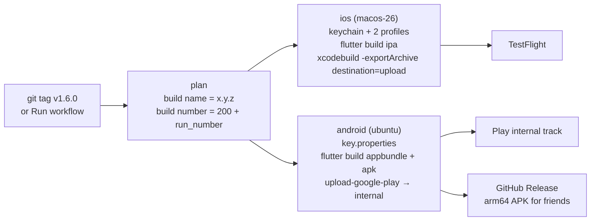

# Releasing Chopstats · 筷拍

How the app gets from a git tag to TestFlight / the App Store and to Google
Play, and everything the owner has to do once by hand before that works.
Written 2026-10-10 against Flutter 3.44.2, Xcode 26.2 and the GitHub
`macos-26` / `ubuntu-24.04` runner images; § 1.4, § 1.7, § 4 and the owner
steps below were brought up to date on 2026-10-25 after an App Review audit
of the first store build, and on 2026-10-29 with the owner's decisions; § 6
(Google Play) was rewritten on 2026-11-13. The store consoles move around, so treat exact
menu names as "as of this writing".

| Piece | What it does | Secrets |
|---|---|---|
| [`.github/workflows/mobile-build.yml`](../.github/workflows/mobile-build.yml) | On every PR and push to `main`, `loop/**`, `feat/**`, `fix/**` (docs-only changes skipped): compiles the iOS project unsigned (Runner **and** ShareExtension) on macOS and the Android app bundle on Ubuntu. Passes today, before any enrolment. | none |
| [`.github/workflows/release.yml`](../.github/workflows/release.yml) | On a `v*` tag or **Actions → Release → Run workflow**: signed IPA → TestFlight, signed AAB → Play internal track (Run workflow can pick the closed test's `alpha` track), arm64 APK → GitHub Release (tags only). Lanes whose secrets are missing are skipped with a warning naming them. | listed in [§ 3](#3-github-secrets-and-variables) |
| [`.github/workflows/python-tests.yml`](../.github/workflows/python-tests.yml) | The existing server + Flutter test CI. Unchanged. | none |
| [`app/ios/ExportOptions.plist`](../app/ios/ExportOptions.plist) | Manual-signing export options naming a profile for **both** bundle ids. CI overwrites the team id and profile names with what it reads from the secrets. | |
| [`app/android/app/build.gradle.kts`](../app/android/app/build.gradle.kts) | Signs the release build with the upload key when `app/android/key.properties` exists, otherwise with the debug key plus a warning. | |
| [`app/android/whatsnew/`](../app/android/whatsnew/) | Play "What's new" text per locale, sent with every upload. | |
| [`app/android/store/`](../app/android/store/) | The Play listing (`metadata/`), graphics, the screenshot list, and the App content and Data safety answers (§ 6.5). | |



Identifiers that must match everywhere:

| | Value |
|---|---|
| iOS app bundle id | `dev.calorietracker.calorieTracker` |
| iOS share-extension bundle id | `dev.calorietracker.calorieTracker.ShareExtension` |
| App Group (both targets) | `group.dev.calorietracker.calorieTracker` |
| Apple team in `Runner.xcodeproj` today | `WLQB3YB22M` — the paid Apple Developer Program (Individual) since 2026-10-29; the Team ID did not change on enrolment (§ 1.2), so the keychain and the dev build carry over |
| Android package / application id | `dev.calorietracker.calorie_tracker` (permanent once the Play app record exists: Create app asks for it, § 6.1) |
| Display name | `Chopstats` (Info.plist `CFBundleDisplayName` and en `InfoPlist.strings`, both targets; 筷拍 under zh-Hans); store name `Chopstats · 筷拍` (owner decision R-F9, 2026-10-29; formerly BiteWise) |
| Version | `app/pubspec.yaml` `version: 1.7.0+9` → `CFBundleShortVersionString` / `versionName` = `1.7.0`; the build number is stamped by CI (§ 5) |

---

## First submission — owner steps in order

Status on 2026-10-29: the first App Store build is `main` + PR #18 (HEIC/GPU
fix) + the release fixes on `release/app-store-1` (per-recipient AI consent,
share-extension purpose string, the owner's decisions, this document). The
restaurant assist and the glasses work (PRs #19/#20) are **not** in it. The
finding ids refer to the 2026-10-25 App Review audit. The owner decided
steps 1 and 2 on 2026-10-29 (the recommended answer each time) and they are
**done in this branch**; the demo key (step 7, R-F6) is still open.

1. **Name** (R-F9) — **DONE 2026-10-29: renamed to Chopstats.** A check on
   2026-10-29 found 12+ live US App Store apps called Bitewise/BiteWise
   (most of them calorie trackers, two sellers are companies named
   Bitewise) and a crowded BITE-/-WISE field at the USPTO, so the English
   name changed. **Chopstats** (筷 chopsticks → stats) had no same-name US
   App Store app and no live or pending USPTO mark (one dead filing); the
   runners-up were Forktally, Pictrition, Platemetry and Gramcracker. This
   is a practical check, not a lawyer's clearance search (state registers
   and unregistered use were not searched). The store name is
   `Chopstats · 筷拍` (14 characters). **Chopstats** is the English display
   name everywhere: `CFBundleDisplayName` in `Info.plist` and en
   `InfoPlist.strings` of Runner **and** ShareExtension, the photo purpose
   string in both, every en UI string (`app_en.arb`, the startup-error
   screen, the `MaterialApp` title), the OpenRouter `X-OpenRouter-Title`,
   the Android launcher label, `docs/PRIVACY.md`, `docs/SUPPORT.md`, the
   README heading and the store metadata. Unchanged on purpose: the zh
   display name 筷拍, the `bitewise://` URL scheme (the setup links and
   `scripts/provision_phone.sh` use it), the bundle ids, the App Group, the
   GitHub repository name, and the certificate/profile labels in § 1.6 and
   `ExportOptions.plist` (internal names nobody else sees). Pinned by
   `app/test/release_decisions_test.dart`.
2. **The open product questions** — **DONE 2026-10-29**:
   - *Own-server row* (R-F5) — **A, neutral.** The connection type that
     said "Subscription" is **Your own server** / 你自己的服务器, with a
     server icon (`Icons.dns_outlined`) instead of the premium badge. Its
     page lists **Claude**, **GLM** and **Doubao** (豆包) under "AI on your
     server", with the company as the note. Everywhere else (the Settings
     root row, *Stop Sharing with …*, the camera-roll notice, the setup-link
     sheet, diagnostics) the AI reads **Claude (server)** / 你服务器上的
     Claude: "Claude via your server" cut the root row's *AI Provider* title
     at 375 pt (`row_fit_layout_test.dart`). Gone: "photos cost nothing
     extra", "flat-rate", "subscription analysis" and "needs credits on Pro"
     (the Fable row is "Fable — frontier"). The setup-link sheet says
     "AI:" instead of "Plan:". Behaviour is unchanged (provider id `server`,
     consent route `server:<plan>`), so your own Claude setup keeps working
     with zero taps (`app/test/ui/own_server_row_test.dart`). Accepted with
     A: the remaining Anthropic/Zhipu terms risk for your own accounts.
   - *Mainland-China/VPN text in the English UI* (R-F11) — **A.** No en
     string gives mainland-China or VPN advice or carries Chinese text: the
     welcome card, the API-key page footer and row notes (empty in English,
     and an empty note shows no value), the Gemini, DeepSeek, Qwen and
     Doubao key footers, Connect Claude, the diagnostics fixes, the
     region-block messages, the Describe/Fix examples, and the model labels
     (`{free}` is "FREE" in en and "FREE 免费" in zh). zh is unchanged. One
     deliberate exception: the consent dialog keeps "{company} processes it
     on servers in mainland China" — that says where the data goes, not how
     to reach a provider. Provider brand names keep their Chinese name
     (Qwen 通义千问). Pinned by `release_decisions_test.dart`.
   - *Privacy policy* (R-F7) — **A.** `docs/PRIVACY.md` has a "Third
     parties and your consent" / 第三方与你的同意 section and the effective
     date 2026-10-29: who receives what (the provider you picked, or your
     own server and the AI plan configured on it; OpenRouter passes it on),
     what each request carries, asking first, withdrawing with Settings ›
     *Stop Sharing with …*, and that each provider's own terms and
     retention apply (no claim that they all protect data equally). On the
     way, an over-disclosure was fixed: *Describe a meal* sends only the
     text and today's date (`NlExecutor.describeMeal` builds its prompt with
     an empty meal list); only *Fix or delete a meal* (`handleText`) sends
     the last 7 days of meals. The consent dialog (en + zh), the policy,
     § 1.7, § 4.3 and the `add_flow.dart` comments now say so.
   - *App Privacy answer* (R-F8) — **B, declare**: Photos or Videos, Health,
     Other User Content; App Functionality only; not linked; no tracking.
     `Runner/PrivacyInfo.xcprivacy` declares exactly these three; the
     ShareExtension's array stays empty (it sends nothing itself). The
     click-by-click App Store Connect answers are in § 4.3.
   - *Support URL* (R-F14) — **A.** [`docs/SUPPORT.md`](SUPPORT.md): iPhone
     only; what the app does, where each provider's key comes from (a
     sentence each), the own-server option, troubleshooting, export /
     delete / stop sharing, GitHub Issues. Both listings' `support_url.txt`
     point at https://github.com/AkiyamaKunka/Chopstats/blob/main/docs/SUPPORT.md
     (404 until this branch is on `main`, step 3). Public contact address
     chosen 2026-10-29: junjia.wang.me@gmail.com (also usable as the App
     Review contact).
3. **Merge PR #18, then the release PR, into `main`** (the step 2 fixes
   are part of it; T-TC-5: **main must equal the store build**; the alternative,
   running the Release workflow on the branch with *internal-only*
   unticked, leaves `main` behind the App Store).
4. Enrol, check the Team ID, create the App IDs, the App Group and the app
   record (§ 1.1–1.4): primary language **English (U.S.)**, zh-Hans as an
   optional localization; name from step 1. **Enrolment and the Team ID
   check are DONE (2026-10-29):** the owner enrolled as an Individual with
   the same Apple ID, Xcode shows the team as a paid Developer Team, and a
   development build signed afterwards carries team `WLQB3YB22M` with a
   one-year profile — the Team ID did not change, so the export below is
   not needed. Kept for reference: **if the Team ID were no longer
   `WLQB3YB22M`**, iOS will refuse to install the TestFlight build over
   today's dev build (§ 1.2), and deleting the dev build wipes its meals
   and settings. So, at step 6:
   1. Settings › Your Data › *Export Data…* (你的数据 › 导出数据…) and
      AirDrop the file to the Mac. It holds the meals, the photo ledger
      (so the scan does not send those photos again) and the body and
      workout data — not the settings, the dietary profile, the meal
      thumbnails or the keys, so write down the dietary profile, the
      lookback (7 days) and the report time.
   2. Only then delete the dev build and install from TestFlight.
   3. Open the file on the Mac, copy all of its text, and on the phone use
      *Import Data…* › *Import from clipboard* (Universal Clipboard).
   4. Set the provider again (your own server: the setup link from
      `scripts/provision_phone.sh --qr`; confirming it is the consent),
      re-enter what you wrote down, and turn on *Watch Camera Roll* again
      — expect the consent and camera-roll notice once.
5. API key, certificate, profiles, GitHub secrets (§ 1.5, 1.6, 3) — or the
   Xcode shortcut (§ 2) for a same-day TestFlight build.
6. **Tag `v1.5.0` on `main`** (§ 4.1, § 8) → TestFlight → install on your
   iPhone through TestFlight and check § 4.2. With an unchanged Team ID it
   installs over the dev build, keeps everything, and shows no consent
   dialog: an install with the watcher on keeps its current recipient (the
   one-time seed in `AppSettings._loadAiConsent`). After a Team ID change
   it is the fresh install from step 4, which asks once. (A later build
   that includes run 7 asks your install once more, "What Chopstats sends
   has changed": the seeded grant is version 1 — § 1.7 item 4, *Wording
   updates*.)
7. **Demo key** (R-F6) — **still open** (being discussed with the owner,
   2026-10-29; the review notes keep the `<key>` placeholder until then).
   The recommendation so far: **a paid Gemini key in its own Google Cloud
   project**, with the per-day request quota lowered (that is the hard cap;
   a budget only sends alerts) plus a budget alert. Gemini is the default
   provider, so the reviewer's path is shortest. Not a free-tier key: the
   2-day backfill can exhaust it during review, Google may use the inputs,
   and it is unavailable in some regions. A prepaid key at another provider
   (auto-recharge off) also works, but the reviewer must pick that provider.
   The key goes only into the App Review notes field.
8. App Store Connect: App Privacy (§ 4.3, answer B click by click), age rating
   **9+** (§ 4.4), screenshots from an **iPhone 17 Pro Max** simulator you
   create yourself (§ 4.4), metadata with the support and privacy-policy
   URLs, Free, **deselect China mainland** (§ 7), review notes (§ 4.4) with
   the demo key, *Manually release this version*. Submit.
9. After approval: revoke the demo key; update the README install section
   for the App Store.

Later, not needed for the first submission: a launch screen that is not
white in dark mode (T-TC-9), asking for notifications in context instead of
at first launch (R-F13), an on-device food check before the watcher uploads
(R-F12, on PR #19's branch), and "Save Image" from the share sheet
(`NSPhotoLibraryAddUsageDescription`, R-F10 — today iOS simply leaves the
option out).

**When PR #19 (restaurant assist) is merged on top of this build** (done
2026-10-30 on PR #19's branch, following these notes), seven
files conflict (`di.dart`, `add_flow.dart`, `fix_meal_screen.dart`,
`provider_page.dart`, `settings_screen.dart`, `services.dart`, this
document); every hunk keeps both sides:
- `di.dart`: keep `pipeline.bindStream(shareConsent.gate(shareIntake.photos()))`
  and then #19's `mealAssist.start()`. A resolution that keeps #19's bare
  `shareIntake.photos()` fails `test/production_wiring_test.dart`.
- `FixMealScreen` takes both `settings:` and `inUse:` (constructor and the
  `add_flow.dart` call). `settings` is required, so a one-sided resolution
  does not compile; #19's `test/ui/meal_in_use_test.dart` call gains
  `settings: FakeSettings()`.
- Regenerate l10n afterwards (`flutter gen-l10n` in `app/`).

The owner's decisions of 2026-10-29 (owner steps 1–2) add these; every hunk
again keeps both sides:
- `Runner/Info.plist` and `Runner/{en,zh-Hans}.lproj/InfoPlist.strings`:
  #19 extends `NSPhotoLibraryUsageDescription` with the photo-location
  sentence. Take #19's text, write **Chopstats** in both of its en
  sentences, and copy the result to the ShareExtension's `Info.plist` and
  `InfoPlist.strings` (en and zh-Hans): `share_extension_plist_test.dart`
  wants them equal to Runner's.
- `PrivacyInfo.xcprivacy` / `app/test/manifest_gate_test.dart`: #19's test
  "both privacy manifests declare no collected data types" pins `<array/>`
  in **both** targets; Runner now declares the three answer-B types. Keep
  the empty-array check for ShareExtension only (or drop it for
  `release_decisions_test.dart`), and rewrite #19's § 4.3 paragraph
  "Restaurant nutrition lookup … stays *Data Not Collected*": the answer
  stays **B**, and the lookup adds no type (chain and food names go to the
  same user-chosen recipient as the photos; the photo location goes only to
  Apple's MapKit, so Location stays No).
- `app_en.arb` / `app_zh.arb`: #19's own strings write BiteWise — rename them to Chopstats —
  and carry no VPN text. Its tests pin the old own-server labels — 'Claude
  Plan' / 'Claude 订阅' through `planShortClaude`
  (`assistProviderLabel`) in `test/ui/assist_source_card_test.dart`,
  `test/ui/diagnostics_test.dart` and `test/ui/setup_link_flow_test.dart`:
  update them to 'Claude (server)' / '你服务器上的 Claude'.
  `release_decisions_test.dart` and `own_server_row_test.dart` catch any en
  string that brings back Chinese text, VPN advice or plan talk.
- `docs/PRIVACY.md`: the effective date conflicts (#19 2026-10-24, this
  branch 2026-10-29); #19 changes the policy, so give it the merge date.
  The date (line 3) and its pin in `app/test/release_decisions_test.dart`
  ("with the new effective date") are set by hand, and must be set again
  to the merge date when PR #19 merges, when the usual-foods PR merges
  (below), and once more when PR #22 (run 7) merges. A 3-way merge keeps
  the older date without a conflict, and no test can tell that the date
  is stale.
  #19's added sentences say "Claude Plan" (the intro's "with Claude Plan,
  the server you run", the restaurant section's **Claude Plan:** bullet, and
  the 中文 counterparts): rename them to "your own server" / 你自己的服务器.
  The "Third parties and your consent" section sits before "Changes and
  contact", clear of #19's hunks; add a bullet to its "What that recipient
  receives" list pointing at #19's *Restaurant nutrition lookup* section.
- `provider_page.dart`: on top of the hunks above, this branch changes the
  own-server row (icon, `serverPlanName` value), `noteLabel` (now
  `String?`) and the `{free}` model labels; keep both sides.

The assist's lookups (chain and item names to the user's server,
Anthropic or OpenRouter/Exa) already have their own per-recipient consent
(#19's restaurant consent sheet; every lookup checks `consentCovers`), so
they need no second gate on the AI consent. *Stop Sharing with …* also
turns the assist off when its lookups go to the same company or server
(`stopRestaurantAssistFor` in ui/widgets/restaurant_consent_sheet.dart):
the row says "nothing more is sent to …", so it takes the mode row's Off
path (pending lookups dropped) and forgets the assist's consent for that
recipient; turning lookups back on for it asks again. One residual is
known and accepted: a direct Anthropic lookup already in flight when the
row is confirmed may still send one continuation of the request it
started (a paused turn) before its cancellation lands, which is up to
three preference writes later (a few milliseconds by estimate); no new
lookup, poll or retry starts.

Photos are held to the same row. The AI consent is asked when a photo is
admitted (the add flow, a shared photo's gate, the Watch Camera Roll
switch), and the photo pipeline reads it again when the photo's turn
comes and once more at the send (`AiSendGate` in ui/photo_pipeline.dart,
built by `aiSendGateFor`; the background run re-reads it from disk): a
photo still queued when *Stop Sharing with …* is confirmed, or queued
across a provider switch, is let go unsent and its ledger row left as it
was. The residual here is the photo already in flight: once the analyzer
was called, that one request finishes (it resizes the photo for about a
second and then uploads it to the recipient chosen at the call); nothing
queued behind it is sent.

**When the usual-foods PR is merged** (`feat/usual-foods`: lookup answers
that found a chain's published numbers are kept a year, your usual
numbers on a photo, *My usual foods*):
- **Order:** **#19 → this PR → #22 (run 7)**, then one restyle commit
  (below). This is the default; the order is the owner's call. #22 waits
  for the 1.5.0 review anyway.
- **Retarget to `main`.** The PR is a draft stacked on #19 (base
  `feat/glasses-restaurant-assist`). When #19 merges, change its base to
  `main` before merging it.
- **The policy date** is set by hand at each of the three merges (the
  `docs/PRIVACY.md` note above).
- Its logic lives in new files under `app/lib/`:
  `core/usual_foods_logic.dart`, `services/usual/usual_foods.dart`,
  `services/usual/usual_choices.dart`, `ui/widgets/usual_chip.dart`,
  `ui/widgets/usual_offer_card.dart` and `ui/screens/usual_foods_screen.dart`.
  It does not touch `photo_pipeline.dart`, `background_glue.dart`,
  `executor.dart`, `day_detail_screen.dart`, `history_screen.dart`,
  `meals_dao_impl.dart`, `db.dart`, `local_store.dart`, `app_settings.dart`,
  the Python server or `shared/`.

This PR's hunks against #22, predicted with `git merge-file` per file (base
7fce5d4 = `main`; ours = f1033b3 plus this PR's hunks; theirs = 8e24932 =
#22). Paths are under `app/lib/` unless they start with `docs/` or
`test/`:

| File | #22 change | This PR's hunk, and where it must go | Result |
|---|---|---|---|
| `ui/screens/add_flow.dart` | Log sheet becomes `showGroupedSheet`; main 31-117 rewritten | One line `if (services.usualFoods != null) usualFoodsRow(ctx),` after `addFromPhotos`; the `else if (choice == 'usual')` branch in the dispatch (main 118-141, untouched by #22); the import after `meal_editor_screen.dart` or `small_spinner.dart` | **The row line conflicts** (certain). Re-add that one line into #22's first `GroupedSection`, right after the `addFromPhotos` row. The dispatch and the import merge clean. |
| `ui/screens/today_screen.dart` | list body rewritten | `usual` field after `final SettingsStore? settings;`; `this.usual`; `_usualOffers` after `_assistUnseen`; `_refreshUsual(todayMeals)` after the `setState` in `reload()`; `usual: widget.usual` in `_editMeal`; `usualChip:` after `assistUnseen:`; imports next to #19's `restaurant_assist_controls` / `services` imports, not after `meal_editor_screen.dart` | Clean |
| `ui/widgets/meal_card.dart` | header moved to `meal_parts.dart` | field, constructor parameter, and the slot after `_AssistChip(...)`; no new import (it takes a `Widget`) | Clean |
| `ui/screens/meal_editor_screen.dart` | ~65 layout lines; appends imports after `small_spinner.dart` | `fresh` / `_freshNext`, the snackbars, `onSearchAgain`, the `usual` parameter, the prefill strip, `keepUserMarks`, the card after `assistCard`, `toAnalysis(now:)`; imports mid-block (`usual_offer_card` after `glasses_badge`; `services/usual/...` before `services/photo/glasses...`) | Clean only with mid-block imports |
| `ui/app.dart`, `ui/services.dart`, `ui/di.dart`, `core/contracts.dart` | +291 / +20 / +61 / `reservePhotoHash` signature | `usual: s.usualFoods` after `settings: s.settings` on `TodayScreen`; the field after `restaurantAssist`; `UsualChoices(...)` / `UsualFoods(...)` after #19's `RestaurantAssistControls(` block and `usualFoods:` after `restaurantAssist: restaurantAssist`; `appRepeat` after `appManualPhoto` | Clean |
| `l10n/app_en.arb`, `l10n/app_zh.arb` | last hunks end at main :1787 / :685 | keys appended at the end; `clearPlacesBody` (#19 only) edited | Clean, and valid JSON |
| `docs/PRIVACY.md` | hunks at :62, :113; zh :181, :208 | the on-phone bullets, saved with the meal, turning it off, deleting | Clean (checked again on 2026-11-07 with this PR's policy and 8e24932). Reset the date and its pin by hand. |
| `test/widget_test.dart` | 7 lines | `addUsual` cases | Keep both |
| #19-only files (`restaurant_section.dart`, `restaurant_consent_sheet.dart`, `assist_source_card.dart`, `assist_view.dart`, `restaurant_assist_controls.dart`, `restaurant_assist_logic.dart`, `meal_assist.dart`, `assist_local_state.dart`) and `meal_edit_logic.dart`, which #22 does not touch | — | — | No conflict possible |

The prediction was made before the hunks were written, so run it again on
the real heads before merging (on `main` with this PR in; a file that
prints is a conflict):

```bash
(
  set -eu
  theirs=8e24932   # #22's head at the time; use its current head
  base=$(git merge-base main "$theirs")
  t=$(mktemp -d "${TMPDIR:-/tmp}/merge-check.XXXXXX")
  for f in $(git diff --name-only "$base" "$theirs"); do
    git show "${base}:${f}" > "$t/b" 2>/dev/null || : > "$t/b"
    git show "main:${f}" > "$t/o" 2>/dev/null || : > "$t/o"
    git show "${theirs}:${f}" > "$t/t" 2>/dev/null || : > "$t/t"
    git merge-file -q "$t/o" "$t/b" "$t/t" || echo "conflict: $f"
  done
)
```

When merging #22 after this PR:
- **Never hand-merge the generated `app_localizations*.dart`.** Take
  either side, then run `flutter gen-l10n` in `app/`.
- `app/test/ui/usual_copy_test.dart` pins the number of keys in each ARB
  file: 809 on `main` since #22 merged, 890 on the iCloud Backup branch
  merged with #33 and the review-171 fixes (`feat/icloud-backup` adds 72
  `backup*` and `import*` keys, #33's source-link label 1, the Test AI
  provider page's three `diagStatus*` check states 3, the Body tab's three
  failure lines 3, the coverage window slider's screen-reader name
  `covWindowLabel` 1, the Leftovers screen's two failure lines 2, none
  shared; review r171 deleted `bodyEmptyHintImperial`, the same text as
  `bodyEmptyHint`). If either side adds keys before both merge, change the
  number in that test to the merged count, and here too (the test checks
  this line); both files must still have the same keys. Do not drop the
  check.
- The policy's *My usual foods* bullet says a meal changed with them goes
  with "the next photo you log that day (and with one taken before 4 a.m.
  the next day)", because #22 also sends the day before's meals with a
  photo taken before 4 a.m. Both languages say so since the merge of `main`
  into #22, and `tests/test_privacy_docs.py` pins it; keep it when you give
  #22 its merge date.
- When run 7's build reaches the App Store, say the day before's meals in
  `README.md` and `README.zh-CN.md` too, in both languages. They describe
  the App Store build, and three places in each name that day's meals
  only: the Privacy paragraph (当天其他餐食), the "You log a photo" bullet
  and the own-server bullet on what the phone supplies (当天的餐食摘要).
  Use the wording `docs/SERVER.md` already has: "that day's meal
  summaries, plus the day before's for a photo taken before 4 a.m.".

**After #22, one restyle commit:** **done 2026-11-11** on branch
`chore/usual-foods-run7-kit` (from `main` at 2b85014, a few small
commits: cc26be4 to da80fa5). Where each item went:
- *My usual foods* (`ui/screens/usual_foods_screen.dart`, cc26be4): rows
  are `GroupedRow.custom` in `context.colors`; `LoadingState`, an
  `InlineError` with Retry for a failed read, `EmptyState` for the empty
  and all-hidden states; "Log it again?" is `appAlertDialog`; the hidden
  row's badge is the neutral grey. The Hidden foods sheet is a
  `GroupedSheet` built by its route, as Body's log sheet is, not
  `showGroupedSheet`: its title counts the meals still hidden, and
  `showGroupedSheet` fixes the title when the sheet opens.
- The usual-numbers card (`ui/widgets/usual_offer_card.dart`) is a
  `GroupedCard`, and the chip (`ui/widgets/usual_chip.dart`) uses the
  tokens (0ded068). The card keeps its tonal and outlined buttons, which
  the theme draws as the editor's other controls.
- The Android clear dialog (`_confirmClearAnswers` in
  `ui/screens/settings/restaurant_section.dart`) is `appAlertDialog`
  (c27e551). Its Clear and that of #19's iOS "Clear learned places?"
  beside it are `AppButtonStyles.destructive`, as Stop sharing and every
  Delete are; the iOS dialog is otherwise unchanged.
- The Log sheet row was already back after the #22 merge, on the neutral
  role (`colorScheme.secondary`, painted `badgeNeutral`).
- Tests: `add_flow_refresh_test` builds services with the usual-foods
  service on (`makeUsualFoods` over a `FakeDao`) and pins
  `_badgeFill(tester, 'addUsual')` to `badgeNeutral` in light and dark;
  its AX5-on-SE loop (375×667, en and zh) runs with the row present
  (9f1aa09). `meal_editor_large_text_test` renders the usual card with
  two items (fe04d8f); it found the description's floated label covering
  the card's bottom edge at AX5, so the card right above the description
  now leaves `_gapAboveField(16)`. `large_text_dialog_test` adds "Log it
  again?" in en and zh (da80fa5). `theme_contrast_test` still passes.

**Check after any of these merges.** The #19 × #22 merge is textually
clean but has never been compiled. On the merged tree run
`flutter gen-l10n`, `flutter analyze` and `flutter test` in `app/`, and
`pytest tests/` from the repo root (`tests/test_privacy_docs.py` pins the
policy).

---

## 1. Apple: one-time setup

### 1.1 Enrol in the Apple Developer Program

**Done 2026-10-29** (Individual, same Apple ID; the Team ID stayed
`WLQB3YB22M`). Before that, the team was a free personal team: 7-day
profiles, no TestFlight, no App Store, no App Store Connect API. The steps,
for reference:

1. <https://developer.apple.com/programs/enroll/> → Individual. Needs
   two-factor authentication on the Apple Account and your legal name.
   US$99 per membership year; activation can take up to 48 h.
2. Once active, open Xcode → Settings → Accounts; the team should now read
   *"(Individual)"* instead of *"(Personal Team)"*.

### 1.2 Check the Team ID (keychain continuity)

An individual who upgrades the same Apple Account normally keeps the same
Team ID: the enrolment converts the personal team. Verify it in
<https://developer.apple.com/account> → Membership details. **If it
changed**, update `teamID` in `app/ios/ExportOptions.plist` and
`DEVELOPMENT_TEAM` in `app/ios/Runner.xcodeproj/project.pbxproj` (every
occurrence, Runner and ShareExtension), and expect this on the phone (not
tested on a device; this is how iOS treats a new team prefix):

- iOS refuses to upgrade an installed app whose `application-identifier`
  (`<TeamID>.dev.calorietracker.calorieTracker`) differs from the new
  build's (MIInstallerErrorDomain: the upgrade's application-identifier
  "does not match" the installed one). The TestFlight build cannot replace
  today's dev build in place.
- The dev build must be deleted first, and that deletes its sandbox: the
  meal database and every setting (the watcher switch and the AI consent
  seed included). The keychain items stay behind in the old team's access
  group, which the new build cannot read either.
- So export the data first and import it into the TestFlight build: the
  sequence is owner step 4. The fresh install asks for the AI consent once,
  like any new install.
- If § 1.3 then says an identifier is "not available", the old personal
  team still holds it; Apple Developer Support can release it.

Either way, never install a build older than commit `9df6846` on the
owner's iPhone again (the keychain migration is one-way).

### 1.3 Identifiers: two App IDs and the App Group

<https://developer.apple.com/account/resources/identifiers/list>

1. **App Group**: Identifiers → + → App Groups → identifier
   `group.dev.calorietracker.calorieTracker`, description "Chopstats".
2. **App ID** `dev.calorietracker.calorieTracker` (explicit, type App):
   Capabilities → tick **App Groups** → Configure → select the group above.
   Also tick nothing else; background fetch needs no capability.
3. **App ID** `dev.calorietracker.calorieTracker.ShareExtension`
   (explicit): the same App Groups capability bound to the same group.

Both entitlement files in the repo already ask for the group; if an App ID
lacks the capability the archive step passes but App Store Connect rejects
the upload with ITMS-90078 (see § 9).

### 1.4 The app record in App Store Connect

<https://appstoreconnect.apple.com> → My Apps → + → New App:

- Platform iOS; Name `Chopstats · 筷拍` (30 chars max; the name is global,
  pick another if taken — and see owner step 1 about the existing
  *Bitewise: AI Calorie Tracker*); Primary language **English (U.S.)** (the
  listing is US-only), with Chinese (Simplified) as an optional
  localization; Bundle ID `dev.calorietracker.calorieTracker`; SKU
  `bitewise-ios`; User Access: Full.
- Name, subtitle and keywords carry no provider marks (Gemini, Claude,
  OpenAI, …) and no accuracy claims; nothing in the listing mentions
  Android, the APK or Telegram (guideline 2.3.10).
- Note the app's numeric **Apple ID** (App Information → General). It is
  only needed for the altool fallback (variable `ASC_APP_APPLE_ID`).

### 1.5 App Store Connect API key (for uploads from CI)

Users and Access → Integrations → App Store Connect API → **Team Keys**
(the Account Holder must first click *Request Access* once):

1. Generate API Key → Name `bitewise-ci`, Access **App Manager** (enough to
   upload builds; this lane never creates certificates or profiles through
   the API — those are made by hand in § 1.6; only cloud signing would need
   Admin).
2. Download `AuthKey_<KEYID>.p8` — **Apple offers the download exactly
   once.** Note the **Key ID** (10 chars) and the **Issuer ID** (UUID shown
   at the top of the page).
3. Turn them into secrets (§ 3): `ASC_KEY_ID`, `ASC_ISSUER_ID`,
   `ASC_API_KEY_P8_BASE64`.

### 1.6 Certificate and the two provisioning profiles

The lane signs manually: one Apple Distribution certificate (valid one year,
shared by both targets) and one App Store profile per bundle id. Do this on
the owner's Mac; the private key never leaves it except inside the encrypted
`.p12` that becomes a secret.

1. **Certificate signing request**: Keychain Access → Certificate Assistant
   → Request a Certificate From a Certificate Authority → your email, common
   name "BiteWise Distribution", *Saved to disk* → `BiteWise.certSigningRequest`.
2. **Apple Distribution certificate**: Certificates, Identifiers & Profiles
   → Certificates → + → *Apple Distribution* → upload the CSR → Download
   `distribution.cer` → double-click to import into the login keychain.
   (Only the Account Holder/Admin can create it; a team may hold at most a
   couple at a time, so reuse rather than re-create.)
3. **Export the .p12**: Keychain Access → My Certificates → expand *Apple
   Distribution: <name>* so the private key shows → select **both** rows →
   right-click → Export 2 items → format `.p12` → choose a strong password
   (that password becomes `IOS_DIST_P12_PASSWORD`). A `.p12` exported from
   the certificate row alone has no private key and the workflow stops at
   "expected exactly one valid 'Apple Distribution' identity".
4. **Profiles**: Profiles → + → Distribution → *App Store Connect* → App ID
   `dev.calorietracker.calorieTracker` → the certificate from step 2 → name
   `BiteWise AppStore` → Generate → Download. Repeat for the ShareExtension
   App ID with the name `BiteWise ShareExtension AppStore`. The names are
   free text: the workflow reads the real names out of the files.
5. Secrets (§ 3): `IOS_DIST_P12_BASE64`, `IOS_DIST_P12_PASSWORD`,
   `IOS_PROFILE_RUNNER_BASE64`, `IOS_PROFILE_SHAREEXT_BASE64`.
6. Delete the exported `.p12`, `.cer`, `.mobileprovision` and `.p8` from
   Downloads afterwards (the root `.gitignore` also refuses to track them).

Calendar note: the certificate and both profiles expire after one year; the
workflow checks the certificate's and both profiles' expiry dates up front
and names the one to renew.

### 1.7 Code prerequisites before the first upload

All done; this is what each one is and where it lives.

- `ITSAppUsesNonExemptEncryption = false` in `app/ios/Runner/Info.plist`
  (the app only uses OS TLS, the keychain and SHA hashing, which are exempt;
  without the key every build sits in "Missing Compliance" until answered).
- `app/pubspec.yaml` is `1.7.0+9`; the ShareExtension takes its version from
  `$(FLUTTER_BUILD_NAME)` / `$(FLUTTER_BUILD_NUMBER)`.

1. **Privacy manifests — done.** Both targets ship a
   `PrivacyInfo.xcprivacy` in their own Resources phase, pinned by
   `app/test/manifest_gate_test.dart`:

   | Target | Required-reason APIs declared | `NSPrivacyCollectedDataTypes` |
   |---|---|---|
   | Runner | UserDefaults `CA92.1`, `1C8F.1`; FileTimestamp `C617.1` | PhotosorVideos, Health, OtherUserContent — not linked, no tracking, App Functionality (§ 4.3, answer B) |
   | ShareExtension | UserDefaults `CA92.1`, `1C8F.1` | empty: the extension sends nothing itself (§ 4.3) |

   The plugins are linked statically through Swift Package Manager
   (`FlutterGeneratedPluginSwiftPackage` in `project.pbxproj`), so their
   code compiles into these two executables, and the two manifests above
   cover the APIs it calls. Their own manifests (as of the locked versions):

   | Plugin | Own manifest | Declares |
   |---|---|---|
   | app_links 7.2.1, share_plus 13.2.1, sqflite_darwin 2.4.3+1, url_launcher_ios 6.4.1, flutter_secure_storage_darwin 0.3.2 | yes | nothing |
   | flutter_local_notifications 22.0.1, permission_handler_apple 9.4.10, shared_preferences_foundation 2.5.6, workmanager_apple 0.9.1+2 | yes | UserDefaults |
   | photo_manager 3.10.0 | yes | FileTimestamp; collected PhotosorVideos (so Xcode's privacy report lists it; App Store Connect does not cross-check it against the label) |
   | receive_sharing_intent 1.9.0 | **no** | — its `UserDefaults(suiteName:)` call is covered by both targets' UserDefaults entries |
   | path_provider_foundation 2.6.0 | n/a | no native iOS code (Dart FFI through `objective_c`) |
   | integration_test (dev dependency) | no | linked into Release by Flutter's generated package; public API only, no XCTest (T-TC-7) |

   The old "fork `receive_sharing_intent`" contingency is dropped: it is
   compiled into the targets rather than shipped as a framework, and neither
   it nor `objective_c` is on Apple's list of SDKs that need their own
   manifest. If ITMS-91053 ever arrives anyway, the email names the API
   category to add to the target's manifest.
2. **iPhone only.** Both targets are `TARGETED_DEVICE_FAMILY = 1` (decided
   2026-10-12): the UI is phone-only, so no iPad screenshots are needed and
   App Review tests on an iPhone. iPads can still run it in iPhone
   compatibility mode. Adding iPad later is allowed; removing it after an
   iPad-capable version has shipped is not, so keep it this way unless an
   iPad layout is built.
3. **Privacy policy URL** (guideline 5.1.1) — **done.** The policy is
   `docs/PRIVACY.md` (English + 中文) at
   https://github.com/AkiyamaKunka/Chopstats/blob/main/docs/PRIVACY.md (live,
   HTTP 200), linked in the app at Settings › Your Data › *Privacy Policy*
   (`privacyPolicyUri` in `settings_screen.dart`). Keep the file in step with
   what the code sends. The "Third parties and your consent" section
   (R-F7) is in, effective 2026-10-29.
4. **Consent before data goes to a third-party AI** (guideline 5.1.2(i)) —
   **done in this branch** (`app/lib/ui/ai_consent.dart`,
   `app/lib/core/ai_consent.dart`). Consent is per recipient: the provider
   id for an API key, `server:<plan>` for the user's own server (the plan is
   the AI company, so a plan switch asks again; a server address edit does
   not). The dialog names the company, lists what goes with a photo
   (dietary profile, a summary of that day's other meals, plus the day
   before's for a photo taken before 4 a.m.), with *Describe
   a meal* (the text only) and with *Fix or delete a meal* (the last 7
   days of meals), and says where DeepSeek, Qwen,
   Doubao, GLM and the GLM/Doubao plans process data (mainland China). It
   is asked:
   - before a picked photo's bytes are read, before Describe/Fix a meal,
     Leftovers, *Test This Provider* and Photo Coverage *Log all / Retry*;
   - for a photo shared into the app, which is held until answered (Not
     now drops it and says so);
   - when *Watch Camera Roll* is turned on (with the camera-roll notice),
     and when the provider or plan changes while it is on (Not now keeps the
     previous choice); with the watcher off the next foreground send asks;
   - by the setup-link dialog, which now names the plan's company:
     confirming it is the consent.

   Settings › *Stop Sharing with …* withdraws it and turns *Watch Camera
   Roll* off (and the restaurant assist, when its lookups go to that
   recipient). A foreground send without a configured key asks nothing
   (nothing can leave; it fails with its own "no key" message).
   Existing installs: on the first launch of this build an install with the
   watcher on, or that accepted the old camera-roll notice, keeps its
   current recipient (not gated on a key: a watcher left on without a key
   must not start sending, unasked, once a key is pasted). The photo
   pipeline is unchanged: every automatic send already needs the watcher.
   *Wording updates* (run 7): each grant records the consent text it was
   given under (`settings.ai_consent_versions`, `aiConsentWordingVersion`
   in `core/ai_consent.dart`; 2 = the before-4 a.m. previous-day context).
   A grant from before — the one-time seed included, so your own install
   too — is version 1: the photo pipeline keeps sending only that day's
   meals for it, and on a launch or a return to the app the shell asks
   once, "What Chopstats sends has changed" / 筷拍发送的内容有更新 (a line
   saying what is new, then the camera-roll notice while the watcher is
   on, then the full consent text; never over the setup-link or
   shared-photo question or any other dialog or screen, and a setup link
   waits for its answer). Allow records version 2 and the previous day is
   sent from then on; Not now is remembered and changes nothing else (the
   watcher keeps logging under the old grant). Any new grant (a new
   recipient, or Allow after *Stop Sharing*) records version 2.
5. **Share extension purpose string** — **done.** The extension links
   Photos.framework (`receive_sharing_intent`'s `PHAsset` lookup), and the
   ITMS-90683 scan runs per bundle, so its `Info.plist` and en/zh-Hans
   `InfoPlist.strings` carry Runner's `NSPhotoLibraryUsageDescription`
   (pinned by `app/test/share_extension_plist_test.dart`). The extension
   never asks at runtime.

---

## 2. First-upload shortcut: Xcode on the Mac (no CI)

If you want a build in TestFlight the same day you enrol, before any secret
exists: `cd app && flutter build ios --release --config-only`, open
`app/ios/Runner.xcworkspace`, select *Any iOS Device*, Product → Archive,
then Organizer → Distribute App → App Store Connect → Upload with automatic
signing (Xcode creates the certificate and profiles for the paid team by
itself). Everything in § 1.3–1.4 must exist first. The CI lane is for every
build after that.

SDK note (T-TC-6): the Mac builds with Xcode 27.1 (iOS 27.1 SDK); CI pins
`XCODE_VERSION: "26.2"` (iOS 26.2 SDK). App Store Connect accepts both (the
current rule is Xcode 26+ with the iOS 26 SDK, since 2026-04-28), but they
are different binaries: ship store builds through one lane and test that
exact build through TestFlight (§ 4.2). A build made with the 27.1 SDK also
brings in the iPhone Duo screenshot requirement from April 2027 (§ 4.4).

---

## 3. GitHub secrets and variables

Repository → Settings → Secrets and variables → Actions. Create the secrets
either at the repository level or inside the environment named `release`
(GitHub creates it on the first run; Settings → Environments → release →
*Required reviewers* = you turns every store upload into a click-to-approve).

Make each base64 value on the Mac and paste it **only** into the GitHub
secret field:

```bash
base64 -i ~/Downloads/BiteWise-dist.p12 | pbcopy        # then ⌘V into the secret
```

or, without the clipboard, straight from the file with the GitHub CLI:

```bash
gh secret set IOS_DIST_P12_BASE64 --repo AkiyamaKunka/Chopstats < <(base64 -i ~/Downloads/BiteWise-dist.p12)
gh secret set PLAY_SERVICE_ACCOUNT_JSON --repo AkiyamaKunka/Chopstats < ~/Downloads/play-service-account.json
```

Never put a value in a chat, a commit, an issue, a `.env` checked into git,
or a terminal history line (`gh secret set NAME` with no redirection prompts
for the value instead).

| Secret | Contents | Made by | Expires |
|---|---|---|---|
| `IOS_DIST_P12_BASE64` | Apple Distribution certificate **with private key**, `.p12`, base64 | § 1.6 step 3 | 1 year |
| `IOS_DIST_P12_PASSWORD` | the `.p12` export password | § 1.6 step 3 | with the p12 |
| `IOS_PROFILE_RUNNER_BASE64` | App Store profile for `dev.calorietracker.calorieTracker`, base64 of the `.mobileprovision` | § 1.6 step 4 | 1 year |
| `IOS_PROFILE_SHAREEXT_BASE64` | App Store profile for `…calorieTracker.ShareExtension`, base64 | § 1.6 step 4 | 1 year |
| `ASC_KEY_ID` | App Store Connect API Key ID | § 1.5 | until revoked |
| `ASC_ISSUER_ID` | App Store Connect Issuer ID | § 1.5 | until revoked |
| `ASC_API_KEY_P8_BASE64` | base64 of `AuthKey_<KEYID>.p8` | § 1.5 | until revoked |
| `ANDROID_UPLOAD_KEYSTORE_BASE64` | base64 of `upload-keystore.jks` | § 6.2 | ~27 years |
| `ANDROID_KEYSTORE_PASSWORD` | keystore password | § 6.2 | |
| `ANDROID_KEY_PASSWORD` | key password (same as the store password when made with the command in § 6.2) | § 6.2 | |
| `PLAY_SERVICE_ACCOUNT_JSON` | the service account's JSON key, whole file | § 6.4 | until rotated |

| Variable (plain text, optional) | Meaning | Default |
|---|---|---|
| `ANDROID_KEY_ALIAS` | alias inside the keystore | `upload` |
| `ASC_APP_APPLE_ID` | the app's numeric Apple ID (§ 1.4) | unset; only the altool fallback reads it |

What the workflow does with them: the `.p12` goes into a throw-away
keychain with a random password, the profiles are installed under their
UUIDs and checked for bundle id, team and expiry, the `.p8` is written to a
`chmod 600` file, `key.properties` + the `.jks` are written into
`app/android/` (git-ignored) — and all of it is deleted in an `always()`
step. No value is ever echoed; GitHub additionally masks them.

---

## 4. The first TestFlight build and App Review

### 4.1 Run it

Only after PR #18 (the HEIC/GPU background fix) and the release PR are on
`main` — a run before that would build without them. Actions → **Release**
→ Run workflow → branch `main` → lane `testflight` → leave *internal-only*
ticked → Run. Watch the `ios` job:

- "installed profile '…' for WLQB3YB22M.dev.calorietracker.calorieTracker"
  twice, "Release configs now sign manually with team …".
- `flutter build ipa` prints the archive and `Built IPA to build/ios/ipa`.
- "Runner.app: Apple Distribution, app group present, 1.5.0 (1xx)" and the
  same for `ShareExtension.appex`.
- The upload step ends with `EXPORT SUCCEEDED`; App Store Connect emails
  "The following build has completed processing" a few minutes later.

The build shows under TestFlight → iOS builds with a *Internal Testing Only*
badge; it cannot be sent to external testers or App Review (that is the
`testFlightInternalTestingOnly` export option, set for every non-tag run).
A tag run (`git tag v1.5.0 && git push origin v1.5.0`) produces an
external-eligible build; the first App Store build is that tag on `main`
(owner step 6), so `main` equals what is in the store. (Running the
workflow on another branch with *internal-only* unticked also produces a
submittable build, but leaves `main` behind the App Store.)

### 4.2 Internal testers → the owner's iPhone

TestFlight → Internal Testing → + group "Owner" → add your own App Store
Connect user → tick *Enable automatic distribution*. Install TestFlight on
the iPhone, accept the invite, install. First things to check on the
phone (see § 1.2): Settings shows the saved provider keys and the server
URL (with an unchanged Team ID the build installs over the dev build and
keeps them; after a Team ID change it is the fresh install of owner
step 4); the 后台扫描 row keeps advancing with the phone locked; the share
sheet still offers Chopstats.

### 4.3 App Privacy (nutrition labels) and the BYO-key model

**Decided 2026-10-29 (R-F8): answer B — declare what leaves the phone.**

App Store Connect → App Privacy. Apple's definition of *collect* is
"transmitting data off the device in a way that allows you and/or your
third-party partners to access it for a period longer than what is
necessary to service the transmitted request in real time", where
*third-party partners* are SDKs and vendors whose code is in the app.
Chopstats has no developer backend and links no provider SDK: it makes plain
HTTPS calls to the AI provider **the user chose with the user's own key**,
or to a server the user runs. What leaves the phone, and to whom:

- **every photo** (picked, shared or found by *Watch Camera Roll*) goes to
  the AI provider with the dietary profile and a short summary of the other
  meals logged that day, plus the day before's for a photo taken before
  4 a.m. (up to five);
- ***Fix or delete a meal*** sends the typed text with the last 7 days of
  meals; ***Describe a meal*** sends only the text and today's date; a
  leftover photo goes with the meal it belongs to;
- **through the user's own server** the same data goes to the server,
  which passes it to the AI company of its plan (Anthropic, Zhipu or
  Volcengine).

So health data goes to the API provider with every photo and every Fix
request, not only through a self-hosted server. Two answers were
defensible:

- A — *Data Not Collected*: true under Apple's literal definition (no
  developer backend, no provider SDK).
- **B — declare what leaves the phone (chosen)**: it matches what the
  consent dialog tells users, App Review does not object to
  over-declaring, and the store page shows only *Data Not Linked to You*.

| Data type (answer B) | Collected? | Linked to the user | Tracking | Purpose |
|---|---|---|---|---|
| Photos or Videos | Yes — sent to the user-selected AI provider for analysis; not retained by the developer | No | No | App Functionality |
| Health & Fitness → **Health** (meal calories and macros, and the dietary profile, which the app attaches itself) | Yes — with every photo and every Fix request, to the same provider | No | No | App Functionality |
| User Content → **Other User Content** (what the user types into *Describe a meal* and *Fix or delete a meal*: meal descriptions and corrections, and also a weight or a workout typed into Fix, such as "I weigh 72 kg" or "burned 450 calories on my 5 km run", which the app then logs as a weight or an activity) | Yes — to the same provider | No | No | App Functionality |
| Health & Fitness → Fitness | **No** — the app attaches no stored workout, step or weight record to any request (a photo carries that day's meals, plus the day before's when taken before 4 a.m.; Fix the last 7 days of meals); a workout the user types goes only as that typed text, declared above as Other User Content; the Garmin fetch from the user's own server sends only a date | | | |
| Everything else (contacts, location, identifiers, diagnostics, usage) | No | | | |

The rule behind the rows: what the app attaches by itself is declared as
what it is (meals and the dietary profile → Health); what the user types
is declared as Other User Content, whatever it is about, as for any
free-text field. So a typed weight is not why Health is ticked, and a
typed workout does not tick Fitness. Declaring typed text by its subject
instead would add *Health & Fitness* → Fitness, a stricter reading the
owner can still choose: the product page's summary card would not change
(it already shows *Health & Fitness*), only its details would list
Fitness, and the Runner manifest would need
`NSPrivacyCollectedDataTypeFitness` to match.

**The answers, click by click** (App Store Connect as of 2026-10; the
console moves things around, so match the wording, not the position):

1. App Store Connect → **Apps** → *Chopstats · 筷拍* → sidebar → **App
   Privacy**.
2. **Privacy Policy** → *Edit* → Privacy Policy URL
   `https://github.com/AkiyamaKunka/Chopstats/blob/main/docs/PRIVACY.md`;
   leave *User Privacy Choices URL* empty → **Save**.
3. **Data Collection** → *Get Started* → "Do you or your third-party
   partners collect data from this app?" → **Yes, we collect data from this
   app** → *Next*.
4. Tick exactly these three data types and nothing else → **Save**:
   - *Health & Fitness* → **Health**
   - *User Content* → **Photos or Videos**
   - *User Content* → **Other User Content**

   In particular leave *Health & Fitness* → Fitness, *Location*,
   *Identifiers*, *Usage Data* and *Diagnostics* unticked.
5. Back on the App Privacy page, each of the three has a *Set Up* button.
   For **Health**, then **Photos or Videos**, then **Other User Content**:
   1. "Indicate all purposes for which … are collected" → tick **App
      Functionality** only → *Next*.
   2. "Are the … collected from this app linked to the user's identity?" →
      **No, … are not linked to the user's identity** → *Next*.
   3. "Do you or your third-party partners use … for tracking purposes?" →
      **No, we do not use … for tracking purposes** → **Save**.
6. Check the preview on the App Privacy page: a single **Data Not Linked
   to You** card listing *Health & Fitness* and *User Content*; no *Data
   Used to Track You* and no *Data Linked to You*.
7. **Publish** (top right). Unpublished answers block *Add for Review*.

The manifests mirror the answer, pinned by
`app/test/release_decisions_test.dart` (it parses both plists):

- `Runner/PrivacyInfo.xcprivacy` → `NSPrivacyCollectedDataTypes` holds three
  dicts, `NSPrivacyCollectedDataTypePhotosorVideos`,
  `NSPrivacyCollectedDataTypeHealth` and
  `NSPrivacyCollectedDataTypeOtherUserContent`, each with
  `NSPrivacyCollectedDataTypeLinked` false,
  `NSPrivacyCollectedDataTypeTracking` false and purposes
  `NSPrivacyCollectedDataTypePurposeAppFunctionality`.
- `ShareExtension/PrivacyInfo.xcprivacy` keeps an empty array on purpose:
  the extension sends nothing itself. It copies the shared photo into the
  App Group container and opens the app (`RSIShareViewController`); the app
  asks for consent and does the sending, and the app's manifest covers
  that data.

App Store Connect does not cross-check the label against the manifests;
photo_manager's bundled manifest already declares PhotosorVideos, so
Xcode's privacy report lists it either way. If what the app sends ever
changes, change these answers, both manifests and `docs/PRIVACY.md`
(§ 1.7.3) together.

**Restaurant nutrition lookup** (design R7a; off by default) does not change
the answer: it stays **B**, and the lookup adds no data type. The Runner
manifest keeps exactly the three types above and the ShareExtension's stays
empty (pinned by `release_decisions_test.dart` and
`manifest_gate_test.dart`), because:

- **The developer collects nothing.** There is still no developer backend;
  nothing about a lookup reaches the developer.
- **Lookups go to the same user-chosen recipient as the photos.** The
  request (up to three chain names from the app's bundled table, the food
  names with amounts, the region code and reply language — never the
  photo, coordinates, city, street or distance) goes from the phone to the
  user's own server (which searches with Claude web search) or to the
  user's own provider account (Anthropic web search; OpenRouter with Exa).
  Other providers make no lookup calls. Food names with amounts are meal
  data, already declared as Health; chain names add no new type. The
  lookup asks for its own per-recipient consent (the restaurant consent
  sheet; every lookup checks `consentCovers`).
- **The photo location goes only to Apple.** On iOS, with "Use photo
  location" on, the photo's position is read from PhotoKit and used for
  one MapKit nearby-places query; MapKit is Apple's service, collected by
  Apple under its terms. The app keeps the position only in memory for
  that query and stores, shows or sends nothing MapKit returns (developer
  license Attachment 6 §2.4–2.5). Chain names derived from it go only to
  the recipient above, and only over https for the user's own server.
  There is no `NSLocation*` key and no location permission (also pinned),
  so the Location row stays *No*.
- **What stays on the phone** (learned places as ~100 m cells, pending
  jobs, the answer cache (a year for answers that found published
  numbers, 30 days for the rest, least recently used first), the decision
  log) lives in the backup-excluded store and is never exported.

**Usual foods** (*My usual foods* and your usual numbers) are worked out
on the phone from the meal log and make no network call, so they add no
App Store or Play data type. The saved lookup answers never leave the
phone either, and Location stays *No*. The answer stays **B**.

`docs/PRIVACY.md` (§ *Restaurant nutrition lookup*, English and 中文) is
the user-facing text for all of this; keep it, the consent sheet
(`app/lib/ui/widgets/restaurant_consent_sheet.dart`) and these answers in
step. Revisit if the app is ever published with a developer-run service.

### 4.4 Review submission checklist

- **Metadata**: name, subtitle (30), promotional text, description,
  keywords (100), **support URL**
  https://github.com/AkiyamaKunka/Chopstats/blob/main/docs/SUPPORT.md (R-F14:
  `docs/SUPPORT.md`, iPhone only, with GitHub Issues and the email line the
  owner still fills in — guideline 1.5 wants an easy way to reach you, and
  the README talks about Android and the APK), marketing URL (optional),
  **privacy policy URL** (required,
  § 1.7.3), category Health & Fitness, copyright, contact information for
  the reviewer. No provider marks in the name, subtitle or keywords; no
  Android, APK or Telegram mentions; no accuracy claims about the calorie
  numbers.
- **Screenshots**: App Store Connect → Screenshot specifications has the
  current list (checked 2026-10-25). For an app that runs on iPhone the
  **large** set is required: iPhone 6.9-inch (1320×2868, 1290×2796 or
  1260×2736 portrait), or 6.5-inch (1284×2778 or 1242×2688) when no 6.9-inch
  set is given; the medium Dynamic Island class (1206×2622 / 1179×2556) is
  optional and scaled from the large set. Take them on an **iPhone 17 Pro
  Max** simulator you create yourself (1320×2868; never another agent's
  device), PNG or JPEG without alpha; the iPhone 17 Pro simulator gives
  1206×2622, which does not fit the required slot. No iPad screenshots (the
  app is iPhone-only, § 1.7.2). Both languages if you localise the listing.
  From April 2027, builds made with the iOS 27.1 SDK or later also need
  iPhone Duo screenshots (§ 2 SDK note).
- **App icon**: the 1024×1024 asset is already in `Runner/Assets.xcassets`
  (`flutter_launcher_icons`, alpha removed).
- **Age rating** (since 2026-01-31 the new questionnaire lives in App
  Information): **Health or Wellness Topics = Yes** (*Frequent* if a
  frequency is asked — Apple's definition names calorie tracking);
  everything else None/No (no web view, no user-generated content, chat or
  ads); do not tick *Made for Kids*. Expected result: **9+**, not 4+.
- **Export compliance**: answered by `ITSAppUsesNonExemptEncryption=false`;
  the version page asks nothing. (Apple notes exempt apps may still owe a
  yearly self-classification report to the US government; see Apple's
  "Complying with Encryption Export Regulations".)
- **Content rights** (App Information; owner's answer): App Store Connect
  holds *does not use third-party content* (checked 2026-11-10). From 1.6.0,
  once the user turns the restaurant lookup on, the app shows the nutrition
  numbers a restaurant chain publishes, found on the web by the user's own AI
  service and shown with a link to the page they came from. Whether that
  counts is the owner's call: answering *Yes* then asks you to confirm you
  have the rights or are otherwise permitted to use it (published nutrition
  facts, shown with their source). 1.6.0 was submitted with the old answer.
- **App Review Information → Sign-in**: not required. **Notes** (draft,
  mirrored in `app/ios/store/metadata/en-US/review_notes.txt`; re-check every
  label against the build actually submitted; the own-server paragraph
  follows the R-F5 decision):

  > Chopstats is a bring-your-own-key calorie tracker. It has no accounts and
  > no backend of ours. The user pastes an API key for an AI provider they
  > already pay for (Google Gemini, OpenAI, Anthropic, xAI, OpenRouter,
  > DeepSeek, Alibaba Qwen, ByteDance Doubao, Zhipu GLM); that provider
  > receives each photo being analyzed (with the user's dietary profile and
  > a short summary of the day's meals) and returns a nutrition estimate.
  > Before anything is sent to a provider for the first time, the app asks
  > for permission in a dialog that names the company and what is sent;
  > Settings › "Stop Sharing with …" withdraws it. Everything else stays on
  > the phone in a local database, unless the restaurant lookup is on.
  >
  > To test: a fresh install opens on Settings. Tap AI Provider › API Key;
  > Google Gemini is already selected; paste the key below into "Gemini
  > API key". Go to Today › "Log" › "From recent photos", allow Photos
  > access, pick a food photo and tap Allow in the consent dialog; the
  > estimate appears after a few seconds. Without food photos on the test
  > device, use "Log" › "Describe a meal" (e.g. "a bowl of beef noodle
  > soup"), or share a food image from Safari or Photos into Chopstats via
  > the share sheet. There is no in-app camera: photos come from the system
  > Camera app.
  >
  > Settings › Watch Camera Roll (optional) shows the same consent with a
  > notice, needs full Photos access (limited access only shows a hint),
  > and as soon as it is on it sends the photos from the last 2 days, then
  > each new photo, to the selected provider; it uses Background App
  > Refresh to check for new photos while the app is closed.
  >
  > AI Provider › Your own server is for people who run their own server
  > (the open-source server in the same repository) with an AI plan signed in
  > on it; it cannot be tested without such a server, and choosing an AI
  > there switches the app away from the Gemini key. Nothing is sold in the
  > app: there are no in-app purchases, and this option unlocks nothing. The
  > bitewise://setup link fills in that server's address and key after a
  > confirmation dialog.
  >
  > New in 1.6.0
  >
  > "Log" › "My usual foods" lists meals logged on at least 2 of the last 90
  > days; tapping one logs it again, with no AI and nothing sent. To see it:
  > "Log" › "Enter manually", type Oatmeal in "What was it?" and 350 in
  > "Calories", pick yesterday with the date button, tap "Add". Repeat for the
  > day before, then open the list.
  >
  > Settings › Restaurant nutrition › "Lookups" (off by default) needs the
  > user's own server or an Anthropic or OpenRouter key; with the demo key it
  > is grayed out ("Not available with Gemini yet.") and no lookup can be
  > tested. A consent sheet names the recipient first. For a photo meal from a
  > US chain, the recipient gets chain and food names with amounts and
  > searches the web for the chain's published nutrition. To see the sheet
  > with no key: API Key › "Anthropic Claude", then "Lookups" › "When unsure".
  > "Use location" there lets the app read a restaurant or takeout photo's
  > location from the photo library, check on the phone that it is in the US
  > and, for a restaurant meal, query Apple MapKit once per lookup. There is
  > no location permission. Only Apple gets the coordinates; the AI service
  > gets at most nearby chain names. Confirming or rejecting a result keeps
  > that spot on the phone, rounded to about 100 m.
  >
  > "Meta glasses photos" (Settings › Photos, on by default): the app does not
  > connect to glasses. With Watch Camera Roll on, a photo it recognizes as
  > saved by the Meta AI app is checked for food on the phone and not sent if
  > none is found.
  >
  > Demo key (Gemini, capped, revoked after review): <key>

  The demo key (owner step 7, still open): a paid Gemini key in its own Google Cloud
  project with a lowered per-day request quota and a budget alert, pasted
  **only** into that field, revoked after approval.
- **Pricing and Availability**: Free; availability → deselect *China
  mainland* unless you hold an ICP filing (§ 7).
- **Version release**: *Manually release this version* for the first one.
- Submit. First external TestFlight build and first App Store submission
  each go through review (TestFlight's Beta App Review is lighter;
  subsequent TestFlight builds usually skip it).

---

## 5. Versioning rules

- `app/pubspec.yaml` `version: X.Y.Z+N` is the single source of the
  marketing version: Flutter maps `X.Y.Z` to `CFBundleShortVersionString`
  (iOS, both targets via `$(FLUTTER_BUILD_NAME)`) and `versionName`
  (Android). Bump it in the PR that ships the change, then tag that commit
  `vX.Y.Z`; `release.yml` refuses a tag whose `X.Y.Z` differs from pubspec.
- The **build number** (`CFBundleVersion` / `versionCode`) is stamped by CI:
  `200 + github.run_number` of the Release workflow, or `N` when the tag is
  written `vX.Y.Z+N`. App Store Connect wants it strictly increasing within
  a version, Play wants it unique forever; `run_number` only grows and the
  offset keeps CI above the hand-built era. It was `+100` up to 1.6.0
  (build 106) and is `+200` from 1.7.0, so the iCloud device tests can use
  107–199 (§ 11). Never lower `BUILD_NUMBER_OFFSET` in `release.yml`. Hand
  builds on the Mac use the `+N` from pubspec (currently 9); keep those
  below 200.
- A tag may be pushed again only after deleting it on both sides; prefer a
  patch bump instead.
- Friends' sideloaded APKs: Android upgrades when `versionCode` grows **and**
  the signing key matches. Every APK before this lane was debug-signed, so
  the first upload-key APK needs an uninstall first (the GitHub Release notes
  say so); after that, upgrades are in place. The GitHub APK and the Play
  build share one key (decision 3, 2026-11-13) once § 6.3's *Change key* is
  done and checked.
- A re-run reuses `github.run_number`, so re-running a job that already
  uploaded to Play fails with "Version code N has already been used":
  start a new run instead. Renaming `release.yml` restarts `run_number`
  at 1, so raise `BUILD_NUMBER_OFFSET` in the same change.
- The GitHub APK is ONE arm64 APK (`flutter build apk --target-platform
  android-arm64`), so its `versionCode` is the same build number as the Play
  bundle's. Never switch it to `--split-per-abi`: Flutter gives a split APK
  `2000 + N`, the two channels could then never upgrade into each other, and
  going back would be a downgrade for every friend. `app/build.gradle.kts`
  (`arm64OnlyApk`) keeps the plugins' other-ABI libraries out of it, and the
  Release workflow checks the APK's `versionCode`, ABI and signer.
- A `vX.Y.Z+N` tag must carry an `N` above `BUILD_NUMBER_OFFSET`; the plan
  job refuses pubspec's own small `+N`. Tag plain `vX.Y.Z` normally.

---

## 6. Google Play

Rewritten 2026-11-13 for the first Google Play release (Android 1.7.0),
from Google's pages as they read that day; each source below carries its
read date. The console moves things around: match the wording, not the
position. The paste-ready answers live next to the app in
[`app/android/store/`](../app/android/store/): `app_content.md`,
`data_safety.md`, `metadata/`, `graphics/` and `screenshots/SHOTS.md`.

**The owner's decisions (2026-11-13):**

1. **Photo access:** the first Play build ships **without broad photo
   access**: no `READ_MEDIA_IMAGES`, `READ_MEDIA_VISUAL_USER_SELECTED` or
   `READ_EXTERNAL_STORAGE`; Watch Camera Roll and Photo Coverage hidden;
   Log and Leftovers use Android's system photo picker. The GitHub APK
   keeps them. No photo-permission declaration for the first submission;
   asking Google for broad access later is an update (§ 6.5). The Play
   build itself is a follow-up (§ 6.3, *The Play build*).
2. **`http://` own-server addresses are refused** on every platform, so
   Data safety answers "encrypted in transit: Yes" (§ 6.5).
   <!-- depends: privacy (kRequireHttpsServer flipped to true in the build that ships) -->
3. **One signer:** keep the package `dev.calorietracker.calorie_tracker`,
   and make the existing upload key the Play app-signing key (§ 6.3), so
   Play and GitHub APKs share one signature.
4. **Android 1.7.0 ships Android-only:** Run workflow › lane `play`, the
   bundle uploaded to Play by hand, and a GitHub Release made by hand
   under the tag `android-v1.7.0` (§ 6.6), so `v1.7.0` stays free for the
   iPhone 1.7.0.

Not decided yet: decision 5 (Android backup beyond Auto Backup and Save
to device; end-to-end-only cloud backup), 6 (Android look and feel: back
at the root, predictive back, scrolling), 7 (orientation and large
screens), 8 (the Meta glasses default on Android), 9 (analysis after you
leave the app), 10 (restaurant lookups with photo location), 11
(shortcuts and a widget) and 12 (Health Connect). Nothing below assumes
an answer to them.

### 6.1 Account and app record

1. <https://play.google.com/console>: create a **personal** developer
   account (US$25 once) and turn on 2-Step Verification. Verify your
   identity (legal name and address, from the payments profile), the
   developer email and the phone, each by one-time code. Google Play shows
   a personal account's developer name, country and developer email
   (<https://support.google.com/googleplay/android-developer/answer/13628312>,
   read 2026-11-13). Choose the public developer name and contact email
   here; the privacy policy and the listing refer to "the developer name
   and email shown on Chopstats' Google Play page" instead of repeating
   them in this repository.
2. **Trader status**, as soon as the account exists
   (<https://support.google.com/googleplay/android-developer/answer/17594752>,
   read 2026-11-13). Non-trader is the usual self-assessment for a free
   app with nothing for sale; a trader's phone and address are shown to
   users in the EEA and UK. Google gives no legal advice: this is your
   call.
3. **A physical Android phone.** New personal accounts must verify access
   to a physical, non-rooted Android 10+ phone through the Play Console
   app before anything can be published; an emulator does not count
   (<https://support.google.com/googleplay/android-developer/answer/14316361>,
   read 2026-11-13). Your own phone is an iPhone, so borrow one.
4. **The closed-test rule.** Personal accounts created after 13 Nov 2023
   must run a closed test with at least 12 testers opted in continuously
   for at least 14 days before they can apply for production; internal
   testing does not count, and review of the application usually takes 7
   days or less
   (<https://support.google.com/googleplay/android-developer/answer/14151465>,
   read 2026-11-13). § 6.6 has the steps.
5. **Create app**
   (<https://support.google.com/googleplay/android-developer/answer/9859152>,
   read 2026-11-13): app name `Chopstats · 筷拍` (14 of 30 characters);
   package name `dev.calorietracker.calorie_tracker` (Create app asks for
   it now, and it is permanent: it can never be deleted or reused);
   default language English (United States); App; Free; the contact
   email; accept the declarations, including the Play App Signing terms.
6. **Store settings:** category **Health & Fitness**, the contact email,
   and the website left empty until the support page covers Android
   (§ 6.9). Main store listing › *Manage translations* › add Chinese
   (Simplified), `zh-CN`.
7. **Developer verification**
   (<https://developer.android.com/developer-verification>, read
   2026-11-13): certified Android devices install only apps from
   registered developers, wherever the app comes from. It has been
   enforced in Brazil, Indonesia, Singapore and Thailand since 2026-09-30
   and is planned for every country in 2027. Play registers its own apps
   automatically; with one signer (§ 6.3) that covers the GitHub APK too.
   After the first Play release, check Play Console › *Android developer
   verification* › package names: the package should be listed with the
   key whose SHA-256 release.yml prints as "APK signer SHA-256". Add the
   key there if it is missing.

### 6.2 Upload keystore and `key.properties`

```bash
keytool -genkey -v -keystore ~/upload-keystore.jks -keyalg RSA -storetype JKS \
        -keysize 2048 -validity 10000 -alias upload
```

Answer the prompts (the key password defaults to the store password; keep
them equal). Password characters: `$`, backticks, quotes, spaces and `=`
are all fine — the workflow writes `key.properties` with `printf`, not a
shell heredoc, and checks both passwords with `keytool` before building.
Avoid a leading space (Java drops it), and a backslash must be written
doubled (`\\`) in a hand-written `key.properties`, because that is a Java
properties file (the workflow doubles it for you). Back the `.jks` up
somewhere that is not this repo (the root `.gitignore` refuses `*.jks`,
`*.keystore`, `key.properties`). With decision 3 this key signs every
install, from Play and from GitHub, for as long as the app exists: keep
the `.jks` and both passwords in a password manager **and** in an offline
copy.

For a local release build create `app/android/key.properties`:

```properties
storeFile=/Users/<you>/upload-keystore.jks   # absolute, or relative to app/android/
storePassword=…
keyPassword=…
keyAlias=upload
```

`app/android/app/build.gradle.kts` picks it up automatically; without the
file it warns and uses the debug key (so `scripts/build_share_apk.sh` and
contributors keep working). Secrets (§ 3): `ANDROID_UPLOAD_KEYSTORE_BASE64`
(`base64 -i ~/upload-keystore.jks | pbcopy`), `ANDROID_KEYSTORE_PASSWORD`,
`ANDROID_KEY_PASSWORD`; variable `ANDROID_KEY_ALIAS` only if you did not use
`upload`.

### 6.3 Play App Signing, the Play build and the first upload

**Play App Signing (decision 3).** Google now enrolls a new app in
quantum-ready hybrid signing with a **Google-generated** key when its
first bundle is uploaded. To use your own key instead: Play Console ›
Chopstats › *Protected with Play* › *Play Store protection* › *Manage
Play app signing* › **Change key** › **Provide a copy of your app signing
key** (the PEPK tool). Google allows the change only before a release is
rolled out to open testing or production
(<https://support.google.com/googleplay/android-developer/answer/9842756>,
read 2026-11-13), but do it **before the first internal rollout anyone
installs**: an install that already carries Google's key can only switch
by uninstalling.

1. Run the exact `java -jar pepk.jar …` command the page shows, on the
   Mac, against `~/upload-keystore.jks` with alias `upload`; it writes an
   encrypted zip. Upload that zip. The `.jks` itself never leaves the Mac.
2. Check the result on the same page: the app signing key's SHA-256 must
   equal the "bundle signer SHA-256" and "APK signer SHA-256" lines that
   every Release run prints. If the page also lists an added
   quantum-ready key, ask Play support before telling anyone that the
   GitHub APK and the Play build can replace each other: Google says
   Android 17+ strictly enforces the upgraded hybrid key, and whether that
   applies to a key you provided is not documented.
3. Google recommends different upload and signing keys. One key for both
   is the price of one signer. If the key leaks or is lost, Play can still
   take updates after *Request upload key reset* (it keeps its copy of the
   signing key), but GitHub APKs could no longer update in place. A
   separate upload key later would also need release.yml's "APK signer ==
   bundle signer" check to compare the APK with the app-signing
   certificate instead.

**Signing secrets in the protected environment (owner action).** Both
release.yml jobs already run in the environment `release`, which today has
no protection rules, so **nothing in the workflow changes**:

1. Repository › Settings › Environments › `release`: *Required reviewers*
   = you; *Deployment branches and tags* = selected: `main`, `release/*`
   and tags `v*`. A run from any other branch then stops before it can
   read a secret.
2. Add `ANDROID_UPLOAD_KEYSTORE_BASE64`, `ANDROID_KEYSTORE_PASSWORD` and
   `ANDROID_KEY_PASSWORD` (and later `PLAY_SERVICE_ACCOUNT_JSON`) as
   **environment** secrets with the same names (an environment secret
   wins over a repository secret of the same name).
3. Run Run workflow › `main` › lane `play` once and check the signer
   lines.
4. Only then delete the repository-level copies. In this order every run
   stays signed.

**The Play build (decision 1) — a follow-up, not built yet.** Today
release.yml builds the bundle and the GitHub APK from one manifest, and
that manifest declares `READ_MEDIA_IMAGES`, `READ_MEDIA_VISUAL_USER_SELECTED`
and (up to API 32) `READ_EXTERNAL_STORAGE` for Watch Camera Roll and
Photo Coverage. **Do not upload a bundle to Play, internal testing
included, until the Play build exists**: Play would ask for the Photo and
video permissions declaration. The plan for that follow-up lane:

- a Gradle property (for example `-Pchopstats.channel=play`) whose
  manifest transform removes the three permissions from the Play
  bundle's merged manifest (`tools:node="remove"`), or product flavors;
- a `--dart-define` (for example `CHOPSTATS_CHANNEL=play`) that hides
  Settings › Photos (Watch Camera Roll, Meta glasses photos, Backfill
  Lookback, Background scan) and Photo Coverage, and never registers the
  photo scan; Log and Leftovers already use the system photo picker
  without full access <!-- depends: photos -->;
- release.yml builds both: the Play bundle with the property and the
  define, the GitHub APK as today, and its verify step fails a Play
  bundle that declares any `READ_MEDIA_*` permission;
- a notice for a phone that moves from the GitHub APK, with Watch Camera
  Roll on, to the Play build (same signer): the watcher is turned off,
  and the app says why.

Before the first upload, check the bundle you are about to upload:
`bundletool dump manifest --bundle app-release.aab` must list no
`READ_MEDIA_*` and no `READ_EXTERNAL_STORAGE` permission.

**The first upload.** Once the Play build exists:

1. Actions › Release › Run workflow › branch `main` › lane `play` (leave
   *play_track* at `internal`). A dispatch creates no tag and no GitHub
   Release. The plan summary says build name `1.7.0` and build number
   2xx (`BUILD_NUMBER_OFFSET` 200 + run number), above the 106 that
   GitHub 1.6.0 users have. Never upload a Mac hand build: it gets
   pubspec's `+9`, below 106.
2. Download the artifact `android-1.7.0-2xx` and take `app-release.aab`.
3. Play Console › *Test and release* › *Testing* › *Internal testing* ›
   *Create new release* › upload it. **Do not roll it out yet.** First
   change the signing key (above) and clear every App content alert
   (§ 6.5).
4. Name the release `1.7.0 (2xx)`, paste the release notes from
   `app/android/whatsnew/`, *Save* › *Review* › *Roll out*, and add
   testers by email list.

The Play Developer API cannot create an app's first release (the
`upload-google-play` action says to upload one by hand first), and until
one exists a CI upload with `status: completed` fails with "Only releases
with status draft may be created on draft app" (§ 9).

### 6.4 Service account → `PLAY_SERVICE_ACCOUNT_JSON`

Optional, and only after the first manual release (§ 6.3).

1. <https://console.cloud.google.com> → new project `bitewise-play` → APIs
   & Services → Library → enable **Google Play Android Developer API**.
2. IAM & Admin → Service Accounts → Create (`play-publisher`), grant it
   **no** project roles → Keys → Add key → JSON → the file downloads once.
3. Play Console → Users and permissions → Invite new users → the service
   account's email → App permissions → Chopstats → **Release apps to testing
   tracks** (add *Release to production, exclude devices, and use Play App
   Signing* later, once § 6.1's closed-test rule is satisfied) → Invite.
   Permissions can take a while to propagate; a `403 The caller does not
   have permission` on the first CI run usually means "wait an hour".
4. Save the file as the **environment** secret `PLAY_SERVICE_ACCOUNT_JSON`
   in `release` (§ 6.3), for example
   `gh secret set PLAY_SERVICE_ACCOUNT_JSON --env release --repo AkiyamaKunka/Chopstats < ~/Downloads/<file>.json`,
   then delete the download.

From then on every run with the Android lane uploads a completed release
with the `.aab`, the R8 `mapping.txt` and the text from
`app/android/whatsnew/whatsnew-<locale>` (500 characters at most, pinned
by `app/test/release_decisions_test.dart`; edit it before each upload):

- a `v*` tag push → the **internal** track;
- Run workflow → the track chosen in **play_track**: `internal`, or
  `alpha` for the closed test (§ 6.6). `alpha` is the name Play gives its
  default closed-testing track; Google's API page does not list it, so
  check the track's name in Play Console first. If your closed track has
  another name, add it to `play_track`'s options in release.yml.

Play adds an informational "you've not uploaded debug symbols" note on
every upload; § 9 says why and how to change that.

### 6.5 App content and the store listing

Everything under **Policy › App content**, answer by answer, is in
[`app/android/store/app_content.md`](../app/android/store/app_content.md);
the Data safety form is in
[`data_safety.md`](../app/android/store/data_safety.md). Finish them all
before the first closed-test release: Health apps, Financial features and
Data safety are required on closed, open and production tracks. In short:

- **Privacy policy:** the same URL as § 1.7.3. Its "Who we are" section
  names no one in this repository: it points to the developer name and
  email shown on Chopstats' Google Play page (§ 6.1).
- **Sign-in details** (formerly *App access*): "All or some functionality
  is restricted", with the Android steps and the budget-capped demo
  Gemini key (the key goes only into the console, never into this
  repository). Keep it valid through every review.
- **Ads:** No.
- **Content rating:** the IARC questionnaire, category **Utility,
  Productivity, Communication, or Other** ("Utility/Health" in the old
  plan is not an IARC category).
- **Target audience:** 18 and over only, with *Restrict Minor Access*
  (the Gemini API terms require users to be 18 or older).
- **News app:** No. **Government app:** No.
- **Financial features**
  (<https://support.google.com/googleplay/android-developer/answer/13849271>,
  read 2026-11-13): required for every app, closed testing included:
  **My app doesn't provide any financial features**.
- **Health apps**
  (<https://support.google.com/googleplay/android-developer/answer/14738291>,
  read 2026-11-13): **Nutrition and Weight Management** and **Activity and
  Fitness**; nothing under Medical; no Health Connect data types.
- **Health disclaimer**
  (<https://support.google.com/googleplay/android-developer/answer/16679511>,
  read 2026-11-13): a health app that is not a medical device puts
  Google's sentence in its description ("not a medical device and does
  not diagnose, treat, cure, or prevent any medical condition") and
  reminds users to consult a healthcare professional. Both full
  descriptions end with the two sentences, and Settings › Your Data shows
  them in the app. <!-- depends: privacy (the in-app health footer) -->
- **Data safety**
  (<https://support.google.com/googleplay/android-developer/answer/10787469>,
  read 2026-11-13). Google counts any transfer off the device as
  collection, whether it goes to the developer or to a third party, and
  "processed ephemerally" means kept only in memory for the request. So
  the old plan here ("processed ephemerally… nothing is collected by the
  developer") was wrong. The answers: **collected** Photos, Health info,
  Fitness info, Other user-generated content and, only through the
  restaurant lookup's `US` country code, Approximate location; **shared:
  No** (user-initiated transfers, and the consent dialog as a prominent
  disclosure); not ephemeral; optional; App functionality; encrypted in
  transit; no accounts. Google's form is not Apple's: § 4.3 keeps Location
  at No for the App Store.
- **User Data policy**
  (<https://support.google.com/googleplay/android-developer/answer/10144311>,
  read 2026-11-13): personal and sensitive data, health data included,
  must be sent with modern cryptography such as HTTPS (decision 2), and
  the privacy policy must name the developer and a privacy contact.
- **Advertising ID:** No (no `AD_ID` permission in the merged manifest).
- **Photo and video permissions:** nothing to declare for the first
  submission (decision 1). If Watch Camera Roll comes to Play later, the
  declaration is filed after uploading the bundle that carries
  `READ_MEDIA_IMAGES` to internal testing without rolling it out (no
  Google page says it can be filed earlier), and Google's verdict comes
  before that release can go out. A refusal means removing the permission
  from every track and uploading again. Its text and a video script are
  at the end of `app_content.md`.
- **AI-Generated Content**
  (<https://support.google.com/googleplay/android-developer/answer/14094294>,
  read 2026-11-13): out of scope, as the owner's assessment. The policy
  targets chatbots, image and voice generators and synthetic media of
  real people, and leaves out productivity apps that use AI to improve an
  existing feature. It is a judgment call; `app_content.md` records the
  reasoning and what a compliant in-app report would cost.

**Store listing**
(<https://support.google.com/googleplay/android-developer/answer/9866151>
and <https://support.google.com/googleplay/android-developer/answer/9898842>,
read 2026-11-13):

- **Text:** `app/android/store/metadata/{en-US,zh-CN}/` holds
  `title.txt` (30 characters at most), `short_description.txt` (80) and
  `full_description.txt` (4,000), in fastlane *supply*'s layout so an
  upload can be automated later; `app/test/release_decisions_test.dart`
  pins the limits, the disclaimer and the words that must stay out (the
  GitHub APK, iPhone-only features, Watch Camera Roll, accuracy or
  user-count claims). The descriptions are the App Store text adapted to
  Android: the photo picker and the share sheet, keys in Keystore-backed
  storage, restaurant lookups from printed brands only, no glasses check.
  The zh-CN text quotes control names and examples in 「」.
  <!-- depends: photos (the full descriptions' "Android's photo picker") -->
- **Graphics:** `python3 scripts/play_graphics.py` renders
  `app/android/store/graphics/icon-512.png` (512 × 512, 32-bit PNG with
  alpha, at most 1,024 KB) and the feature graphic, which Play requires
  before publishing: `feature-graphic.png` for en-US and
  `feature-graphic-zh-CN.png` (1,024 × 500, 24-bit PNG, no alpha). It
  checks both itself (`--verify`), and so does the test.
- **Screenshots:** none yet. The QA step captures at least 4 portrait
  shots per language (9:16, at least 1,080 × 1,920, no alpha) from the
  Play build, as `app/android/store/screenshots/SHOTS.md` lists. The
  iPhone sets are about 2.17:1, and Play refuses anything longer than
  2:1.
- **What's new:** `app/android/whatsnew/whatsnew-{en-US,zh-CN}`, the
  first-release note (500 characters at most, no GitHub or APK pointers).
  It rides every upload, so rewrite it before the next one.

### 6.6 Testing tracks, production and the GitHub APK

- **Internal testing**
  (<https://support.google.com/googleplay/android-developer/answer/9845334>,
  read 2026-11-13): up to 100 testers by email list, no review, ready in
  minutes, and it can start before the app setup is complete. It does not
  count toward the closed test.
- **Closed testing (the 14-day test):** create the *Closed testing* track
  (Play's default closed track is *Alpha*), add at least 12 testers (aim
  for 15) by email list or Google Group, roll out the same build, and
  share the opt-in link. Testers need a Google account and Google Play;
  Play is not available in mainland China (§ 7), so recruit elsewhere.
  Keep everyone opted in for 14 consecutive days: a tester who opts out
  and rejoins starts again. Keep a short log of feedback and changes for
  the production application. Fixes go out as new closed-test builds, by
  hand or with Run workflow › lane `play` › *play_track* `alpha` once
  `PLAY_SERVICE_ACCOUNT_JSON` exists (§ 6.4).
- **Production:** on day 15 or later, Dashboard › *Apply for production*,
  answering from the log; review usually takes 7 days or less, and Google
  may ask for more testing. Then release to production with a staged
  rollout (for example 20%, then 100%).

**Android 1.7.0, Android-only (decision 4).** release.yml runs both lanes
on any `v*` tag, and the iOS lane stops until the iCloud container exists
(§ 11.1). So Android goes first without a `v*` tag:

1. Actions › Release › Run workflow › `main` › lane **`play`**. The
   artifact `android-1.7.0-2xx` holds the bundle and the arm64 APK, with
   one build number and one signer (the verify step checks both).
2. The bundle goes to Play by hand (§ 6.3).
3. The APK goes on a GitHub Release made by hand: tag the run's commit
   `android-v1.7.0` and push the tag (`git tag android-v1.7.0 <sha> &&
   git push origin android-v1.7.0`), then GitHub › Releases › *Draft a new
   release* › tag `android-v1.7.0` › title `Chopstats Android 1.7.0` ›
   attach the APK renamed `Chopstats-v1.7.0-b2xx-arm64-v8a.apk` (the name
   release.yml's own releases use) › notes (below) › *Publish*.
   release.yml triggers only on tags matching `v*`, and `android-v1.7.0`
   does not match it (pinned by `release_decisions_test.dart`), so no run
   starts and no iOS build is attempted. `python-tests.yml` runs on every
   push, tags included; that is harmless.
4. Notes: what changed for Android since 1.6.0, including PR #60's fix to
   shared photos; installing over a GitHub build from 1.5.0 or later keeps
   the data. Say that the GitHub APK and the Play build can replace each
   other **only after** § 6.3's step 2 check has passed, and say that the
   Play build has no Watch Camera Roll.

Later, when the iPhone 1.7.0 is ready, tag `v1.7.0` on `main` as usual.
That run also builds Android again, with a higher build number: it puts
that APK on the `v1.7.0` release and, with `PLAY_SERVICE_ACCOUNT_JSON`
set, sends the bundle to the internal track. Both are harmless (an
upgrade for anyone who installs them).

**The friends and the GitHub APK.** Google Play is not available in
mainland China, so the GitHub Release APK stays (§ 7). With one signer
(decision 3), a phone can move between the GitHub APK and the Play build
by installing the other over it, as long as the version code is higher;
the data stays. The Play build has no Watch Camera Roll (decision 1), so
someone who moves from the GitHub APK to Play loses it (the follow-up's
notice says so). Until § 6.3's check has passed, tell people to export
first (Settings › Your Data › *Export Data…*). The notes release.yml
writes on `v*` tags still say the two "can carry different signatures";
make them definitive after that check.

### 6.7 Android platform checks

- **Target API**
  (<https://support.google.com/googleplay/android-developer/answer/11926878>,
  read 2026-11-13): new apps and updates must target Android 16 (API 36)
  since 2026-08-31; the extension window closed on 2026-11-01. Met:
  `app/android/app/build.gradle.kts` takes `flutter.targetSdkVersion`,
  which is 36 in Flutter 3.44.2 (compileSdk is 37). Check a build with
  `aapt2 dump badging app-release.apk | grep -o "targetSdkVersion:'[0-9]*'"`.
  Google raises the level every year: plan the next Flutter upgrade for
  it.
- **16 KB memory pages**
  (<https://developer.android.com/guide/practices/page-sizes>, read
  2026-11-13): apps targeting API 35+ must support 16 KB pages on 64-bit
  devices, and from 2027-02-01 an update that does not cannot be
  released. Met on `main` 9d7b4d2 (every 64-bit `.so` has LOAD alignment
  of at least 16 KB and a safe RELRO end; `zipalign` passes). Check a new
  build, with the NDK's `llvm-readelf` and build-tools' `zipalign`:

  ```bash
  ndk="$ANDROID_HOME/ndk/28.2.13676358/toolchains/llvm/prebuilt/darwin-x86_64/bin"
  d=$(mktemp -d) && unzip -q -o app-release.apk 'lib/arm64-v8a/*' -d "$d"
  for so in "$d"/lib/arm64-v8a/*.so; do echo "$so"; "$ndk/llvm-readelf" -Wl "$so" | grep -E 'LOAD|GNU_RELRO'; done
  "$(ls -d "$ANDROID_HOME"/build-tools/* | sort -V | tail -n 1)/zipalign" -c -P 16 -v 4 app-release.apk | tail -n 1
  ```

  Every LOAD line's last column must be `0x4000` or more; `zipalign` must
  end with "Verification successful". The emulator check (an image whose
  `adb shell getconf PAGE_SIZE` prints 16384) belongs to the QA step.
- **Advisory Play warnings to expect** (not blockers): the "debug
  symbols" note (§ 9; check with `unzip -l app-release.aab | grep
  debugsymbols` whether the bundle already carries them), and, observed by
  developers but on no Google page, an edge-to-edge "deprecated APIs"
  recommendation caused by Flutter engine calls that only run below
  API 35.
- **When the app moves to API 37:**
  - local network access becomes a runtime permission
    (`ACCESS_LOCAL_NETWORK`, in the nearby-devices group) and is blocked
    by default, which matters for "Your own server" on a LAN or private
    address; check the resolved address, not the URL text. Play announced
    a matching policy on 2026-10-29, with declarations from June 2027;
  - the opt-out from Android 16's large-screen rules (orientation and
    resizability are ignored at 600 dp and wider) ends.

### 6.8 Owner checklist, in order

Do now:

1. Read decisions 1–4 above; they are settled. Decisions 5–12 can wait
   for the closed test.
2. Create the personal Play Console account, with 2-Step Verification,
   identity, email and phone checks, the public developer name and contact
   email, and the trader-status declaration (§ 6.1).
3. Verify a borrowed physical Android 10+ phone through the Play Console
   app (§ 6.1).
4. Back up the upload keystore and both passwords offline. Protect the
   `release` environment and move the Android signing secrets into it, in
   § 6.3's order.
5. Create the app record and the store settings (§ 6.1), then fill in
   App content and Data safety from `app/android/store/` (§ 6.5).
6. Store listing: paste the en-US and zh-CN title, short and full
   descriptions; upload `icon-512.png` and the feature graphics.

Only after the Play build (§ 6.3) is merged and the QA step has captured
the screenshots:

7. Upload the screenshots (at least 4 per language).
8. Run workflow › `main` › lane `play`; check the plan summary's build
   number and the bundle's permissions (§ 6.3).
9. Upload the bundle to Internal testing. **Do NOT roll it out yet:**
   change the signing key to the upload key first (§ 6.3), and check the
   SHA-256.
10. Roll out to internal; install from Play on a real phone; try the
    picker, a share, Describe a meal and the daily summary.
11. Create the closed track, add at least 12 testers outside mainland
    China, roll out, share the opt-in link, and start the 14-day log.
12. Publish the GitHub APK as `android-v1.7.0` by hand (§ 6.6).

Optional, only after the first manual rollout:

13. The service account and `PLAY_SERVICE_ACCOUNT_JSON` in the `release`
    environment (§ 6.4), then later builds go out with play_track
    `internal` or `alpha`.

Only on day 15 or later of the closed test, with 12 or more testers still
opted in:

14. Dashboard › *Apply for production*. Then a staged production rollout.

Only after the production release is live:

15. Check Android developer verification lists the package and the key
    (§ 6.1).
16. Apply the support page text (§ 6.9) and update the README's Android
    section with the Play link.

**Do NOT revoke the demo Gemini key** while any review is pending (the
closed test, the production application or an update): the reviewer
uses it.

### 6.9 When Android ships on Google Play: the support page

`docs/SUPPORT.md` is the App Store listing's support URL and, like the
README, describes what is in the App Store: today it is iPhone-only on
purpose (owner decision R-F14, pinned by `release_decisions_test.dart`,
because Apple's guideline 2.3.10 frowns on naming other platforms in an
app's metadata). The Play listing can leave its website field empty until
Android is in production. Then, in one PR, and only with the owner's OK
to relax R-F14 (the page becomes the support page of both stores; the
test keeps banning the APK, sideloading, Telegram and VPN advice, and
starts allowing Android and Google Play):

1. **Intro:** "Chopstats is an iPhone app (iOS 15 or later)" becomes
   "Chopstats is an app for iPhone (iOS 15 or later) and Android phones
   (Android 7.0 or later, from Google Play)".
2. **What it does › Log a meal:** add "on Android, **+ Log** › *From
   recent photos* opens Android's photo picker, which needs no access to
   your whole library; or share a photo into Chopstats from Google Photos
   or another app". <!-- depends: photos -->
3. **What it does › Watch Camera Roll:** add "(iPhone; not in the Google
   Play version)".
4. **Getting started, step 2:** "it is kept in the iOS Keychain on this
   phone" becomes "on iPhone it is kept in the iOS Keychain; on Android in
   encrypted storage protected by the Android Keystore, which Android's
   backup and device transfer leave out". <!-- depends: native (the secure-storage files excluded from backup and transfer) -->
5. **Troubleshooting › Watch Camera Roll misses photos:** add that the
   Google Play version has no Watch Camera Roll.
6. **Your data:** under **Export Data…**, add "on Android, **Save to
   device…** saves the file to a folder you pick"; under Delete
   everything, add that on Android uninstalling removes the API keys too
   (unlike the iOS Keychain), and that Android may offer to keep the
   app's data. <!-- depends: privacy (the Save to device… label), native (hasFragileUserData) -->
7. **Contact:** keep GitHub issues; add "or the developer email shown on
   Chopstats' Google Play page".

Check every label against `app_en.arb` on the day; the zh labels are for
the README, not this page.

---

## 7. China mainland

- **App Store**: since 2023 Apple requires a valid ICP filing number for
  apps on the China mainland storefront; filings need a China-based entity
  or host, which a US individual cannot obtain. Pricing and Availability →
  App Availability → Manage → deselect **China mainland** → Next → confirm
  before the first submission (choosing "All countries" selects it). The app
  itself is unaffected: a mainland user with a non-China Apple ID installs
  normally, and the Qwen / Doubao / GLM providers work without a VPN.
- **Google Play** is not available in mainland China at all; the friends
  there stay on the GitHub Release APK (§ 6.6).

---

## 8. Running a release (cheat sheet)

(Before the first 1.7.0 tag: § 11, the iCloud container, or the iOS lane
stops at "Check the Runner profile allows the iCloud container". Once
1.7.0 is in the App Store: § 12, the support page. Android 1.7.0 goes
first without a `v*` tag: § 6.6.)

```bash
# 1. in the shipping PR: app/pubspec.yaml  version: 1.7.0+9   (the +N is for hand builds only)
# 2. edit app/android/whatsnew/whatsnew-*.{en-US,zh-CN}
# 3. merge to main, then
git tag v1.7.0 && git push origin v1.7.0     # iOS + Android lanes, external-eligible TestFlight build, GitHub Release
# or: Actions → Release → Run workflow → lane testflight | play | both (internal-only TestFlight build;
#     play_track internal | alpha picks the Play track when PLAY_SERVICE_ACCOUNT_JSON is set)
# Android only (decision 4): Run workflow → lane play, then a hand-made GitHub Release
#     under an android-vX.Y.Z tag, which starts no run (§ 6.6)
```

Artifacts kept 90 days on the run page: the IPA + dSYMs + Dart symbols
(`flutter symbolize -d app.ios-arm64.symbols` for crash reports), the AAB
with its own R8 mapping as `aab-mapping.txt` (the one Play received), the
arm64 APK with its own as `mapping.txt`, the Android Dart symbols.

---

## 9. Troubleshooting

**Workflow says "lane skipped: GitHub secret(s) not configured: …"** — that
is the intended behaviour until § 3 is done; the names listed are the ones
to add.

**"expected exactly one valid 'Apple Distribution' identity"** — the `.p12`
was exported without its private key, or the password secret is wrong
(`security import` fails earlier in that case). Re-export both rows (§ 1.6
step 3). Two identities = an old certificate is still in the keychain you
exported from; export only the current one. Zero with a valid, unexpired
certificate = the WWDR intermediate that issued it is missing; the step
imports Apple's `AppleWWDRCAG3`…`G8` into its keychain first, so look for a
failed download in the log just above the error.

**"the Apple Distribution certificate in IOS_DIST_P12_BASE64 expired on …"**
— the yearly chore in § 10: new certificate, new `.p12`, both profiles
regenerated against it, the four `IOS_*` secrets updated.

**"profile '…' is for TEAM.bundle, expected …"** — the two profile secrets
are swapped, or a profile was made for the wrong App ID.

**"profile '…' expired"** — regenerate it in Certificates, Identifiers &
Profiles (same certificate), download, re-encode the secret.

**`No profiles for 'dev.calorietracker.calorieTracker.ShareExtension' were
found` / `Provisioning profile doesn't include signing certificate`** — the
profile was generated before the current certificate; regenerate it.

**ITMS-90078 "missing entitlement com.apple.security.application-groups"**
— the App ID lacks the App Groups capability, or the profile predates
enabling it. Fix the App ID, regenerate the profile. (The workflow's
"Verify signature, entitlements and versions" step catches this before the
upload.)

**ITMS-91053 "Missing API declaration"** — § 1.7.1.

**ITMS-90683 "Missing purpose string in Info.plist"** — every bundle that
links Photos needs `NSPhotoLibraryUsageDescription`; Runner and the share
extension both carry it (§ 1.7.5). The email names the bundle and the key.

**"Missing Compliance" in TestFlight** — `ITSAppUsesNonExemptEncryption` is
gone from `Runner/Info.plist`.

**Upload step fails (xcodebuild -exportArchive destination=upload)** — read
the error: an authentication error means the key is wrong, revoked or has
too low a role (App Manager is enough for uploads); a "bundle id / app
record" error means § 1.4 was skipped. To try the other transport set
`IOS_UPLOAD_TRANSPORT: altool` in `release.yml`. Known altool quirks on
Xcode 26: it may upload to the wrong app when the account has several
bundle ids (set the `ASC_APP_APPLE_ID` variable; the workflow passes
`--apple-id`), it has reported success with exit code 0 on failure (the
workflow greps its output for `ERROR`), and one report of a spurious 409
"bundle identifier cannot be changed" went away with the xcodebuild
transport.

**"This bundle is invalid. The value for key CFBundleVersion must contain a
higher value"** — a build number was reused. Tag as `vX.Y.Z+N` with a
higher N once, or raise `BUILD_NUMBER_OFFSET`; never lower it.

**"Xcode 26.2 is not on this runner image"** (warning) — GitHub removed that
patch release; the build used the default. Set `XCODE_VERSION` in both
workflows to the version now on the image (or `""`), and consider updating
the Mac to match.

**"fastlane is not on this runner image"** — the macos-26 image lists
Fastlane 2.238; if it disappears add `sudo gem install fastlane --no-document`
before the "Point the Release configuration…" step.

**Flutter "version solving failed" on CI** — four places name the Flutter
version: `flutter --version` on the Mac, `FLUTTER_VERSION` in
`mobile-build.yml`, `FLUTTER_VERSION` in `release.yml`, and
`python-tests.yml`. Keep the first three equal (the pin moved on the Mac but
not in the workflows, or vice versa). `python-tests.yml` deliberately floats
on channel `stable` with no pin: it is the early warning that the next
stable breaks `flutter analyze` / `flutter test` before the pin is moved, so
a failure there alone means "the newest stable", not a mismatch.

**Android: "app-release.aab is signed with the DEBUG key"** — the keystore
step did not run (secrets missing) or `key.properties` was not written next
to `app/android/`; locally, check the file path and the `storeFile` value.

**"ANDROID_KEYSTORE_PASSWORD does not open the keystore" / "ANDROID_KEY_PASSWORD
does not unlock key"** — the secret holds the wrong password, or the alias
is not `upload` (set the `ANDROID_KEY_ALIAS` variable). On the Mac,
`keytool -list -keystore ~/upload-keystore.jks -alias upload` reproduces
the first one.

**Play: "The Android App Bundle was signed with the wrong key"** — the
keystore in `ANDROID_UPLOAD_KEYSTORE_BASE64` is not the one used for the
first upload. Either re-encode the right `.jks`, or Play Console → Setup →
App signing → *Request upload key reset* with the new certificate.

**Play: "Version code N has already been used"** — see the CFBundleVersion
entry above; the same rule.

**Play: "This App Bundle contains native code, and you've not uploaded debug
symbols"** — informational, on every upload. The Flutter engine's `.so`
symbols are only produced when `app/android/app/build.gradle.kts` sets
`ndk { debugSymbolLevel = "SYMBOL_TABLE" }` inside `buildTypes.release`,
which needs Flutter's NDK (28.2) on the runner; the Ubuntu image ships
27.3/29/30, so AGP would download ~1 GB on every run. The lane leaves it
off. Add it, plus
`debugSymbols: app/build/app/outputs/native-debug-symbols/release/native-debug-symbols.zip`
on the upload step, if native crash traces ever matter.

**Play: `403 The caller does not have permission` / "Package not found"** —
the service account is not invited to the app (§ 6.4), the permission has
not propagated yet, or the first manual upload (§ 6.3) never happened.

**Play: "Only releases with status draft may be created on draft app"** —
the app record has never had a completed release; do § 6.3 first. The
workflow uploads with `status: completed`, to internal on a tag push and to
*play_track* on Run workflow, so the first release must be made by hand.

**Gradle and the Aliyun mirrors** — `settings.gradle.kts` and
`build.gradle.kts` put the Aliyun mirrors first only for builds on the
owner's Mac, whose network resets TLS to Maven Central and Google. On CI
(GitHub Actions sets `CI=true`) they are left out, so the signed bundle,
the GitHub APK and the PR builds resolve only from Google
(`dl.google.com`), Maven Central (`repo.maven.apache.org`) and the Gradle
Plugin Portal. Any local build can leave them out too:
`-Pchopstats.noMirror=true`, or `chopstats.noMirror=true` in
`~/.gradle/gradle.properties`. `app/test/release_decisions_test.dart`
pins the rule. A normal run's log names no repository (Flutter runs Gradle
quietly); to see where each artifact comes from, run the build once with
`flutter build appbundle -v` and search the log for `aliyun` (no match
expected on CI). If the Mac stops resolving, that is the mirror or the
network, not this rule.

**`base64: invalid input` while installing a secret** — the secret holds the
raw file instead of its base64 text. Re-create it with `base64 -i <file>`.

---

## 10. Yearly and occasional chores

| When | What |
|---|---|
| Every year (Apple emails 30 days ahead) | New Apple Distribution certificate → new `.p12` → regenerate both profiles → update the four `IOS_*` secrets. The expired certificate does not affect the published app. |
| Every year | Apple Developer Program renewal (auto-renew is available). |
| When GitHub rotates the macOS image | `XCODE_VERSION` in both workflows; pin a new one or float. |
| When Flutter is upgraded on the Mac | `FLUTTER_VERSION` in `mobile-build.yml` and `release.yml`, in the same PR as the `pubspec.lock` change (`python-tests.yml` floats on `stable` and needs nothing). |
| Never, unless compromised | The ASC API key, the Play service account key, the upload keystore (if lost: Play takes updates again after *Request upload key reset*, § 6.3; GitHub APKs can no longer update in place). |

---

## 11. iCloud container (1.7.0 iCloud Backup)

iCloud Backup writes the meal record into the user's **own** iCloud Drive
(a *Chopstats* folder they see in the Files app). The code is split in two
on `feat/icloud-backup`:

- **Part A — everything but the entitlement.** Safe to merge and ship on
  its own: without the entitlement `url(forUbiquityContainerIdentifier:)`
  is nil, every channel call answers `unavailable`, and Settings › Your
  Data says *iCloud Drive is not available for Chopstats*. Export with
  pictures and Import › Choose File… work on both platforms.
- **Part B — one commit** (*iOS: Runner gets the iCloud container…*;
  the fixes after it touch neither the entitlements nor Info.plist):
  `Runner.entitlements` gains `com.apple.developer.icloud-container-identifiers`,
  `com.apple.developer.icloud-services` = `CloudDocuments` and
  `com.apple.developer.ubiquity-container-identifiers`, all
  `iCloud.dev.calorietracker.calorieTracker`, and `Info.plist` gains
  `NSUbiquitousContainers` for it (public scope, name *Chopstats*, one
  folder level). The ShareExtension gets nothing. To ship without iCloud,
  revert that one commit.

### 11.1 Owner steps (Apple Developer website), before any device test

1. **Certificates, Identifiers & Profiles → Identifiers → +** → *iCloud
   Containers* → description `Chopstats`, identifier
   `iCloud.dev.calorietracker.calorieTracker` → Register. (A container id
   can never be deleted or reused; this one matches the code.)
2. **Identifiers → App IDs → `dev.calorietracker.calorieTracker`** → tick
   **iCloud** (*Include CloudKit support* is not needed; iCloud Documents
   is what the app uses) → **Configure** → select the container → Save →
   confirm that the profiles become invalid. Leave the ShareExtension's
   App ID alone.
3. **Profiles** → the App Store profile for
   `dev.calorietracker.calorieTracker` → **Edit → Save** (it is
   regenerated with the container) → Download →
   `base64 -i <file>.mobileprovision | pbcopy` → update the secret
   `IOS_PROFILE_RUNNER_BASE64`. The ShareExtension profile does not change.
4. On the Mac, the development profile updates itself the next time the
   register-and-build recipe runs with `-allowProvisioningUpdates`.

`release.yml` checks this before it builds: when `Runner.entitlements`
names a container and the decoded Runner profile does not allow it with
iCloud Documents, the run stops at *Check the Runner profile allows the
iCloud container* with these steps. The verify step after the archive
checks the signed Runner carries the container exactly when the
entitlements file names it, and that the ShareExtension never carries
iCloud.

### 11.2 The build-number trap

iOS reads `NSUbiquitousContainers` (the folder's name and whether Files
shows it) only when an install has a **higher `CFBundleVersion`** than the
last one it saw. So:

- give every device test build a higher number than the last one on that
  phone: `flutter build ios --config-only --build-number 107` (then 108,
  109 …) before the register-and-build recipe; stay within **107–199**
  (1.6.0 in the store is build 106, and CI starts at 201 now);
- do not change the `NSUbiquitousContainers` block after the first device
  test (a changed name may not show until the next higher build);
- the folder appears in iCloud Drive only after the app has written a
  file into it, so nothing in the app mentions the Files app before the
  first backup has landed.

### 11.3 What only the device can show (checklist for the owner)

The unit tests cover the format, the owner rule (Dart and, in RunnerTests,
Swift on a temporary folder: `xcodebuild test … -only-testing:RunnerTests/CloudFilesTests`,
local only, no CI job runs RunnerTests), the guards and every choice
against an in-memory folder. iCloud itself is not in any test. On the
phone, with Part B and § 11.1 done:

1. Fresh install with meals: the notice appears once; *Keep On*; after a
   day (or *Back Up Now*) Settings says *Last backup …* and later the
   uploaded state; iCloud Drive › Chopstats shows `Chopstats Backup.json`
   and `Meal Pictures/` in Files.
2. Delete the app, reinstall: the restore offer appears with the right
   counts; *Restore* brings back meals and pictures; the next backup
   replaces the old file (its header names the new install).
3. A second iPhone on the same account: it is offered the first phone's
   backup; *Not Now* leaves the first phone's file untouched (Settings
   says another iPhone's backup is in iCloud).
4. Sign out of iCloud / iCloud Drive off for the app: the status line says
   so; signing in to another account asks the notice again.
5. Optimize iPhone Storage / evicted files: a background run skips a file
   that is not downloaded; the app downloads it in the foreground.
6. Airplane mode on two phones, both back up, then online: *Combine the
   Two Copies* appears and merges.
7. Delete `Chopstats Backup.json` in Files: Settings says the backup is
   gone and offers *Back Up Again*.
8. iCloud storage full: the status line says so.
9. Turn the switch off → *Delete It…*: this phone's files go, another
   phone's stay.
10. Files not on the phone (the unit tests model them with the fake and,
    in RunnerTests, a pre-iOS 17 `.icloud` placeholder; only a device
    shows real eviction):
    - a new iPhone with an old backup that has pictures → *Start Fresh…*:
      every file of the old backup goes (pictures first, the records file
      last), and the offer does not come back;
    - evict this phone's `Meal Pictures` files in Files (*Remove
      Download*), then turn the switch off → *Delete It…*: they are
      downloaded and deleted; in Airplane mode the snackbar says some
      files could not be deleted yet, the switch stays off, and *Delete
      iCloud Backup…* in Settings finishes the job once online;
    - with the switch off after *Keep the Backup in iCloud*, Settings
      shows *Delete iCloud Backup…*, and nothing uploads before it.
11. Restore on a fresh reinstall in poor network: a month whose pictures
    cannot be read is reported, then comes in on a later launch (no
    manual Import), and the new backup's header still lists it.
12. Two phones conflict, then *Delete It…* on one: the other phone's
    version is not lost (the delete is left; *Combine the Two Copies*
    first).
13. A file another device has not uploaded yet (error 4353) never makes
    Settings say *iCloud Drive is not available for Chopstats*.

---

## 12. When 1.7.0 ships: the support page

`docs/SUPPORT.md` is the support URL of both store listings, so, like the
README, it describes the version in the App Store (1.6.0 today). What only
`main` has is written here instead and goes onto the page in a PR once
1.7.0 is in the App Store. The labels are the app's on `main`:
`app/test/ui/copy_consistency_test.dart` checks them against `app_en.arb`,
and checks that `SUPPORT.md` does not name them yet; drop that check
("names no 1.7.0 control …") in the same PR. If 1.7.0 ships without Part B
(§ 11), leave out the iCloud Backup text (steps 1, 3 and 4) and keep
step 2.

1. **Intro**: "your meal log stays on your phone" becomes "your meal log
   stays on your phone (and, with iCloud Backup, in your own iCloud
   Drive)".
2. **Export and import**, under *Your data*: Settings › Your Data ›
   **Export Data…** "saves your meals and their pictures, weight, body
   measurements, workouts and activities, fitness profile and the list of
   processed photos to a file you can share or keep (API keys are not
   included)": an export now carries the meal pictures, with the data a
   camera can embed in them removed. The Import sentence becomes:
   "**Import Data…** restores it: tap **Choose File…** and pick the file
   (a full export with its pictures is too big for the clipboard), paste a
   small export's text, or tap **Import from clipboard**. Meals already
   here are kept, and pictures are added to meals that have none."
3. **A new bullet after Export**: "**iCloud Backup** (Settings › Your
   Data): on by default, after a notice; nothing is uploaded before you
   answer it. It copies everything an export holds, the meal pictures
   included, to a *Chopstats* folder in your own iCloud Drive, and after
   a reinstall, or on a new iPhone with the same Apple Account, Chopstats
   offers to restore the backup. API keys are never included, and the
   developer receives nothing. Turning the **iCloud Backup** switch off
   asks whether to **Keep the Backup in iCloud** or **Delete It…**."
4. **Delete everything** gains, after the backups sentence: "The copy
   iCloud Backup keeps in your iCloud Drive stays too. Uninstalling does
   not delete it: delete it in Settings › Your Data (turning **iCloud
   Backup** off offers **Delete It…**; with the switch already off, tap
   **Delete iCloud Backup…**), or in the Files app under iCloud Drive ›
   Chopstats."

The README has its own list (*Lines tied to a release*, in its maintainer
notes; go through all of it, for README.zh-CN.md too) and so do the slides
(`docs/readme/src/README.md`, *Slides tied to a release*);
`docs/PRIVACY.md` already describes 1.7.0.
